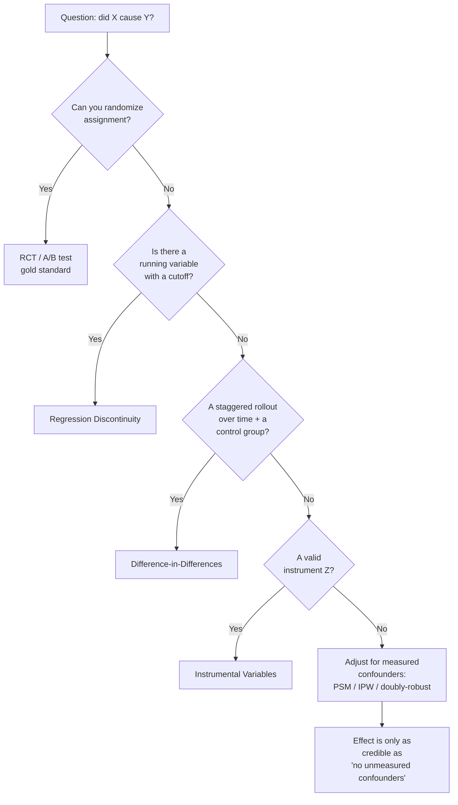

# Causal Inference When You Can't Randomize

> **Related:** [A/B Testing & Experimentation](06-ab-testing-experimentation.md) is the randomized case — when assignment is under your control. This file is the *observational* case: estimating an effect from data where treatment was **not** randomly assigned. For the rapid-fire version of the study-design taxonomy see [Canonical Stats §3](../01-math-foundations/05-canonical-stats-questions.md).



---

## Why This Is a Round-3 Question

The A/B file answers "did it work?" when you *ran the experiment*. The harder, more realistic version — the one that separates a senior candidate — is: **"we shipped it, but we couldn't randomize. Did it actually work?"**

Reasons you can't randomize show up constantly in production:
- The feature was rolled out to everyone at once (no control group).
- Rollout was by region, cohort, or self-selection (assignment correlates with the user).
- Ethics or business forbid withholding (you can't deny fraud protection to a control group).
- You're analyzing something historical that already happened.

In all of these, a naive before/after or treated-vs-untreated comparison is **confounded** — the difference you measure mixes the treatment effect with whatever made those units different in the first place. Causal inference is the toolkit for recovering the effect anyway, under stated assumptions. The interview is really testing whether you know *which assumption each method buys you*, and whether you'll say out loud what could break it.

---

## The Core Object: the Confounder

A **confounder** is a variable that causes both the treatment and the outcome. It creates a spurious association that has nothing to do with the treatment's actual effect.

The canonical trap: *users who adopted the new premium feature spend more, therefore the feature drives spend.* But high-intent users both adopt features **and** spend more. Intent is the confounder. The measured gap is mostly selection, not causation.

**The DAG framing.** Draw the causal graph. Treatment $T$, outcome $Y$, confounder $C$:

```
      C
     / \
    v   v
    T-->Y
```

The $C \to T$ and $C \to Y$ arrows open a **back-door path** $T \leftarrow C \to Y$ that carries non-causal association. To estimate the true $T \to Y$ effect you must **block every back-door path** — the back-door criterion. Blocking means conditioning on (adjusting for) a set of variables that intercepts each such path.

Two things the DAG makes obvious that regression instinct gets wrong:
- **You do not control for everything.** Conditioning on a *collider* (a variable both $T$ and $Y$ cause) or a *mediator* (a variable on the causal path $T \to M \to Y$) introduces bias rather than removing it. "Throw all features into the regression" is a mistake; the DAG tells you which to include.
- **Unmeasured confounding is unfixable by adjustment.** Every method below except IV assumes you have measured the confounders. That assumption — **no unobserved confounders** (ignorability) — is the one you can never fully test, and the one an interviewer will press on.

---

## The Estimand: ATE vs. ATT

Be precise about *what effect* you're estimating. With potential outcomes $Y(1)$ (outcome if treated) and $Y(0)$ (if not), the individual effect $Y_i(1)-Y_i(0)$ is never observed — you only ever see one. So we target averages:

- **ATE** (Average Treatment Effect): $\mathbb{E}[Y(1)-Y(0)]$ over the whole population. "If we treated everyone vs. no one."
- **ATT** (Average Treatment effect on the Treated): $\mathbb{E}[Y(1)-Y(0)\mid T=1]$. "For the units that actually got treated, what did it do?"

They differ when the effect is heterogeneous and the treated are not a random slice. Rollout decisions usually want ATT (what did this launch do to the people it reached); policy decisions about scaling to everyone want ATE. DiD estimates ATT; IPW can target either.

---

## Method 1 — Propensity Scores (PSM, IPW, Doubly Robust)

**When:** you believe you've measured the confounders, and treatment was not randomized. This is the workhorse for observational data with rich covariates.

The **propensity score** $e(x) = P(T=1 \mid X=x)$ is the probability of being treated given covariates — typically a logistic regression or gradient-boosted model predicting treatment from $X$. Its magic (Rosenbaum–Rubin): conditioning on the single scalar $e(x)$ is sufficient to remove confounding from all of $X$. You collapse a high-dimensional matching problem into one dimension.

Three ways to use it:

**Matching (PSM).** Pair each treated unit with a control unit of similar propensity; compare outcomes within pairs. Intuitive and transparent, but discards unmatched units and is sensitive to the matching caliper.

**Inverse Propensity Weighting (IPW).** Reweight units by the inverse of their probability of the treatment they got, building a pseudo-population where treatment is independent of $X$:

$$\widehat{\text{ATE}} = \frac{1}{n}\sum_i \left[\frac{T_i Y_i}{e(x_i)} - \frac{(1-T_i)Y_i}{1-e(x_i)}\right]$$

A treated unit that "looked unlikely to be treated" ($e$ small) is rare and gets up-weighted to stand in for similar untreated units. The danger: propensities near 0 or 1 create enormous weights and explode the variance. **Clip or trim** extreme weights, and always check **overlap / positivity** — if some covariate region has only treated or only control units, no method can compare them there.

**Doubly Robust (AIPW).** Combine an outcome model $\hat\mu(x)$ with the IPW correction:

$$\widehat{\text{ATE}}_{DR} = \frac{1}{n}\sum_i \left[\hat\mu_1(x_i) - \hat\mu_0(x_i) + \frac{T_i(Y_i-\hat\mu_1(x_i))}{e(x_i)} - \frac{(1-T_i)(Y_i-\hat\mu_0(x_i))}{1-e(x_i)}\right]$$

It's **consistent if *either* the propensity model *or* the outcome model is correct** — two shots at getting it right. This is the modern default (and the basis of double/debiased ML, where both nuisance models are ML estimators fit with cross-fitting).

**The assumption you're buying:** ignorability — no unmeasured confounders. Everything here fails silently if a confounder isn't in $X$.

---

## Method 2 — Difference-in-Differences (DiD)

**When:** treatment turned on at a known time for one group but not another (a staggered or regional rollout), and you have data from **before and after** for both.

DiD cancels time-invariant confounders by differencing twice — once over time (removes anything fixed about each group), once across groups (removes anything common to the period like seasonality):

$$\widehat{\text{ATT}} = \underbrace{(\bar Y_{\text{treat,post}} - \bar Y_{\text{treat,pre}})}_{\text{treated change}} - \underbrace{(\bar Y_{\text{ctrl,post}} - \bar Y_{\text{ctrl,pre}})}_{\text{control change}}$$

**Worked example.** You launch a new ranking model in the EU but not the US.

| | Pre | Post | Change |
|---|---|---|---|
| EU (treated) | \$40 | \$52 | +\$12 |
| US (control) | \$38 | \$44 | +\$6 |

Naive "EU went up \$12" overstates it — the US rose \$6 with no treatment (a market-wide trend). DiD: $12 - 6 = \$6$ is the causal lift. The control group's change is your estimate of the counterfactual "what would EU have done anyway."

**The assumption you're buying:** **parallel trends** — absent treatment, the two groups would have moved by the same amount. You can't prove it, but you support it by plotting *pre-period* trends: if EU and US moved in parallel for months before launch, parallel trends is credible. If they were already diverging, DiD is biased. (Modern caveat: with staggered adoption across many units, the classic two-way fixed-effects regression is biased when effects vary over time — use a Callaway–Sant'Anna style estimator.)

---

## Method 3 — Regression Discontinuity (RDD)

**When:** treatment is assigned by a **threshold on a continuous running variable** — a credit score cutoff for loan approval, a test score for a scholarship, a spend threshold for a loyalty tier.

Units just below and just above the cutoff are essentially identical on everything except that one got treated. So compare outcomes in a narrow window around the threshold; the jump in $Y$ at the cutoff is the causal effect (a **local** effect, at the cutoff).

$$\text{effect} = \lim_{x\downarrow c}\mathbb{E}[Y\mid X=x] - \lim_{x\uparrow c}\mathbb{E}[Y\mid X=x]$$

**The assumption you're buying:** units can't precisely **manipulate** the running variable to land on their preferred side (otherwise the two sides self-select). Test it with a density check (McCrary) — a suspicious pile-up just past the cutoff is a red flag. Strength: near-experimental credibility. Weakness: only identifies the effect *at the cutoff*, and you often have little data in the window.

---

## Method 4 — Instrumental Variables (IV)

**When:** you suspect **unmeasured** confounding — the one case adjustment can't fix — but you have an **instrument** $Z$.

A valid instrument satisfies three conditions:
1. **Relevance:** $Z$ affects treatment $T$ (testable — check first-stage strength; weak instruments give badly biased, high-variance estimates).
2. **Exclusion:** $Z$ affects $Y$ *only through* $T$, never directly.
3. **Independence:** $Z$ is as-good-as-random with respect to unobserved confounders.

$Z$ injects exogenous variation into $T$ that is unrelated to the confounders; the effect is recovered from the part of $T$'s variation that $Z$ explains (two-stage least squares). Classic examples: distance-to-college as an instrument for years-of-education when estimating its effect on wages; a randomized *encouragement* to use a feature (an email nudge) as an instrument for actual adoption.

**The assumptions you're buying:** exclusion and independence are **untestable** — you argue them from domain knowledge, and a skeptic can always propose a back-door from $Z$ to $Y$. IV also estimates a **LATE** (local average treatment effect) — the effect for "compliers," the units whose treatment status the instrument actually moved — not the whole population.

---

## Choosing, in One Table

| Method | Needs | Fixes | Assumption you defend | Effect |
|---|---|---|---|---|
| **RCT / A/B** | control of assignment | everything | randomization worked (check SRM) | ATE |
| **RDD** | threshold on a running var | confounding at the cutoff | no manipulation of the running var | local (at cutoff) |
| **DiD** | pre/post × treat/control | time-invariant confounders | parallel trends | ATT |
| **IV** | a valid instrument | *unmeasured* confounding | exclusion + independence (untestable) | LATE (compliers) |
| **PSM / IPW / DR** | measured confounders | measured confounding only | no unobserved confounders + overlap | ATE or ATT |

The ordering top-to-bottom is roughly strongest-to-weakest identification. Reach for the highest one your data supports.

---

## Interview Angles

### Q: "We launched a feature to all users at once — no control group. How do you tell if it worked?" [Hard]

Name the problem first: no control group means a naive before/after conflates the feature with any concurrent trend (seasonality, other launches, marketing). Then walk the options by what data exists:

1. **Is there an untreated comparison group anywhere?** Another region, platform, or segment that didn't get it → **DiD** against them, after checking pre-period parallel trends.
2. **Was assignment threshold-based?** (e.g., only users above some tier) → **RDD** at the cutoff.
3. **Is there an instrument?** e.g., a staggered rollout order or an email nudge that shifted adoption → **IV**.
4. **None of the above, but rich user covariates?** → **PSM / IPW / doubly-robust**, comparing adopters to matched non-adopters — while stating loudly that this rests on *no unmeasured confounders*, which self-selection into adoption usually violates.
5. **Nothing credible?** Say so, and propose a **holdback for the next iteration** — the honest senior answer is often "we can't cleanly attribute this one; here's how we instrument the next launch to make it answerable."

**Trap:** jumping straight to "compare adopters vs non-adopters." That's the confounded comparison the whole field exists to avoid — adopters are self-selected.

### Q: "You ran a propensity-matched analysis and found a positive effect. Why might I not believe it?" [Hard]

Three lines of attack, in order:
- **Unmeasured confounding.** PSM only balances what's in $X$. If motivation/intent drives both adoption and the outcome and isn't measured, the effect is still confounded. Quantify robustness with a **sensitivity analysis** (e.g., Rosenbaum bounds / E-value): how strong would a hidden confounder have to be to explain away the result?
- **Overlap/positivity.** If treated and control barely overlap in covariate space, matches are poor and extrapolation creeps in. Show the propensity-score distributions overlap; report how many units were discarded.
- **Model dependence.** Results that swing with the matching caliper or propensity specification aren't robust. Prefer doubly-robust estimation and report the effect across specifications.

### Q: "DiD assumes parallel trends. How do you defend that assumption?" [Medium]

You can't prove it (it's about the unobserved counterfactual), but you build a case: **plot the pre-period trends** for treated and control — if they moved in parallel for several periods before treatment, the assumption is credible; if they were diverging, DiD is biased. Complement with a **placebo/pre-trend test** (run DiD on a fake treatment date before the real one — it should show ~zero effect). Mention the staggered-adoption caveat: with many units adopting at different times, classic two-way fixed effects is biased under heterogeneous effects — use a modern estimator.

### Q: "Why not just put all the confounders in a regression and read off the treatment coefficient?" [Medium]

It can work *if* the model is correctly specified and you include exactly the right variables — but it silently fails in three ways the DAG exposes: (1) **wrong functional form** biases the coefficient (propensity/DR methods separate the treatment model from the outcome model, so a misspecified outcome surface hurts less); (2) **controlling for a collider or a mediator** *introduces* bias rather than removing it — more controls is not safer; (3) it gives no diagnostic for **overlap** — regression will happily extrapolate into covariate regions with no control units. Regression adjustment is a valid tool, but "throw everything in" is exactly the instinct causal reasoning corrects.

---

## Connections

- **The randomized counterpart:** [06-ab-testing-experimentation.md](06-ab-testing-experimentation.md) — when you *can* assign treatment (SRM, CUPED, switchback, interleaving).
- **Rapid-fire study-design taxonomy:** [../01-math-foundations/05-canonical-stats-questions.md](../01-math-foundations/05-canonical-stats-questions.md) §3 (Causal Study Design) and §2 (Simpson's paradox — confounding in one line).
- **Bandits vs. experiments:** [../09-reinforcement-learning/02-bandits-and-exploration.md](../09-reinforcement-learning/02-bandits-and-exploration.md) — the adaptive-assignment alternative to a fixed A/B split.

---

## Flashcards

**What is a confounder, and what makes it different from a mediator or a collider?** #flashcard
A confounder causes *both* treatment and outcome, opening a back-door path that creates spurious association — you must adjust for it. A mediator lies *on* the causal path (T→M→Y); adjusting for it removes part of the real effect. A collider is caused by both T and Y; adjusting for it *creates* bias. Only confounders should be controlled.

**What does the propensity score buy you, and what is its one fatal assumption?** #flashcard
It reduces balancing all of X to conditioning on the single scalar e(x)=P(T=1|X). Its fatal assumption is ignorability — *no unmeasured confounders*; if a confounder isn't in X, PSM/IPW/DR are all still biased and give no warning.

**Why is a doubly-robust estimator called "doubly robust"?** #flashcard
It combines an outcome model and an inverse-propensity correction, and is consistent if *either* one is correctly specified — two independent chances to get the estimate right instead of betting everything on one model.

**State the difference-in-differences estimate and the assumption it rests on.** #flashcard
ATT = (treated post − treated pre) − (control post − control pre); it cancels time-invariant group differences and common time trends. It rests on *parallel trends*: absent treatment the two groups would have changed by the same amount — supported by checking pre-period trends move in parallel.

**When do you reach for instrumental variables instead of propensity methods?** #flashcard
When you suspect *unmeasured* confounding — the case adjustment can't fix. An instrument Z affects treatment but influences the outcome only through treatment (exclusion) and is independent of confounders. IV estimates a LATE (effect on compliers), and its key assumptions are untestable.

**Someone couldn't randomize and compared adopters to non-adopters directly. What's wrong?** #flashcard
Selection bias: adopters self-select and differ systematically (intent, engagement) from non-adopters, so the gap mixes the treatment effect with those differences. You need DiD, RDD, IV, or propensity adjustment — and even the last only works if the confounders are all measured.
