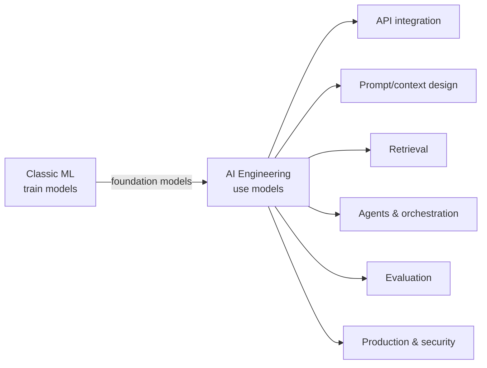

# What is AI Engineering

## 1. The Shift
- Old default: collect data → train model → deploy. Most of the work went into model building.
- New default: start from a **pretrained foundation model**, then build a system around it. Most of the work goes into integration, context, evaluation and operations.
- Cloud analogy: few teams run their own data centres; most build on top of compute they rent. In the same way, few teams pretrain models, and most build on top of models they call.

**Definition:** AI engineering is building software systems that use foundation models as important building blocks.

## 2. What AI Engineers Build
| System | Core pieces |
|---|---|
| Support assistant | RAG over docs, escalation, citations |
| Code review bot | Diff context, tool calls, structured comments |
| Legal/research assistant | Long-doc retrieval, grounding, provenance |
| Content moderation | Classifiers + LLM judges, thresholds, appeals |
| Document extraction | Parsing, structured output, validation, human review |

## 3. Core Skills
| Skill | What it actually involves |
|---|---|
| **API integration** | Retries, timeouts, rate limits, streaming, structured outputs, tool calls, provider fallbacks |
| **Prompt design** | Prompts treated as code: versioned, tested, tied to evals |
| **Retrieval** | Chunking, embeddings, hybrid search, reranking, metadata filters, citations, freshness, ACLs, handling weak evidence |
| **Orchestration / agents** | Scoped autonomy, narrow permissions, explicit state, auditable tool calls |
| **Evaluation** | Representative test sets, task metrics, human review, regression suites, drift, LLM-judge calibration |
| **Production** | Latency budgets, caching, cost control, tracing, incident response, privacy, model routing, release process |
| **Security** | Prompt injection, data exfiltration, unsafe tool use, approval gates |

## 4. Why Software Engineers Fit the Role
- **Systems experience:** queues, caching, retries and observability carry over directly.
- **Unreliable dependencies:** models are *fluent but plausibly wrong*. Treat them like a flaky upstream service that has to be validated.
- **Reliability over raw capability:** a weaker but predictable model can beat a stronger, erratic one.
- **UX instincts:** citations, streaming, undo, approvals, escalation paths.

## 5. What AI Engineering is NOT
- Not ML research (no new architectures or pretraining).
- Not data science (the main job isn't exploratory analysis).
- Not "just prompting": prompts are about 10% of the system.
- Not tied to a single provider: put an abstraction over the model.

## 6. AI Engineer vs Adjacent Roles
| Role | Primary output | Main tools |
|---|---|---|
| ML engineer | Trained/fine-tuned models, training pipelines | PyTorch, feature stores, GPUs |
| Data scientist | Insights, experiments, models for decisions | SQL, notebooks, stats |
| **AI engineer** | Products built on foundation models | LLM APIs, vector DBs, eval harnesses, agents |
| ML infra / inference engineer | Serving platforms, GPU efficiency | vLLM, Triton, K8s |

## 7. Mental Model
> Do not extend more trust to the model than it has earned. Every model output is untrusted input until it has been validated, grounded or reviewed.

## Interview angles
- "How is AI engineering different from ML engineering?" Answer: the primary artefact is the *system around* a model, not the model itself.
- "What breaks first in an LLM app in production?" Typical answers: retrieval quality, cost/latency at scale, prompt regressions, injection.

## Takeaways
- AI engineering builds products on top of foundation models; ML engineering trains the models.
- Core loop: adapt the model (prompt → RAG → tools → fine-tune), evaluate, ship, operate.
- Software-engineering skills (APIs, testing, observability, product sense) transfer directly; evals are the new core skill.
- Climb the adaptation ladder only when evals show the cheaper step is insufficient.

## References
- Chip Huyen, *AI Engineering* (O'Reilly, 2025) · swyx, *The Rise of the AI Engineer* (Latent Space, 2023)

## Related
- [Three layers of the AI stack](02-three-layers-of-the-ai-stack.md)
- [The AI landscape](03-the-ai-landscape.md)
- [LLM applications (repo track)](../../11-llm-applications/)
