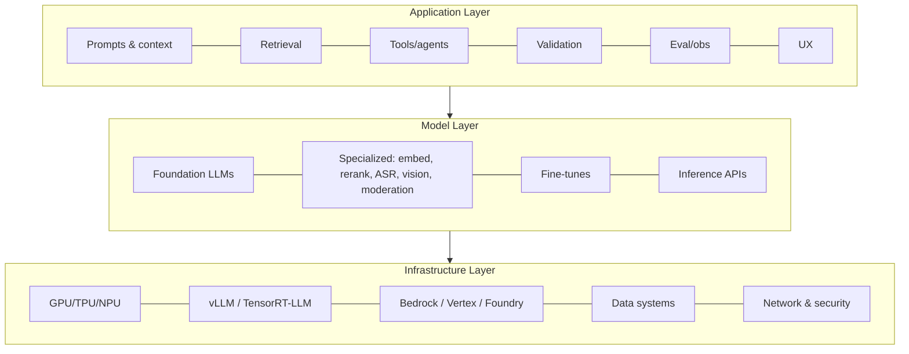
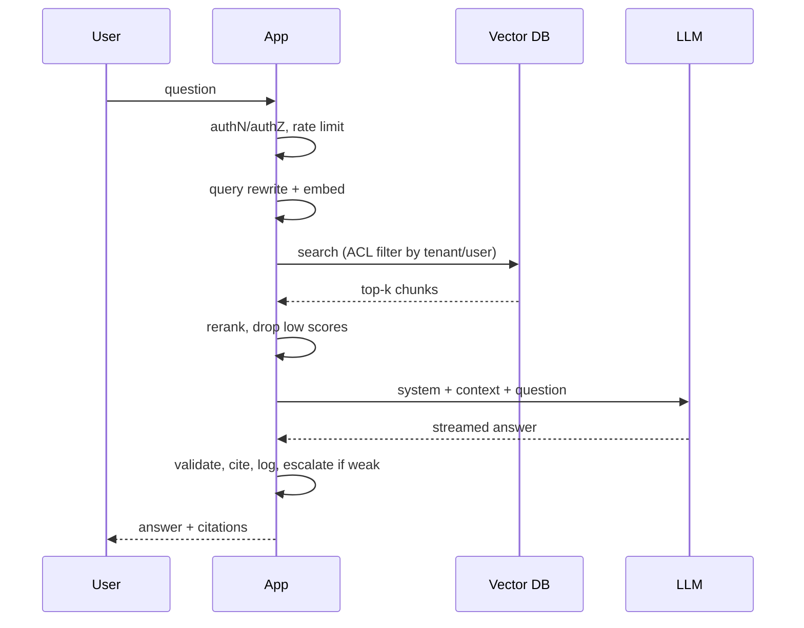

# The Three Layers of the AI Stack

## 1. Infrastructure Layer
| Component | Examples | Notes |
|---|---|---|
| Accelerators | NVIDIA H100/H200/B200, Google TPU, NPUs on device | Memory bandwidth bounds decode speed |
| Inference runtimes | vLLM, TensorRT-LLM, SGLang, llama.cpp | Paged KV cache, continuous batching |
| Cloud AI platforms | AWS Bedrock, GCP Vertex AI, Microsoft Foundry | Managed access, private networking, compliance |
| Data systems | Object stores, vector DBs, warehouses, queues | Feed retrieval and logging |
| Networking/security | VPC, private endpoints, residency, tenant isolation, audit logs | Often decide which models you're allowed to use |

**Why AI engineers care even if they never touch GPUs:**
- Large models can be too slow for interactive use (TTFT, tokens/sec).
- Self-hosting moves the operations burden onto your team.
- Long context is expensive at scale (prefill cost grows with input length).
- Provider outages become *your* incidents, so you need fallbacks.
- Data-residency rules can exclude certain models or regions.

## 2. Model Layer
- **Foundation models:** general LLMs (GPT, Claude, Gemini, Llama, Qwen, DeepSeek, Mistral).
- **Specialized models:** embeddings, rerankers, speech (ASR/TTS), vision, moderation, small classifiers.
- **Fine-tuned models:** adapted for tone, format or a narrow task.
- **Inference APIs:** the contract you program against.

| Dimension | Closed (API) | Open-weight |
|---|---|---|
| Examples | GPT-5.x, Claude, Gemini | Llama, Qwen, DeepSeek, Mistral |
| Access | HTTP API only | Download weights |
| Customization | Prompting, provider fine-tune | Full fine-tune, LoRA, quantize, distill |
| Cost model | Per token | GPU hours + ops staff |
| Data control | Provider terms, ZDR options | Full (your infra) |
| Maintenance | Provider handles it | You handle upgrades, scaling, security |

**Gotchas**
- A large context window doesn't guarantee the model attends to all of it ("lost in the middle").
- Benchmark scores don't guarantee performance on *your* task, so run your own evals.
- Reasoning models add latency and cost (hidden reasoning tokens).
- Small models are often enough for classification, routing and extraction.
- Fine-tuned models still make unsupported claims, so they still need grounding.

## 3. Application Layer (where AI engineers live)
1. Prompts and **context engineering**
2. Retrieval and grounding
3. Tools and agents
4. Structured outputs and validation
5. Evaluation and observability
6. Product UX (streaming, citations, feedback)
7. Deployment and operations

## 4. End-to-End Data Flow: Support Bot

**Key point:** the *application* owns the control flow. The model is one step inside it.

## 5. Blurred Boundaries
- **Fine-tuning** sits between the model and application layers.
- **Self-hosting** pulls the infrastructure layer into your team.
- **Managed platforms** (Bedrock Agents, Vertex Agent Builder) package application-layer features.
- **Edge/on-device** models merge all three layers on the client.

## Takeaways
- Three layers: infrastructure (compute, serving), model (training, adaptation), application (prompts, RAG, agents, UX, evals).
- AI engineers mostly work in the application layer but must understand the costs and limits below it.
- Follow a request end to end through every layer to see where latency, cost, and failures come from.
- Boundaries blur: fine-tuning and self-hosting pull application teams down the stack.

## References
- Chip Huyen, *AI Engineering* (2025), ch. 1 · a16z, *Emerging Architectures for LLM Applications* (2023)

## Related
- [LLM serving](../../12-systems-and-scale/03-llm-serving.md)
- [AI infrastructure track](../../20-ai-infrastructure/)
- [Self-hosting models](../13-llm-optimization/05-self-hosting-models.md)
