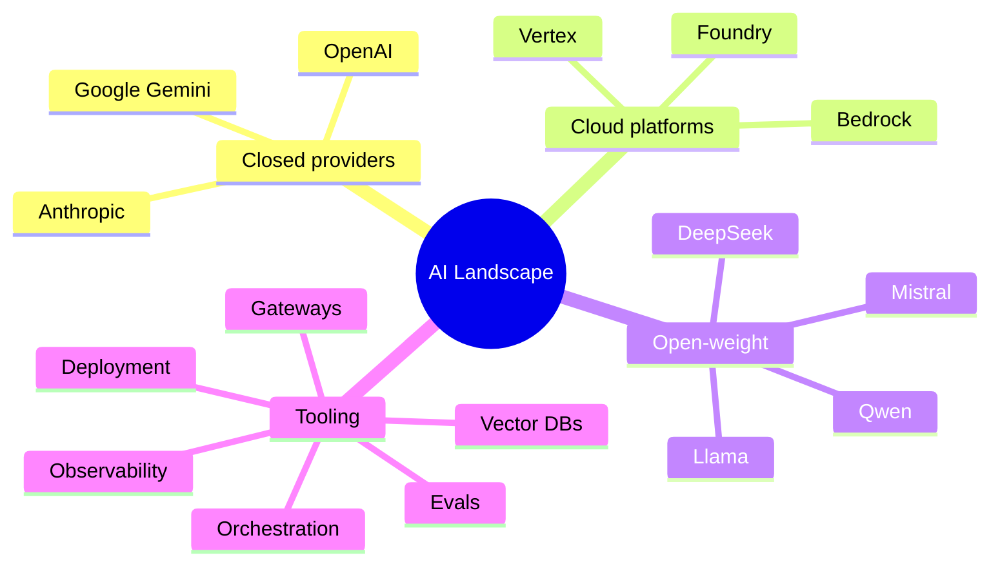

# The AI Landscape

## 1. Model Families
| Family | Known for |
|---|---|
| **OpenAI** | Broad platform; set the pattern for structured outputs and tool calling; Responses API; reasoning models |
| **Anthropic (Claude)** | Coding, long documents, instruction following, computer use, created **MCP** |
| **Google Gemini** | Native multimodality, very long context, search grounding, code execution |
| **Cloud platforms** | Bedrock, Vertex and Foundry host many models behind one enterprise contract |
| **Llama (Meta)** | Largest open-weight ecosystem |
| **Mistral** | MoE models, EU-based, efficient |
| **DeepSeek** | Training/inference efficiency (MoE, MLA), strong reasoning |
| **Qwen (Alibaba)** | Multilingual, strong small models |

"Open-weight" is more accurate than "open source": the weights are released, but the training data and code often aren't. Open-weight isn't automatically cheaper (GPUs + ops) or safer (you own the guardrails).

## 2. Model Choice Factors
| Factor | Question to ask |
|---|---|
| Task fit | Does it pass *my* eval set? |
| Output reliability | Does it follow schemas and instructions consistently? |
| Context strategy | Does it need long context, or can retrieval handle it? |
| Latency | TTFT and total time against the UX budget |
| Cost | All tokens: input, output, reasoning, tool calls, retries |
| Data control | Retention, residency, ZDR, self-host requirements |
| Operational reliability | Uptime, rate limits, regional availability |
| Ecosystem fit | SDKs, tool support, gateway support |

**Approach:** start with a strong managed model, build an eval set, then try cheaper or faster models against that same eval set. Don't optimize before you can measure.

## 3. Toolkit Map
| Category | Tools | Notes |
|---|---|---|
| Gateways/routers | OpenRouter, LiteLLM, Portkey, Cloudflare AI Gateway | One API surface, fallbacks, cost tracking |
| Orchestration | **LangChain** (integrations; can hide control flow), **LangGraph** (stateful graphs, explicit loops, persistence, HITL), **LlamaIndex** (data/retrieval), **Haystack** (opinionated pipelines) | Plain code is often enough |
| Vector DBs | Pinecone (managed), Weaviate (hybrid), Qdrant (fast, filters), **pgvector** (often the best first choice) | Choose by scale + ops |
| Evals | LangSmith, Braintrust, promptfoo, custom scripts (50–200 cases) | Start custom |
| Observability | Langfuse, Helicone, Arize Phoenix, OpenTelemetry GenAI | Trace every call |
| Deployment | Modal, Replicate, vLLM, Together, Fireworks | Self-host or serverless GPU |

## 4. Maturity
| Mature | Developing | Early |
|---|---|---|
| Managed LLM APIs | Eval platforms | Multi-agent systems |
| Embeddings & retrieval | Agent frameworks | AI video generation |
| Structured outputs | Multimodal apps | Fully autonomous long-running agents |
| Bounded tool calling | Edge/on-device | |
| RAG (with caveats) | Computer use | |
| Fine-tuning for narrow goals | | |

## 5. Market Dynamics
- **Consolidation:** frontier capability is concentrated in a few labs; cloud platforms bundle models.
- **Fragmentation:** new open-weight releases arrive monthly; tooling churns.
- The practical response is to design for **swapability**.

## 6. Durable Practices
1. Keep a clean model interface: one internal `LLMClient` abstraction.
2. Treat prompts and tool schemas as code (versioned, reviewed).
3. Let tests decide, not vibes or leaderboard ranks.
4. Build in fallbacks and observability from day one.
5. Be skeptical of demos; test on messy real inputs.

## Takeaways
- Model families: closed frontier APIs, open-weight models, and small/specialized models, each with different cost, control, and privacy.
- Choose models by evals on your task, then latency, cost, context length, data residency, and licensing.
- The tooling stack (frameworks, vector DBs, eval and observability tools) changes fast; keep abstractions thin.
- Durable practices outlive model churn: evals, versioned prompts, gateways, and tracing.

## References
- LMArena leaderboard · Artificial Analysis model comparisons · Stanford HAI, *AI Index Report* (annual)

## Related
- [Model selection & routing](../13-llm-optimization/03-model-selection-and-routing.md)
- [AI gateway pattern](../11-ai-system-architecture/05-the-ai-gateway-pattern.md)
- [Agent frameworks](../10-agents/04-agent-frameworks.md)
