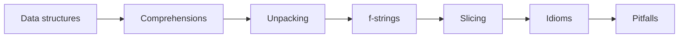

# Python Essentials for AI



## 1. Core Data Structures
| Type | Ordered | Mutable | Duplicates | Typical AI use |
|---|---|---|---|---|
| `list` | Yes | Yes | Yes | Chat messages, chunks, batches |
| `dict` | Yes (insertion, 3.7+) | Yes | Unique keys | JSON payloads, configs, metadata |
| `set` | No | Yes | No | Dedup IDs, vocab, seen URLs |
| `tuple` | Yes | No | Yes | Fixed records, cache keys, dict keys |

```python
# Dedupe while preserving order
unique_ids = list(dict.fromkeys(doc_ids))

messages = [{"role": "system", "content": "You are concise."},
            {"role": "user", "content": "Hi"}]
```

## 2. Comprehensions
```python
texts = [d["text"].strip() for d in docs if d.get("text")]
by_id = {d["id"]: d for d in docs}
langs = {d["lang"] for d in docs}
total_tokens = sum(len(t) // 4 for t in texts)    # generator, no list
```
Rule: if a comprehension has 3+ levels of nesting or side effects, write a loop.

## 3. Unpacking
```python
first, *rest = chunks
system, *history, latest = messages
for i, (q, a) in enumerate(qa_pairs): ...
merged = {**defaults, **overrides}      # later wins
```

## 4. f-strings
```python
print(f"{model=} cost=${cost:.2f} acc={acc:.1%} latency={ms:,}ms")
prompt = f"""Context:\n{context}\n\nQuestion: {q!r}"""
```

## 5. Slicing (same semantics in NumPy/PyTorch)
```python
recent = history[-10:]      # last 10 turns
head, tail = s[:200], s[-200:]
every_other = xs[::2]
```

## 6. Walrus `:=` (sparingly)
```python
if (n := len(tokens)) > MAX_TOKENS:
    raise ValueError(f"too long: {n}")
```

## 7. Everyday Idioms
| Idiom | Example |
|---|---|
| `enumerate` | `for i, chunk in enumerate(chunks, start=1)` |
| `zip` | `for q, emb in zip(queries, embeddings, strict=True)` |
| `any`/`all` | `if any(b in text for b in BANNED)` |
| `sorted(key=)` | `sorted(results, key=lambda r: r["score"], reverse=True)[:5]` |
| `dict.get` | `meta.get("source", "unknown")` |
| `collections.Counter` | `Counter(labels).most_common(3)` |
| `collections.defaultdict` | `groups = defaultdict(list)` |

## 8. Strings
- `split()`/`join()` are **not** tokenizers; use the model's tokenizer to count tokens.
- `strip()`, `lower()`, `casefold()` (better for Unicode), `startswith(("http://", "https://"))`.
- `textwrap.dedent` keeps multi-line prompts tidy.

## 9. Truthiness Pitfalls
- Falsy values: `None, 0, 0.0, "", [], {}, set()`.
- When `0` or `""` are valid values, use `is None`:
```python
temperature = cfg.get("temperature")
if temperature is None:      # NOT `if not temperature` (0.0 is valid!)
    temperature = 0.7
```

## 10. Mutable Default Argument
```python
def add_msg(msg, history=[]):       # BUG: shared across calls
    history.append(msg); return history

def add_msg(msg, history=None):     # FIX
    history = [] if history is None else history
    history.append(msg); return history
```

## Takeaways
- Know the core containers and their costs: list, dict, set, tuple; prefer dict/set for membership.
- Comprehensions, unpacking, f-strings, and slicing are the everyday idioms in AI code.
- Watch truthiness pitfalls (`0`, `""`, `[]` are falsy) and use `is None` for missing values.
- Never use a mutable default argument; default to `None` and create inside the function.

## References
- Python docs, *The Python Tutorial* · Ramalho, *Fluent Python* (2nd ed., 2022)

## Related
- [Functions, decorators, generators](02-functions-decorators-and-generators.md)
