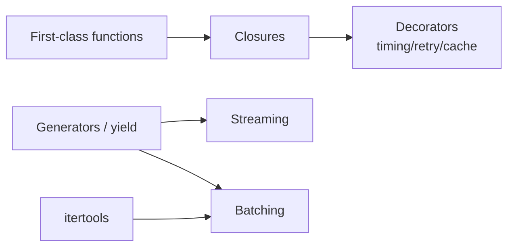

# Functions, Decorators, and Generators



## 1. First-Class Functions
Functions are values: you can assign them, store them, pass them in and return them.
```python
sorted(results, key=lambda r: r.latency_ms)
sorted(results, key=lambda r: r.accuracy, reverse=True)
```
`sorted()` doesn't need to know the result schema; the key function makes the decision. This keeps the iteration separate from the decision.

## 2. `*args` / `**kwargs`
```python
def logged(fn, *args, **kwargs):
    log.info("call %s", fn.__name__)
    return fn(*args, **kwargs)        # forwards everything, survives new params

DEFAULTS = {"model": "openai/gpt-5.4-mini", "temperature": 0.2}
def chat(messages, **kwargs):
    return client.chat.completions.create(messages=messages, **{**DEFAULTS, **kwargs})
```

## 3. Closures
```python
def make_classifier(threshold: float):
    def classify(score: float) -> str:
        return "toxic" if score >= threshold else "ok"
    return classify

strict, lenient = make_classifier(0.3), make_classifier(0.8)
```
A closure remembers the scope it was created in. Decorators are built on closures.

## 4. Decorators
`@deco` is shorthand for `fn = deco(fn)`. Calling `fn` after decoration actually calls the wrapper.

### `@timing`
```python
import functools, time
def timing(fn):
    @functools.wraps(fn)                 # keep __name__, __doc__
    def wrapper(*args, **kwargs):
        t0 = time.perf_counter()
        try:
            return fn(*args, **kwargs)
        finally:
            log.info("%s took %.1fms", fn.__name__, (time.perf_counter()-t0)*1e3)
    return wrapper
```

### `@retry` (three layers because it takes configuration)
```python
import random
TRANSIENT = (TimeoutError, ConnectionError)

def retry(max_retries=3, base=0.5, exceptions=TRANSIENT):
    def decorator(fn):
        @functools.wraps(fn)
        def wrapper(*args, **kwargs):
            for attempt in range(max_retries + 1):
                try:
                    return fn(*args, **kwargs)
                except exceptions:
                    if attempt == max_retries:
                        raise
                    time.sleep(base * 2**attempt + random.uniform(0, base))  # backoff + jitter
        return wrapper
    return decorator
```
- Retry **only transient errors** (timeouts, 429, 5xx).
- Retrying reads is safe. Retrying writes, payments, tool actions or DB inserts can create duplicates unless the operation is **idempotent** (use idempotency keys).

### `@cache`
```python
@functools.lru_cache(maxsize=10_000)
def embed_cached(text: str, model: str) -> tuple[float, ...]:
    return tuple(embed(text, model))
```
- Arguments must be hashable (str, int, tuple; not list or dict).
- The cache lives in one process: it isn't shared across workers and is lost on restart. Use Redis or disk for persistence, and respect provider privacy and retention rules.

### Stacking order
Decorators apply bottom-up. The one closest to the function wraps it first.
```python
@timing          # measures total time INCLUDING retries
@retry(3)
def call_llm(...): ...
```
Swap the order and `timing` measures each attempt separately. **Order changes behaviour.**

## 5. Generators
- A function containing `yield` returns a generator object; calling it doesn't run the body.
- Each `next()` call runs the body until the next `yield`, then pauses with local state preserved.
- `return` ends the function; `yield` pauses it. Memory stays flat no matter how large the dataset is.

| | List | Generator |
|---|---|---|
| Memory | O(n) | O(1) |
| Reusable | Yes | One-shot |
| Indexing/len | Yes | No |
| Laziness | Eager | Lazy |

```python
def read_jsonl(path):
    with open(path, encoding="utf-8") as f:
        for line in f:
            if line.strip():
                yield json.loads(line)

lengths = (len(r["text"]) for r in read_jsonl("docs.jsonl"))   # generator expression
```

### Streaming LLM output
```python
def stream_text(prompt):
    stream = client.chat.completions.create(model=MODEL, stream=True,
                                            messages=[{"role": "user", "content": prompt}])
    for chunk in stream:
        if chunk.choices and (delta := chunk.choices[0].delta.content):
            yield delta
```
Callers just `for piece in stream_text(q)` and never see the provider's protocol. Prefer the SDK's own streaming helpers when they exist.

### Batching
```python
def batch_items(iterable, size):
    batch = []
    for item in iterable:
        batch.append(item)
        if len(batch) == size:
            yield batch; batch = []
    if batch:
        yield batch
```
Accepts lists, file readers, DB cursors or other generators.

## 6. itertools Essentials
| Function | Use |
|---|---|
| `chain(a, b)` | Iterate several sources as one stream |
| `islice(gen, 5)` | Take the first N items from any iterator (smoke-test a pipeline) |
| `batched(it, 100)` | Native batching in **3.12+** (`more-itertools.chunked` on older versions) |
| `groupby` | Group *sorted* items by key |
| `tee` | Split one iterator into several |

## 7. lambda and `functools.partial`
- Keep lambdas tiny; if one needs explaining, give it a name.
- `partial` pre-fills arguments with clearer intent:
```python
from functools import partial
summarize = partial(chat, temperature=0.2, max_completion_tokens=300)
```

## Takeaways
- Functions are first-class objects, which enables closures, decorators, and callbacks.
- Decorators add cross-cutting behaviour (timing, retry, caching) without touching the wrapped code; use `functools.wraps`.
- Generators produce values lazily: ideal for streaming LLM tokens and batching large datasets.
- `itertools` and `functools.partial` replace most hand-written loops and wrapper lambdas.

## References
- Python docs: `functools`, `itertools` · Ramalho, *Fluent Python* (2nd ed.), ch. 7–9, 17

## Related
- [Async Python](06-async-python.md) (async generators)
- [Streaming & conversation management](../03-first-ai-application/04-streaming-and-conversation-management.md)
