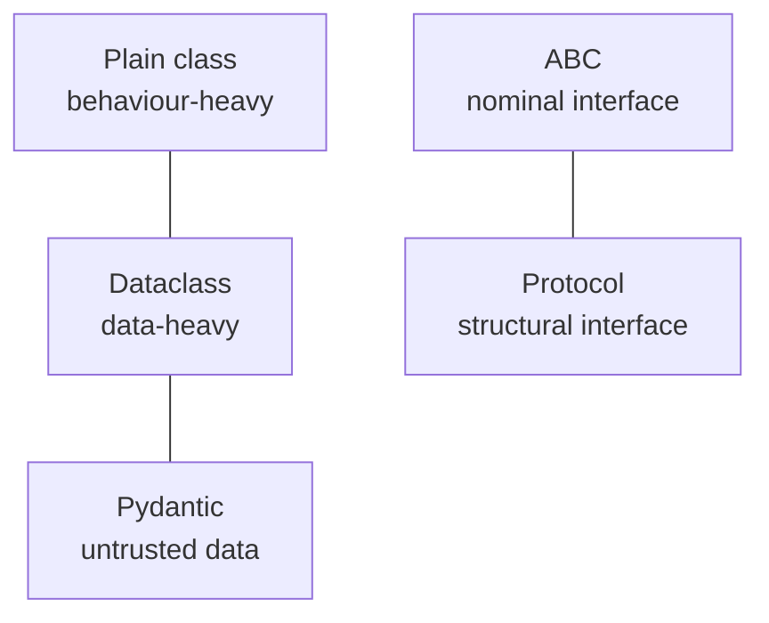

# Object-Oriented Python and Dataclasses



## 1. Python vs Other Languages
- No `new`; `__init__` initializes the object. Instance methods take `self` (forgetting it gives an argument-count error).
- No enforced access control: `_internal` is a convention; `__mangled` triggers name mangling to avoid subclass clashes. **Neither is a security boundary.**
- **Duck typing:** behaviour matters more than lineage. Anything with `__len__` works with `len()`.

## 2. Dunder Methods (the protocol system)
| Method | Hooks into | Notes |
|---|---|---|
| `__init__` | construction | |
| `__repr__` | `repr()`, debugger | Developer-facing; ideally looks like code that recreates the object |
| `__str__` | `print()`, `str()` | Falls back to `__repr__` |
| `__eq__` | `==` | Default compares identity |
| `__hash__` | dict keys, sets | Equal objects **must** hash equal; defining `__eq__` alone makes the class unhashable |
| `__len__`, `__getitem__` | `len()`, `obj[i]`, iteration | The basis of map-style datasets (PyTorch `Dataset`) |
| `__iter__`, `__next__` | `for` | |
| `__enter__`, `__exit__` | `with` | |
| `__call__` | `obj()` | Callable objects, e.g. a model wrapper |

```python
class ChunkDataset:
    def __init__(self, chunks): self.chunks = chunks
    def __len__(self): return len(self.chunks)
    def __getitem__(self, i): return self.chunks[i]   # iteration works until IndexError
    def __repr__(self): return f"ChunkDataset(n={len(self)!r})"
```
Never mutate fields that feed `__eq__`/`__hash__` after the object is used as a key; frozen dataclasses are safer.

## 3. Inheritance and MRO
- Lookup order: instance → class → bases, following the **MRO** (`Cls.__mro__`, `Cls.mro()`).
- `super()` calls the *next class in the MRO*, not a hard-coded parent. This matters with multiple inheritance.
- Prefer single inheritance, composition or protocols over deep hierarchies.

## 4. Properties, classmethod, staticmethod
```python
class TrainConfig:
    def __init__(self, n_samples, batch_size):
        self.n_samples, self.batch_size = n_samples, batch_size
    @property
    def steps_per_epoch(self): return -(-self.n_samples // self.batch_size)  # stays current
    @classmethod
    def from_yaml(cls, path): return cls(**yaml.safe_load(open(path)))      # alt constructor
    @staticmethod
    def is_valid_lr(lr): return 0 < lr < 1                                    # no state
```
Use `functools.cached_property` for expensive derived values.

## 5. Dataclasses
```python
from dataclasses import dataclass, field

@dataclass(frozen=True)
class ModelConfig:
    name: str
    temperature: float = 0.2
    max_tokens: int = 1024
    stop: tuple[str, ...] = ()            # tuple (hashable), not list

@dataclass
class EvalResult:
    case_id: str
    passed: bool
    scores: dict[str, float] = field(default_factory=dict)   # fresh dict per instance
    raw: str = field(default="", repr=False)                 # hide from repr
    latency_ms: float = 0.0
    tokens: int = field(init=False, default=0)

    def __post_init__(self):
        if self.latency_ms < 0:
            raise ValueError("latency_ms must be >= 0")
        self.tokens = len(self.raw) // 4
```
- Generates `__init__`, `__repr__` and `__eq__` automatically.
- A mutable default (`= []`) raises `ValueError`; use `default_factory`.
- `frozen=True` + `eq=True` gives an auto `__hash__`, so the object works as a cache key (all fields must be hashable).
- `slots=True` (3.10+) saves memory for many instances; `kw_only=True` forces keyword arguments.

| Use case | Plain class | Dataclass |
|---|---|---|
| Complex behaviour, many methods | Good | Usually not |
| Config objects | Sometimes | Good |
| API response containers | Sometimes | Good |
| DTOs | Sometimes | Good |
| Mostly logic, little data | Good | Usually not |
| Want generated `__eq__`/`__repr__` | Manual | Good |

**Rule:** internal named fields with light validation → dataclass. Untrusted input, serialization or an external API contract → **Pydantic**.

## 6. Abstract Base Classes
```python
from abc import ABC, abstractmethod

class LLMProvider(ABC):
    @abstractmethod
    def generate(self, prompt: str, **kw) -> str: ...
    def generate_batch(self, prompts: list[str], **kw) -> list[str]:
        return [self.generate(p, **kw) for p in prompts]   # default; override with a real batch API

class OpenAIProvider(LLMProvider):
    def generate(self, prompt, **kw): ...
```
Instantiating the ABC, or a subclass missing an abstract method, raises `TypeError`.

## 7. Protocols (structural typing, PEP 544)
```python
from typing import Protocol, runtime_checkable

@runtime_checkable
class Embedder(Protocol):
    def embed(self, texts: list[str]) -> list[list[float]]: ...

def index(docs, embedder: Embedder): ...   # any object with .embed works; no inheritance
```
The `isinstance` check with `@runtime_checkable` is shallow: it checks the attribute exists, not the signature.

| Feature | ABC | Protocol |
|---|---|---|
| Requires inheritance | Yes | No |
| Shared default implementations | Yes | Not for structural implementers |
| Works with third-party classes | No | Yes |
| Runtime `isinstance` | Yes | Only with `@runtime_checkable` |
| Seen in | LangChain, LlamaIndex base classes | Type hints, signatures |

Use an ABC when you own the hierarchy and want shared behaviour; use a Protocol to describe a capability without forcing inheritance.

## Takeaways
- Dunder methods plug classes into Python protocols (iteration, comparison, context managers).
- Use `@dataclass` for plain data containers; `frozen=True` for immutable config or messages.
- Prefer composition and Protocols (structural typing) over deep inheritance; know the MRO when you do inherit.
- Abstract base classes or Protocols define swappable interfaces such as LLM providers or vector stores.

## References
- Python docs: `dataclasses`, `abc`, `typing.Protocol` · PEP 544 · PEP 557

## Related
- [Type hints & Pydantic](04-type-hints-and-pydantic.md)
