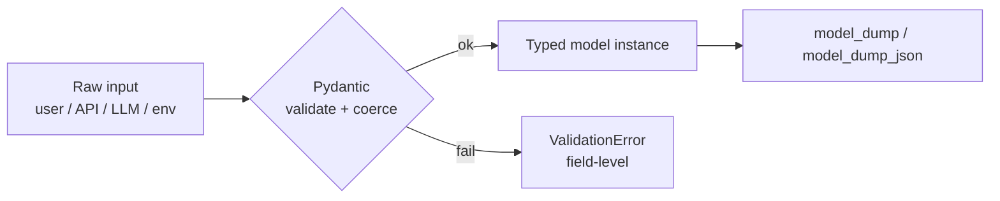

# Type Hints and Pydantic



AI systems pass data across boundaries you don't control: user input, provider APIs, JSON files, queues, DBs, tool calls and **model-generated output**. Type hints *document* the expected shape (for IDEs, mypy and pyright); Pydantic *enforces* it at runtime.

## 1. Type Hints Basics (PEP 484, Python 3.5+)
```python
def count_tokens(text: str, model: str = "gpt-5.4-mini") -> int: ...
messages: list[dict[str, str]] = []          # built-in generics, 3.9+
scores: dict[str, float] = {}
```
Python ignores annotations at runtime; they are advisory.

## 2. Optional / Union / None
```python
from typing import Optional, Union
name: Optional[str] = None           # == Union[str, None]
name: str | None = None              # 3.10+
value: int | float | str
```

## 3. Aliases, TypeVar, Generics
```python
type Embedding = list[float]                 # 3.12+
from typing import TypeAlias
Message: TypeAlias = dict[str, str]          # 3.10/3.11

from typing import TypeVar
T = TypeVar("T")
def first(xs: list[T]) -> T: return xs[0]    # output type follows input

class Page[T]:                               # 3.12 generic class syntax
    items: list[T]; next_cursor: str | None
```
Also worth knowing: `Literal["low","high"]`, `TypedDict`, `Annotated[int, Field(ge=0)]`, `Callable[[str], int]`, `Any` (escape hatch).

## 4. Pydantic Models (v2)
```python
from pydantic import BaseModel, Field, field_validator, model_validator, ValidationError

class TokenUsage(BaseModel):
    prompt_tokens: int = Field(ge=0)
    completion_tokens: int = Field(ge=0)

class Citation(BaseModel):
    doc_id: str
    page: int | None = None

class Answer(BaseModel):
    text: str = Field(min_length=1, description="Final answer for the user")
    confidence: float = Field(ge=0, le=1, description="Self-reported confidence 0-1")
    citations: list[Citation] = Field(default_factory=list)
    usage: TokenUsage | None = None

    @field_validator("text")
    @classmethod
    def strip_text(cls, v: str) -> str:
        return v.strip()

    @model_validator(mode="after")
    def need_citation_if_confident(self):
        if self.confidence > 0.8 and not self.citations:
            raise ValueError("high confidence requires at least one citation")
        return self
```
- **Coercion** is on by default (lax mode): `"1024"` → `1024`. Use `model_config = ConfigDict(strict=True)` or `StrictInt` to turn it off.
- Nested dicts are converted to nested models automatically.
- `model_config = ConfigDict(extra="forbid")` rejects unknown keys, which is useful against LLM key drift.

| Constraint | Applies to | Meaning |
|---|---|---|
| `ge`, `gt` | numbers | ≥ / > |
| `le`, `lt` | numbers | ≤ / < |
| `min_length`, `max_length` | str, list | length bounds |
| `pattern` | str | regex |
| `default` / `default_factory` | any | default value |
| `description` | any | Goes into **JSON Schema**, which the LLM sees |

### Validators
- `@field_validator("x")`: one field; return the cleaned value or raise `ValueError`.
- `@model_validator(mode="after")`: cross-field checks on the built instance.
- `@model_validator(mode="before")`: reshape raw input before field validation.

## 5. Serialization
| Method | Direction |
|---|---|
| `Model.model_validate(dict)` | dict → model |
| `Model.model_validate_json(str)` | JSON → model |
| `m.model_dump()` | model → dict (`exclude_none=True`, `mode="json"`) |
| `m.model_dump_json()` | model → JSON |
| `Model.model_json_schema()` | model → JSON Schema (for LLM structured output and tool schemas) |
| `TypeAdapter(list[Answer]).validate_python(x)` | validate non-model types |

```python
try:
    ans = Answer.model_validate_json(llm_text)
except ValidationError as e:
    errors = e.errors()          # [{'loc': ('confidence',), 'msg': ..., 'type': ...}]
```

## 6. Pydantic Settings
```python
from pydantic import SecretStr
from pydantic_settings import BaseSettings, SettingsConfigDict

class Settings(BaseSettings):
    model_config = SettingsConfigDict(env_file=".env", env_prefix="APP_")
    openrouter_api_key: SecretStr          # required → fails fast at startup
    default_model: str = "openai/gpt-5.4-mini"
    chunk_size: int = Field(800, ge=100, le=4000)
    vector_db_url: str

settings = Settings()
settings.openrouter_api_key.get_secret_value()   # repr shows '**********'
```
This replaces scattered `os.getenv()` calls. A missing key fails at boot instead of surfacing as `None` deep in the pipeline.

## 7. Schema for LLM Output
```python
class DocSummary(BaseModel):
    title: str = Field(description="Document title as written")
    key_points: list[str] = Field(min_length=3, max_length=7)
    audience: Literal["beginner", "intermediate", "expert"]

resp = client.responses.parse(model=MODEL, input=doc_text, text_format=DocSummary)
summary: DocSummary = resp.output_parsed
```
A schema guarantees **shape, not truth**. You still need to handle refusals, empty inputs and domain checks.

## Best Practices
- Validate at every trust boundary.
- Write `Field(description=...)` text carefully, because it acts as prompt text inside the schema.
- Use `extra="forbid"` for LLM outputs and `SecretStr` for keys.
- Run mypy/pyright in CI.

## Takeaways
- Type hints document intent and enable static checking; they don't validate at runtime.
- Pydantic validates and coerces data at runtime, and its models double as JSON schemas for LLM structured output.
- Use validators for business rules, `pydantic-settings` for configuration, and `model_dump`/`model_validate_json` for I/O.
- Validate every boundary: LLM outputs, tool arguments, API payloads, and config.

## References
- Pydantic v2 docs · PEP 484 · mypy and pyright docs

## Related
- [Structured output from LLMs](../03-first-ai-application/03-structured-output-from-llms.md)
- [Designing tool schemas](../08-tool-use/02-designing-tool-schemas.md)
