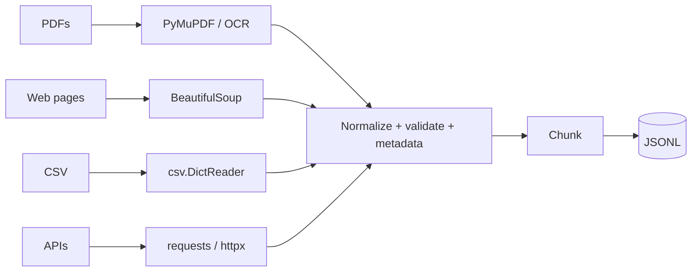

# Working with Files and Data



## 1. pathlib
```python
from pathlib import Path
root = Path("data") / "raw"                 # / joins, OS-independent
p = root / "report.pdf"
p.stem, p.suffix, p.with_suffix(".txt")      # 'report', '.pdf', data/raw/report.txt
Path("out").mkdir(parents=True, exist_ok=True)
prompt = Path("prompts/system.md").read_text(encoding="utf-8")   # small files only
for f in root.rglob("*.pdf"): ...           # recursive (glob = one level)
```

## 2. Context Managers
```python
with open(path, encoding="utf-8") as f:     # closes on success, exception or return
    for line in f: ...
```
A manual `close()` gets skipped on exceptions, and leaked handles eventually exhaust file descriptors in long-running services.
```python
from contextlib import contextmanager
@contextmanager
def experiment_run(name):
    run = tracker.start(name)
    try:
        yield run
    finally:
        run.end()                            # always runs
```

## 3. JSON and JSONL
| Function | Works on |
|---|---|
| `json.load` / `json.dump` | file objects |
| `json.loads` / `json.dumps` | strings |

```python
json.dump(cfg, f, indent=2, ensure_ascii=False)   # readable + real Unicode

# JSONL: one object per line, appendable and streamable
with open("eval.jsonl", "a", encoding="utf-8") as f:
    f.write(json.dumps(record, ensure_ascii=False) + "\n")
```
Use JSONL for datasets, eval sets, traces and logs. Always pass `encoding="utf-8"`.

## 4. CSV
```python
import csv
with open("labels.csv", newline="", encoding="utf-8") as f:
    rows = [{**r, "score": float(r["score"])} for r in csv.DictReader(f)]  # all values arrive as str
```
`pandas` infers types but is heavy; the `csv` module has no dependencies.

## 5. HTTP: requests vs httpx
```python
r = requests.post(url, json=payload, timeout=(5, 60))   # (connect, read)
r.raise_for_status()                                     # don't let errors pass silently
data = r.json()                                          # can raise on non-JSON
```
- **Always set timeouts.** Connect: 5–10s. Read: longer for generation.
- `httpx` has the same sync API plus `AsyncClient` for concurrency. Use `requests` for simple scripts and `httpx.AsyncClient` when you fan out to many calls.
- Reuse a `Session`/`Client` for connection pooling.

## 6. PDFs
```python
import fitz  # PyMuPDF
def pdf_pages(path):
    with fitz.open(path) as doc:
        for i, page in enumerate(doc, start=1):
            text = page.get_text()
            yield {"source": str(path), "page": i, "text": text}   # keep page provenance
```
- Extract page by page so you keep page numbers for **citations** and debugging.
- Scanned PDFs: `get_text()` returns little or nothing, so you need OCR (pytesseract, cloud OCR, or a VLM). Trade off accuracy, cost, latency and privacy.
- Guard: `if len(text.strip()) < 50: flag_for_ocr(page)`.
- Other parsers: `pdfplumber` (tables), `unstructured`, `docling`, `marker` (layout-aware, to Markdown).

## 7. HTML
```python
from bs4 import BeautifulSoup
soup = BeautifulSoup(html, "html.parser")
for t in soup(["script", "style", "nav", "footer"]): t.decompose()
text = soup.get_text(separator="\n", strip=True)
title = soup.title.string if soup.title else None
links = [a["href"] for a in soup.find_all("a", href=True)]
```
Respect `robots.txt`, licences, authentication boundaries and site terms. Alternatives: `trafilatura`, `readability-lxml` (main-content extraction).

## 8. Large Files
```python
for i, line in enumerate(open(path, encoding="utf-8")):  # line-by-line; memory stays flat
    ...
def read_chunks(path, size=1 << 20):
    with open(path, "rb") as f:
        while chunk := f.read(size):
            yield chunk
```

## 9. Ingestion Pipeline Pattern
**discover → parse (per type) → normalize → validate → chunk → write JSONL**

For production, add retries, structured logs, **dedup by content hash**, metadata validation (Pydantic), error quarantine files, and idempotent re-runs.

```python
record = {"id": sha256(text), "source": path, "page": n, "text": text,
          "parser": "pymupdf@1.24", "ingested_at": now_iso()}
```

## Takeaways
- Use `pathlib` for paths and context managers for every file and connection.
- JSONL is the default format for datasets, eval sets, and logs: one record per line, streamable.
- Prefer `httpx` (sync and async, timeouts) for API calls; always set timeouts.
- Stream large files and parse PDFs/HTML with dedicated libraries; ingestion = load → clean → chunk → write.

## References
- Python docs: `pathlib`, `json`, `csv` · httpx docs · pypdf / PyMuPDF and BeautifulSoup docs

## Related
- [Building a production RAG pipeline](../07-rag/02-building-a-production-rag-pipeline.md)
- [Data architecture for AI](../11-ai-system-architecture/03-data-architecture-for-ai.md)
