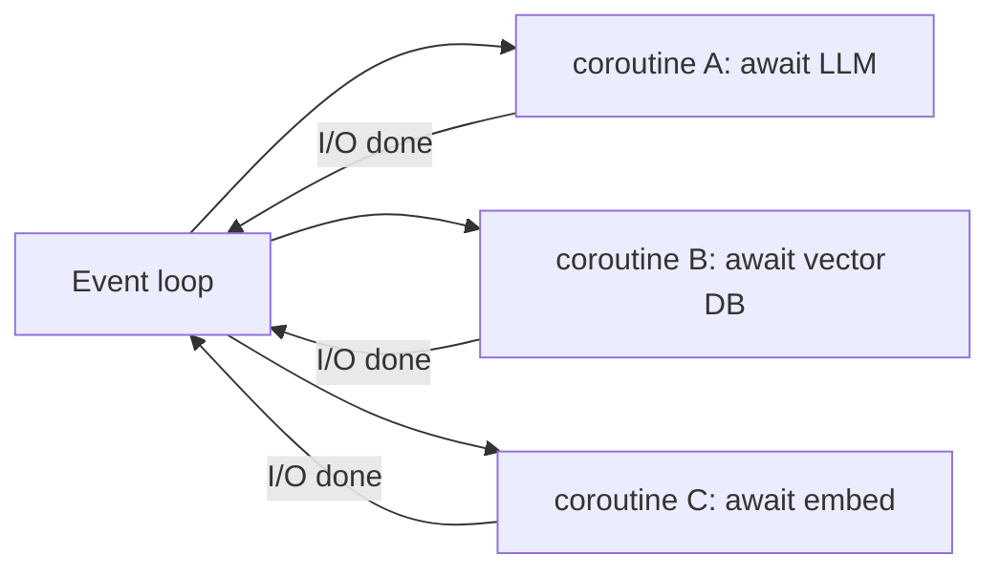

# Async Python



AI apps spend most of their time **waiting** on model APIs, vector DBs, storage and queues. Async keeps many I/O operations in flight in one thread. It does **not** make a single call faster; it overlaps the waiting. Three 5s calls take about 15s sequentially and about 5s concurrently.

## 1. Fundamentals
| Concept | Meaning |
|---|---|
| Event loop | Scheduler; switches coroutines at each `await` |
| `async def` | Defines a coroutine function; calling it creates a coroutine object but doesn't run it |
| `await` | Suspends until the awaitable completes; the loop runs other work |
| `asyncio.run(main())` | Entry point: creates the loop, runs, cleans up |

- Sequential `await`s are *not* concurrent: 0.2 + 0.3 + 0.1 = about 0.6s.
- `await asyncio.sleep()` is fine. **`time.sleep()` blocks the whole loop.**
- Notebooks, FastAPI and pytest-asyncio already run a loop, so `await` directly there instead of calling `asyncio.run`.

## 2. Async HTTP
```python
import httpx, asyncio
async def main():
    async with httpx.AsyncClient(timeout=httpx.Timeout(60, connect=5)) as client:  # reuse = pooling
        r = await client.get(url)
        r.raise_for_status()
```
`requests` blocks the loop, so use `httpx` or `aiohttp`. Provider SDKs ship `AsyncOpenAI` / `AsyncAnthropic`.

## 3. gather vs TaskGroup
```python
results = await asyncio.gather(*(embed(c) for c in chunks))         # input order kept
results = await asyncio.gather(*tasks, return_exceptions=True)       # partial failure OK

async with asyncio.TaskGroup() as tg:                                # 3.11+, structured
    t1 = tg.create_task(retrieve(q))
    t2 = tg.create_task(classify_intent(q))
ctx, intent = t1.result(), t2.result()
```
| Use | When |
|---|---|
| `gather(return_exceptions=True)` | A batch where some failures are acceptable; inspect each result |
| `TaskGroup` | One unit of work: any failure cancels siblings and raises `ExceptionGroup` |
| sequential `await` | Steps that depend on each other |

## 4. Timeouts and Cancellation
```python
async with asyncio.timeout(10):        # 3.11+ (asyncio.wait_for on older versions)
    ans = await llm(q)
```
- Cancellation comes from user disconnects, timeouts and parent failures. **Let it propagate.** Use `try/finally` for cleanup.
- `CancelledError` derives from `BaseException`, so `except Exception` won't swallow it. If you catch it, re-raise.

## 5. Semaphores (concurrency caps)
```python
class LLMPool:
    def __init__(self, limit=8):
        self.sem = asyncio.Semaphore(limit)
        self.client = AsyncOpenAI(base_url=BASE, api_key=KEY)
    async def chat(self, **kw):
        async with self.sem:
            return await self.client.chat.completions.create(**kw)

pool = LLMPool(limit=8)
outs = await asyncio.gather(*(pool.chat(model=M, messages=m) for m in batch), return_exceptions=True)
```
- Without a cap you get bursts of 429s, tail-latency spikes and exhausted sockets or DB connections.
- A semaphore limits **concurrency**, not **RPM/TPM**. For those, add a token-bucket limiter (`aiolimiter`), respect `Retry-After` and rate-limit headers, and back off.

## 6. `as_completed` (results as they finish)
```python
for fut in asyncio.as_completed(tasks):
    res = await fut
    progress.update(1)
```
Uses: progress bars, partial UIs, and hedged requests where the fastest one wins (cancel the losers and close their streams).

## 7. Async Generators for Streaming
```python
async def stream_answer(q):
    stream = await aclient.chat.completions.create(model=M, stream=True,
                                                   messages=[{"role": "user", "content": q}])
    async for chunk in stream:
        if chunk.choices and (d := chunk.choices[0].delta.content):
            yield d

async for piece in stream_answer("Explain RAG"):
    print(piece, end="", flush=True)
```

## 8. When NOT to Use Async
| Good fit (I/O-bound) | Poor fit (CPU-bound) |
|---|---|
| HTTP APIs, DBs, queues, sockets, object storage, streaming | Huge parsing jobs, image resizing, local inference, numerical work |

- For CPU-bound work: vectorize, use `ProcessPoolExecutor`, worker queues (Celery, RQ, Arq) or a separate service.
- Blocking library inside async code: `await asyncio.to_thread(blocking_fn, arg)`, or switch to an async library.

## Takeaways
- Async wins on I/O-bound work like concurrent LLM and API calls; it doesn't speed up CPU-bound code.
- Use `asyncio.TaskGroup` (or `gather`) for fan-out, and `Semaphore` to respect rate limits.
- Always wrap calls in timeouts and handle cancellation cleanly.
- Async generators stream tokens to clients; don't block the event loop with sync calls.

## References
- Python docs: `asyncio` · Python 3.11 TaskGroup (PEP 654 exception groups) · httpx async docs

## Related
- [Rate limiting & API management](../11-ai-system-architecture/08-rate-limiting-and-api-management.md)
- [Latency optimization](../13-llm-optimization/04-latency-optimization.md)
