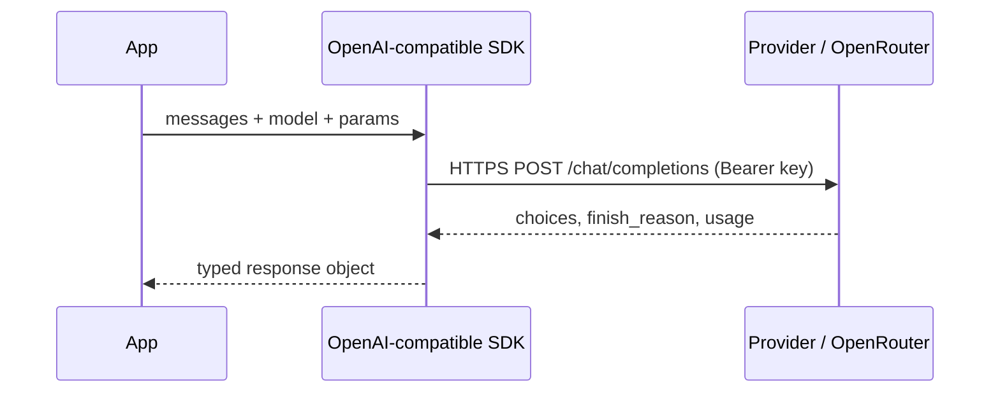

# Making Your First LLM API Call



## 1. Setup
```python
# .env  (add .env to .gitignore — never commit keys)
# OPENROUTER_API_KEY=sk-or-...

import os
from dotenv import load_dotenv
from openai import OpenAI

load_dotenv()
client = OpenAI(
    base_url="https://openrouter.ai/api/v1",     # OpenAI-compatible gateway → many models
    api_key=os.environ["OPENROUTER_API_KEY"],
    timeout=60, max_retries=2,
)
MODEL = "openai/gpt-5.4-mini"
```
One SDK and one `base_url` swap lets you reach OpenAI, Anthropic, Google, Llama and others. That makes model comparisons cheap.

## 2. The Request
```python
resp = client.chat.completions.create(
    model=MODEL,
    messages=[
        {"role": "system", "content": "You are a concise senior Python reviewer."},
        {"role": "user", "content": "What does functools.wraps do?"},
    ],
    max_completion_tokens=300,
)
```
| Role | Purpose |
|---|---|
| `system` (or `developer`) | Persistent instructions: persona, rules, format |
| `user` | End-user input |
| `assistant` | Prior model turns (you send these back for multi-turn) |
| `tool` | Results of tool calls |

The API is **stateless**. Every request must carry the full conversation you want the model to see.

## 3. The Response
```python
choice = resp.choices[0]
text = choice.message.content
choice.finish_reason      # "stop" (natural end) | "length" (hit max tokens) | "tool_calls" | "content_filter"
resp.usage                # prompt_tokens, completion_tokens, total_tokens
```
Always check `finish_reason == "length"`. It means a truncated answer, and truncated JSON won't parse.

## 4. Tokens: The Unit of Everything
| Rule of thumb | Value |
|---|---|
| Characters per token (English) | ~4 |
| 100 tokens | ~75 words |
| 1 page | ~300–400 tokens |
| Code / non-English | More tokens per character |

- You pay for input and output tokens. **Output tokens usually cost 3–5× more.**
- `tiktoken` (`o200k_base`) gives exact counts for OpenAI models and estimates for others; `resp.usage` is the source of truth.
```python
cost = (u.prompt_tokens * IN_PRICE + u.completion_tokens * OUT_PRICE) / 1_000_000
```

## 5. Error Handling
| Status | Meaning | Action |
|---|---|---|
| 400 | Bad request / context too long | Fix input; trim context. Don't retry |
| 401 | Bad/missing key | Fix config. Don't retry |
| 402 | Out of credits/quota | Alert. Don't retry |
| 403 | Forbidden / region / moderation | Don't retry |
| 408 / 504 | Timeout | Retry with backoff |
| 413 | Payload too large | Trim |
| 429 | Rate limit | Retry; honour `Retry-After` |
| 5xx | Provider error | Retry, then fall back to another model/provider |

```python
import openai, time, random
def chat_with_retry(messages, attempts=4):
    for i in range(attempts):
        try:
            return client.chat.completions.create(model=MODEL, messages=messages)
        except (openai.RateLimitError, openai.APITimeoutError, openai.InternalServerError):
            if i == attempts - 1: raise
            time.sleep(min(30, 2**i) + random.random())
        except (openai.AuthenticationError, openai.BadRequestError):
            raise                                   # non-retryable
```
**Always set timeouts.** A hung request without one holds a worker forever.

## 6. Comparing Models
```python
for m in ["openai/gpt-5.4-mini", "anthropic/claude-haiku-5-5", "google/gemini-flash"]:
    r = client.chat.completions.create(model=m, messages=msgs)
    print(m, r.usage.total_tokens, r.choices[0].message.content[:120])
```
Compare on **representative prompts from your task**, measuring quality, latency (TTFT and total) and cost, never a single toy prompt.

## 7. Provider-Native APIs
| | OpenAI Chat Completions | OpenAI Responses | Anthropic Messages |
|---|---|---|---|
| System prompt | `system` message | `instructions` | top-level `system` |
| Output | `choices[0].message.content` | `output_text` / typed items | `content[]` blocks |
| Max tokens | `max_completion_tokens` | `max_output_tokens` | `max_tokens` (required) |
| State | Stateless | Optional `previous_response_id` | Stateless |

## Takeaways
- A chat call = model + messages (system/user/assistant) + parameters; the response carries content, finish reason, and token usage.
- Tokens are the unit of cost, latency, and context limits; log usage on every call.
- Handle rate limits, timeouts, and server errors with retries, exponential backoff, and jitter.
- Keep keys in environment variables or a secret manager, and compare models on your own prompts.

## References
- OpenAI API reference · Anthropic Messages API docs · Google Gemini API docs

## Related
- [LLM parameters](02-understanding-llm-parameters.md)
- [Understanding AI application costs](../13-llm-optimization/01-understanding-ai-application-costs.md)
