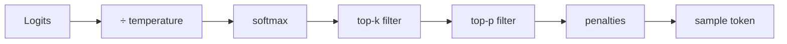

# Understanding LLM Parameters



## 1. Temperature
`p_i = softmax(logit_i / T)`. Low T sharpens the distribution toward the most likely token; high T flattens it.

| T | Behaviour | Use |
|---|---|---|
| 0 | ~Greedy | Code, extraction, classification |
| 0.1–0.3 | Focused | Summaries, translation |
| 0.5–0.7 | Balanced | Chat, email drafting |
| 0.8–1.0 | Varied | Creative writing |
| 1.0–1.5 | Wild | Brainstorm experiments |

T=0 is **not guaranteed deterministic**: floating-point ordering, batching and MoE routing introduce variance. Reasoning models often fix or ignore temperature.

**Variation over 10 runs (illustrative):** T=0 → 1–2 unique outputs, 0.3 → 3–5, 0.7 → 6–8, 1.0 → 8–10, 1.5 → 10.

## 2. Top-p (Nucleus Sampling)
Keep the smallest set of tokens whose cumulative probability ≥ p, then renormalize.

| Token | p | Cumulative |
|---|---|---|
| the | .40 | .40 |
| a | .25 | .65 |
| one | .15 | .80 ← p=0.8 keeps 3 |
| my | .10 | .90 |
| some | .05 | .95 ← p=0.95 keeps 5 |
| every | .03 | .98 |
| that | .02 | 1.00 |

Top-p **adapts**: a confident distribution keeps few tokens, an uncertain one keeps many. **Tune temperature or top-p, not both.**

## 3. Top-k
Keep a fixed number k of the most likely tokens. k=1 is greedy; common values are 10–100. It doesn't adapt to confidence. Not exposed by OpenAI; available on Anthropic, Gemini and open-weight runtimes.

## 4. Seed
`seed=42` gives **best-effort** reproducibility. Compare `system_fingerprint` across calls: if it changed, the backend changed. Useful for debugging and evals, but never assert exact string equality in tests.

## 5. Max Tokens and the Context Window
- Input and output **share** the window: 390K input in a 400K window leaves only 10K for output.
- `max_completion_tokens` (the older name is `max_tokens`) caps output, including hidden reasoning tokens on reasoning models.
- `finish_reason="length"` means truncated, so handle it (continue, raise the limit, or fail cleanly).

## 6. Stop Sequences
`stop=["\n\n", "###"]`, up to 4. The model stops *before* emitting the stop string, which is excluded from the output. Fine for simple formats; **prefer structured output** for extraction.

## 7. Frequency and Presence Penalties
| Penalty | Effect | Range | Practical |
|---|---|---|---|
| `frequency_penalty` | Subtracts in proportion to how often a token has already appeared | -2 to 2 | 0.3–0.8 cuts repetition |
| `presence_penalty` | Flat subtraction once a token has appeared at all | -2 to 2 | 0.3–0.8 encourages new topics |
Values above 1.5 produce forced, odd wording.

## 8. Logprobs
```python
r = client.chat.completions.create(model=M, messages=msgs, logprobs=True, top_logprobs=5, max_completion_tokens=5)
for alt in r.choices[0].logprobs.content[0].top_logprobs:
    print(alt.token, round(math.exp(alt.logprob), 3))
```
Uses:
- **Confidence scores** for classification: `exp(logprob)` of the label token.
- **Review flags:** if top-1 and top-2 are close (e.g. billing 0.48 vs technical 0.41), route to a human.
- **Prompt A/B testing:** compare the average logprob of the correct label.
- **Calibration** checks.

## 9. Cost Awareness
Pricing is per 1M tokens, with output higher than input. Estimate before the call with `tiktoken`; record the actual `usage` after it. Log cost per request, user and feature.

## 10. Cheat Sheet
| Param | Range | Default | Notes |
|---|---|---|---|
| temperature | 0–2 | 1 | Main creativity knob |
| top_p | 0–1 | 1 | Pick this or temperature |
| top_k | int | off/provider | Not on OpenAI |
| seed | int | none | Best effort |
| max_completion_tokens | int | model max | Always set it |
| stop | ≤4 strings | none | |
| frequency_penalty | -2–2 | 0 | |
| presence_penalty | -2–2 | 0 | |
| logprobs/top_logprobs | bool / 0–20 | off | |
| response_format | text/json_object/json_schema | text | |

## 11. Recipes
| Task | Temp | Max tokens | Extras |
|---|---|---|---|
| Code generation | 0–0.3 | 2–4K | seed |
| Factual QA | 0–0.2 | 500–1K | retrieval |
| Chatbot | 0.7 | 1–2K | freq 0.3 |
| Creative writing | 0.9–1.0 | 2–4K | presence 0.5 |
| Brainstorming | 1.2–1.5 | 1K | presence 1.0 |
| Extraction | 0 | 500 | structured output |
| Summarization | 0.3 | 500–1K | freq 0.5 |
| Classification | 0 | 10–50 | logprobs |
| Debugging prompts | 0.7 | — | seed=42 |

## Takeaways
- Temperature and top-p control randomness; tune one, not both. Use low values for extraction, higher for creative work.
- `max_tokens` caps output (and cost); stop sequences end generation early.
- Seeds give best-effort reproducibility only; evaluate over several samples.
- Logprobs expose model confidence for classification and calibration.

## References
- OpenAI and Anthropic API parameter docs · Holtzman et al., *The Curious Case of Neural Text Degeneration* (2020)

## Related
- [How LLMs generate text](../04-how-llms-work/04-how-llms-generate-text.md)
