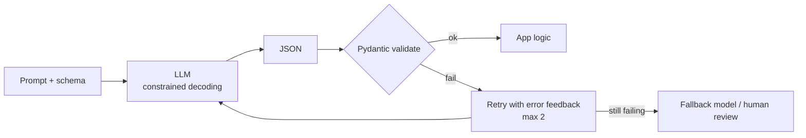

# Structured Output from LLMs



Free text isn't an interface. Regex over prose breaks as soon as the model rephrases something.

## 1. Three Approaches
### a) JSON mode
```python
client.chat.completions.create(model=M, messages=msgs, response_format={"type": "json_object"})
```
Guarantees **valid JSON syntax only**. Keys drift (`name` vs `product_name`), types drift (`"348"` vs `348`), fields go missing. The prompt must mention "JSON".

### b) JSON Schema (strict structured outputs)
```python
schema = {
  "type": "object",
  "properties": {
    "product": {"type": "string"},
    "rating": {"type": "integer", "minimum": 1, "maximum": 5},
    "pros": {"type": "array", "items": {"type": "string"}},
    "sentiment": {"type": "string", "enum": ["positive", "neutral", "negative"]}
  },
  "required": ["product", "rating", "pros", "sentiment"],
  "additionalProperties": False
}
client.chat.completions.create(model=M, messages=msgs,
    response_format={"type": "json_schema", "json_schema": {"name": "review", "strict": True, "schema": schema}})
```
**Constrained decoding** masks tokens that would break the schema, so the output always matches. Strict-mode limits: every field must be `required` (model optional fields as `["string","null"]`), and some keywords aren't supported. **Schema-valid ≠ correct.**

### c) Tool/function calling as extraction
```python
tools = [{"type": "function", "function": {"name": "extract_product_review", "parameters": schema, "strict": True}}]
r = client.chat.completions.create(model=M, messages=msgs, tools=tools,
        tool_choice={"type": "function", "function": {"name": "extract_product_review"}})
data = json.loads(r.choices[0].message.tool_calls[0].function.arguments)   # read args; don't "execute"
```

| Approach | Reliability | Complexity | Best for |
|---|---|---|---|
| JSON mode | Medium | Low | Prototypes |
| JSON Schema strict | High | Medium | Production on supporting models |
| Tool-based | High | Medium | Models/providers without schema mode; Anthropic |

## 2. Pydantic + Native Parse
```python
class Review(BaseModel):
    model_config = ConfigDict(extra="forbid")
    product: str
    rating: int = Field(ge=1, le=5)
    pros: list[str]
    cons: list[str]
    price_mentioned: float | None = None

r = client.beta.chat.completions.parse(model=M, messages=msgs, response_format=Review)
msg = r.choices[0].message
if msg.refusal: handle_refusal(msg.refusal)
review: Review = msg.parsed
```

## 3. Instructor
```python
import instructor
ic = instructor.from_openai(client)
review = ic.chat.completions.create(model=M, response_model=Review, messages=msgs, max_retries=2)
```
Flow: schema → request → parse → **validate** → on failure, re-ask *with the validation error message* → return a typed object. It works across providers, including ones without native schema support. Also good for entity and relationship extraction (`list[Entity]`, `list[Relation]`).

## 4. Failure Modes
| Failure | Example | Defense |
|---|---|---|
| Invalid JSON | Truncated at `max_tokens`, trailing prose | Strict schema, check `finish_reason` |
| Missing fields | No `email` key | `required`, defaults |
| Wrong types | `"4"` vs 4 | Schema + Pydantic |
| Rule violations | rating = 7 | `Field(ge, le)`, validators |
| Unsupported facts | Invented price | Grounding checks, "null if not stated" instruction, human review |
| Refusal | Safety refusal instead of an object | Check `refusal` |

## 5. Retry Strategies
| Strategy | When | Tradeoff |
|---|---|---|
| No retry | Strict schema, simple tasks | Cheapest |
| Retry with error feedback | Validator failures | 1–2 retries usually fix it |
| Re-prompt / rephrase | Semantic errors | More tokens |
| Fallback to a stronger model | Persistent failure | Latency + cost + complexity |

**Production default:** strict schema for shape + Pydantic validators for business rules + `max_retries=2` + log the source text and validation errors for every failure.

## 6. Design Tips
- Field names and `description`s are prompts. Make them explicit (`price_usd`, "null if not mentioned").
- Use `enum`/`Literal` for categories.
- Keep schemas flat and small; deep nesting lowers quality.
- Put a `reasoning` field *before* the answer fields if you want CoT inside the JSON (field order = generation order).
- Make "unknown" representable (`null`, `"unknown"`) so the model isn't pushed to invent values.

## 7. Capstone: Resume Parser
```python
class Job(BaseModel):
    company: str; title: str
    start: str | None = Field(description="YYYY-MM or null")
    end: str | None = Field(description="YYYY-MM, 'present', or null")

class Resume(BaseModel):
    name: str
    email: str | None = None
    skills: list[str] = Field(description="Normalized skill names, deduplicated")
    jobs: list[Job]

    @model_validator(mode="after")
    def check_dates(self):
        for j in self.jobs:
            if j.start and j.end not in (None, "present") and j.end < j.start:
                raise ValueError(f"end before start at {j.company}")
        return self

def parse_resume_safe(text: str) -> Resume | None:
    try:
        return ic.chat.completions.create(model=M, response_model=Resume, max_retries=2,
            messages=[{"role": "system", "content": "Extract only what is stated. Use null when missing."},
                      {"role": "user", "content": text}])
    except Exception as e:
        log.warning("resume parse failed: %s", e); return None
```
Edge cases to test: missing email, skills buried in prose, employment gaps, overlapping jobs, ambiguous dates ("Summer '21").

> Structured output improves **shape**, not **truth**.

## Takeaways
- Prefer strict JSON-schema structured outputs over JSON mode; JSON mode guarantees syntax, not schema.
- Define schemas with Pydantic and parse natively, or use Instructor for validation with automatic retries.
- Validate semantics in code; on failure, retry with the validation error fed back.
- Keep schemas small, use enums and nullable fields, and add field descriptions.

## References
- OpenAI structured outputs guide · Anthropic tool use docs · Instructor docs · Willard & Louf, *Efficient Guided Generation* (Outlines, 2023)

## Related
- [Type hints & Pydantic](../02-python-for-ai/04-type-hints-and-pydantic.md)
- [Designing tool schemas](../08-tool-use/02-designing-tool-schemas.md)
