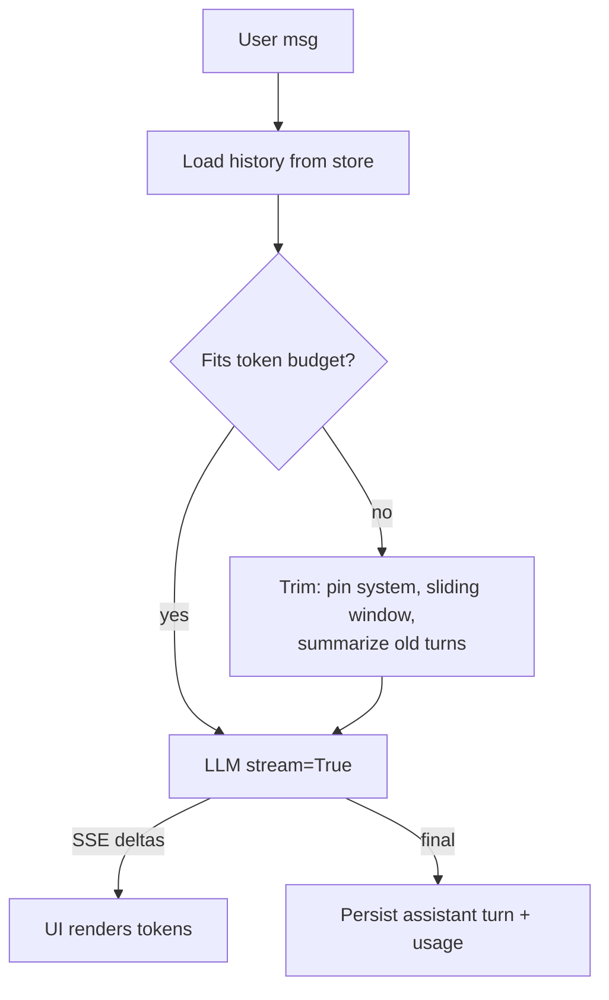

# Streaming and Conversation Management



Two problems: **waiting** (users stare at a spinner until the full answer arrives) and **memory** (the API is stateless, so the app has to supply the history).

## 1. Why Stream
- Non-streaming: latency = full generation time (often 5–20s).
- Streaming: perceived latency ≈ **TTFT** (time to first token, usually 200ms–1s, more for reasoning models).
- Tokens per second then sets how fast the text "types".
- Users can cancel early, which saves output tokens.

## 2. How Streaming Works
- The server sends **Server-Sent Events** (SSE): `data: {...}\n\n` chunks, then `data: [DONE]`.
- Each chunk has a `delta` (a partial string or a partial tool-call argument). `finish_reason` arrives in the last chunk.
- Usage only arrives at the end with `stream_options={"include_usage": True}`.

```python
stream = client.chat.completions.create(
    model=M, messages=msgs, stream=True, stream_options={"include_usage": True})
parts, usage, finish = [], None, None
t0 = time.perf_counter(); ttft = None
for chunk in stream:
    if chunk.usage: usage = chunk.usage
    if not chunk.choices: continue
    c = chunk.choices[0]
    if c.delta.content:
        ttft = ttft or time.perf_counter() - t0
        parts.append(c.delta.content)
        print(c.delta.content, end="", flush=True)
    if c.finish_reason: finish = c.finish_reason
full = "".join(parts)
```

### Async + web endpoint (FastAPI SSE)
```python
from fastapi.responses import StreamingResponse

@app.post("/chat")
async def chat(req: ChatReq):
    async def gen():
        try:
            stream = await aclient.chat.completions.create(model=M, messages=build(req), stream=True)
            async for ch in stream:
                if ch.choices and (d := ch.choices[0].delta.content):
                    yield f"data: {json.dumps({'delta': d})}\n\n"
            yield "data: [DONE]\n\n"
        except asyncio.CancelledError:
            await stream.close(); raise              # client disconnected → stop paying for tokens
        except Exception as e:
            yield f"data: {json.dumps({'error': 'upstream_error'})}\n\n"
    return StreamingResponse(gen(), media_type="text/event-stream")
```

### Streaming gotchas
| Issue | Handling |
|---|---|
| Error mid-stream | Can't change the HTTP status after headers are sent; emit an error event and let the UI show partial text + a retry button |
| Proxy buffering | Disable buffering (`X-Accel-Buffering: no`), keep-alive pings |
| Moderation / validation | You can't validate before showing. Validate per sentence, buffer the first N tokens, or stream to a draft and retract |
| Structured output | Partial JSON isn't parseable; use partial-JSON parsers or stream only the text fields |
| Tool calls | Arguments arrive as fragments; accumulate by `index` until `finish_reason="tool_calls"` |
| Retries | Retrying mid-stream duplicates text; restart cleanly or continue from the partial text |

## 3. Conversation State
The model remembers nothing between calls. Each request = `system + (history) + new user message`.

```python
@dataclass
class Turn:
    role: Literal["user", "assistant", "tool"]
    content: str
    tokens: int
    created_at: datetime

class Conversation:
    def __init__(self, system: str, store):
        self.system, self.store = system, store
    def messages(self, conv_id, budget):
        turns = self.store.load(conv_id)
        return [{"role": "system", "content": self.system}] + fit(turns, budget)
```

### Storage options
| Store | Good for |
|---|---|
| In-memory dict | Prototypes (lost on restart, single process) |
| Redis (TTL) | Session chats, fast, multi-worker |
| Postgres | Durable history, search, analytics, audit |
| Provider-side state (`previous_response_id`, Assistants/Conversations APIs) | Less code; but vendor lock-in and less control over trimming |

Schema: `conversations(id, user_id, title, created_at)`, `messages(id, conv_id, role, content, tokens, model, created_at)`. Store token counts at write time so budgeting is cheap.

## 4. Fitting the Context Window
**Budget:** `context_window ≥ system + tools + retrieved_context + history + new_msg + max_output`.

| Strategy | How | Pros | Cons |
|---|---|---|---|
| **Sliding window** | Keep the last N turns / last X tokens | Simple, cheap | Forgets early facts |
| **Pinned + window** | Always keep the system prompt, the first user goal and key facts; window the rest | Keeps the task framing | Choosing what to pin |
| **Summarization** | Replace old turns with a running summary (refreshed every K turns) | Long chats stay coherent | Extra LLM call; lossy; summary drift |
| **Retrieval memory** | Embed past turns; retrieve the relevant ones | Scales to very long histories | Complexity, retrieval misses |
| **Truncate tool outputs** | Keep only the parts of large tool results that matter | Big savings | Needs per-tool logic |

```python
def fit(turns, budget):
    kept, used = [], 0
    for t in reversed(turns):                 # newest first
        if used + t.tokens > budget: break
        kept.append(t); used += t.tokens
    kept.reverse()
    if kept and kept[0].role == "assistant":   # don't start mid-exchange
        kept = kept[1:]
    return [{"role": t.role, "content": t.content} for t in kept]

def compact(conv_id):
    old, recent = split_history(conv_id, keep_last_tokens=4000)
    summary = llm(f"Summarize the facts, decisions, open questions and user preferences:\n{render(old)}")
    store.replace(conv_id, old, Turn("assistant", f"[Summary of earlier conversation]\n{summary}", ...))
```
Never split a tool-call / tool-result pair; providers reject orphaned tool messages.

## 5. Long-Context Failure Modes
- **Lost in the middle:** facts in the middle of long contexts get less attention. Put the important material at the start and end.
- **Context rot:** quality degrades as irrelevant tokens pile up, even well within the limit.
- **Cost growth:** every turn resends the whole history, so cost grows ~quadratically with conversation length. Prompt caching helps (keep a stable prefix).
- **Instruction dilution:** the system prompt carries less weight after many turns; restate key rules near the end.

## 6. UX Patterns
- A stop button (cancel the stream server-side).
- Regenerate (re-run the last turn; keep the alternatives).
- Edit and resubmit an earlier message (branch the history).
- Show "thinking…" states for tool calls and reasoning.
- Name conversations automatically with a cheap model.

## Takeaways
- Streaming cuts perceived latency; deliver tokens over SSE and handle partial chunks, tool-call deltas, and disconnects.
- LLM APIs are stateless: the app stores conversation history and resends it on every turn.
- Fit the context window with truncation, summarization, or retrieval over old turns.
- Long contexts degrade quality (lost in the middle); keep only what the current turn needs.

## References
- OpenAI and Anthropic streaming docs · MDN, *Server-sent events* · Liu et al., *Lost in the Middle* (2023)

## Related
- [Context engineering](../05-prompt-engineering/04-context-engineering.md)
- [Agent memory systems](../10-agents/02-agent-memory-systems.md)
- [Conversational RAG](../07-rag/06-conversational-rag.md)
- [Building AI-powered UX](../11-ai-system-architecture/06-building-ai-powered-ux.md)
