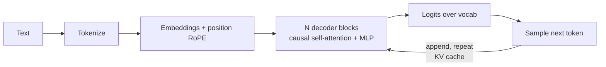

# What are LLMs

## 1. Core Idea
An LLM is a neural network trained to **predict the next token** given the previous tokens. At large enough scale, that single objective produces grammar, facts, reasoning patterns, code and instruction following.

## 2. The "Large"
| Model | Params | Notes |
|---|---|---|
| GPT-2 (2019) | 1.5B | |
| GPT-3 (2020) | 175B | ~300B training tokens |
| Llama 3.1 | 8B / 70B / 405B | ~15T tokens; 405B trained on 16K+ H100s |
| DeepSeek-V3 | 671B total / **37B active** (MoE) | 14.8T tokens; ~2.788M H800 GPU-hours |
| Llama 4 Scout / Maverick | 109B / 400B total, 17B active | MoE |
| Kimi K2 | ~1T total / 32B active | 15.5T tokens |

**Mixture of Experts (MoE):** total params ≫ active params per token. You get large-model capacity at the compute cost of a smaller one, but all weights still have to fit in memory.

## 3. How It Works (pipeline)
1. **Tokenization:** text → integer IDs (BPE, WordPiece, SentencePiece).
2. **Embeddings:** each ID → a vector; position information (RoPE) is added.
3. **Transformer decoder:** stacked blocks of causal self-attention (each token attends only to earlier tokens) + feed-forward MLP.
4. **Output:** logits over the vocabulary → probabilities → sampling.
5. **Autoregression:** the chosen token is appended and the process repeats. The **KV cache** stores past keys/values so they aren't recomputed.

## 4. Training Stages
| Stage | Data | Produces |
|---|---|---|
| Pretraining | Trillions of web/code/book tokens | Base model (completes text, doesn't follow instructions) |
| SFT | Curated instruction → response pairs | Instruction follower |
| Preference tuning (RLHF / DPO) | Human/AI preference comparisons | Helpful, harmless, preferred style |
| RL for reasoning (RLVR) | Verifiable rewards (math, code) | Reasoning models |
| Product adaptation | Tool use, safety, system prompts | Deployed assistant |

## 5. What LLMs Are Good / Bad At
| Good | Bad |
|---|---|
| Drafting, rewriting, summarizing | Exact recall of facts (not a database) |
| Translation, style transfer | Arithmetic over long numbers without tools |
| Extraction to structure | Knowing events after the cutoff |
| Code generation & explanation | Deterministic, repeatable outputs |
| Grounded QA over given context | Knowing when they don't know (calibration) |
| Planning tool calls | Long-horizon tasks without scaffolding |
| Natural-language interfaces | Replacing system design (validation, auth, state) |

## 6. Implications for Engineers
- Outputs are **probabilistic**: design for variance (validation, retries, evals).
- Knowledge is **frozen** at the cutoff: inject fresh facts via RAG or tools.
- The context window is **working memory**: what's in context matters more than what's in the weights.
- **Hallucination** is the default failure mode: the model produces fluent, plausible text whether or not it's true.

## Takeaways
- An LLM is a next-token predictor trained on huge text corpora; capabilities emerge from scale.
- Training stages: pretraining → instruction tuning → preference/RL tuning.
- Strong at language, synthesis, and code; weak at exact recall, arithmetic, fresh facts, and self-knowledge.
- Engineering implication: ground with retrieval, verify with code, and evaluate everything.

## References
- Vaswani et al., *Attention Is All You Need* (2017) · Brown et al., *Language Models are Few-Shot Learners* (2020) · Karpathy, *Intro to Large Language Models* (2023)

## Related
- [Tokenization](02-tokenization.md) · [Transformer architecture](03-transformer-architecture.md) · [Generation](04-how-llms-generate-text.md) · [Training pipeline](05-llm-training-pipeline.md)
- Repo deep dives: [../../11-llm-applications/](../../11-llm-applications/)
