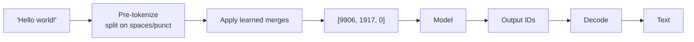

# Tokenization



Models never see characters or words, only integer **token IDs**. Tokenization decides cost, context usage, latency and some failure modes (spelling, arithmetic, non-English text).

## 1. Why Not Words or Characters?
| Unit | Problem |
|---|---|
| Words | Huge vocabulary, unknown words (OOV), morphology (`run/running/runner` are unrelated IDs) |
| Characters | Tiny vocabulary but very long sequences → attention cost O(n²), weak per-token meaning |
| **Subwords** | The compromise: common words = 1 token, rare words = several pieces, nothing is unknown |

**Byte-level** BPE (GPT-2 onward) and **byte fallback** (SentencePiece) can encode any byte sequence, so there is no `<UNK>` token.

## 2. Byte Pair Encoding (BPE)
Training: start from characters, then repeatedly merge the **most frequent adjacent pair** until the target vocabulary size is reached.

Toy corpus (`_` = end of word): `low`×5, `lower`×2, `newest`×6, `widest`×3

| Step | Pair counts (top) | Merge | Result |
|---|---|---|---|
| 1 | (e,s)=9, (s,t)=9, (t,_)=9 | `e s → es` | `n e w es t _`, `w i d es t _` |
| 2 | (es,t)=9 | `es t → est` | `n e w est _` |
| 3 | (est,_)=9 | `est _ → est_` | `n e w est_` |
| 4 | (l,o)=7 | `l o → lo` | `lo w _`, `lo w e r _` |
| 5 | (lo,w)=7 | `lo w → low` | `low _`, `low e r _` |

Encoding new text applies the merges in the order they were learned. `lowest` → `low` + `est_`, even though it never appeared in training.

```python
from collections import Counter

def train_bpe(words: dict[str, int], num_merges: int):
    vocab = {tuple(w) + ("_",): c for w, c in words.items()}
    merges = []
    for _ in range(num_merges):
        pairs = Counter()
        for sym, c in vocab.items():
            for a, b in zip(sym, sym[1:]):
                pairs[(a, b)] += c
        if not pairs: break
        best = max(pairs, key=pairs.get)
        merges.append(best)
        new = {}
        for sym, c in vocab.items():
            out, i = [], 0
            while i < len(sym):
                if i < len(sym) - 1 and (sym[i], sym[i + 1]) == best:
                    out.append(sym[i] + sym[i + 1]); i += 2
                else:
                    out.append(sym[i]); i += 1
            new[tuple(out)] = c
        vocab = new
    return merges

train_bpe({"low": 5, "lower": 2, "newest": 6, "widest": 3}, 5)
```

### Vocabulary size trade-off
| Tokenizer | Vocab | Used by |
|---|---|---|
| GPT-2 BPE | ~50K | GPT-2, GPT-3 |
| cl100k_base | ~100K | GPT-3.5, GPT-4 |
| o200k_base | ~200K | GPT-4o, o-series |
| SentencePiece (Llama 2) | 32K | Llama 2, Mistral 7B |
| tiktoken-style (Llama 3) | 128K | Llama 3.x |

Bigger vocabulary → fewer tokens per text (cheaper, longer effective context) but bigger embedding and output matrices (`vocab × d_model` each) and rarer tokens that get less training.

## 3. WordPiece
Like BPE, but it picks the merge that most increases training-data **likelihood**: score = `count(ab) / (count(a)·count(b))`. Continuation pieces are marked `##`: `tokenization → token ##ization`.

| | BPE | WordPiece |
|---|---|---|
| Merge criterion | Most frequent pair | Largest likelihood gain |
| Continuation marker | None (space marker on word start) | `##` prefix |
| Models | GPT, Llama, Mistral, Qwen | BERT, DistilBERT, ELECTRA |
| Typical vocab | 32K–200K | ~30K |

**SentencePiece** (T5, Llama 1/2, Gemma) treats the input as a raw stream, with spaces encoded as `▁`. It is language-agnostic (no pre-tokenization), supports BPE or **Unigram** LM training, and is common for multilingual models.

## 4. Counting Tokens in Practice
```python
import tiktoken
enc = tiktoken.get_encoding("o200k_base")          # or tiktoken.encoding_for_model("gpt-4o")
ids = enc.encode("Hello world! Tokenization matters.")
print(len(ids), [enc.decode([i]) for i in ids])
# ['Hello', ' world', '!', ' Token', 'ization', ' matters', '.']
```
Notes:
- The **leading space belongs to the word** (`" world"`). `"world"` and `" world"` are different tokens.
- Punctuation is usually its own token.
- Numbers split unpredictably (`"12345"` → `"123"`, `"45"`), one reason LLMs are bad at arithmetic and digit counting.

```python
from transformers import AutoTokenizer
tok = AutoTokenizer.from_pretrained("meta-llama/Llama-3.1-8B-Instruct")
tok.tokenize("unbelievable")        # boundary markers differ by family
```
| Family | Word-boundary marker |
|---|---|
| SentencePiece | `▁hello` |
| GPT byte-level BPE | `Ġhello` (Ġ = space byte) |
| WordPiece | `hello`, `##ing` |

For Claude and Gemini, use the provider's token-counting endpoint (`messages.count_tokens`, `countTokens`). Don't estimate with tiktoken.

## 5. Text Types That Cost More Tokens
| Content | Why |
|---|---|
| Non-Latin scripts (Hindi, Thai, Tamil, Amharic) | Fewer merges learned → often 2–5× more tokens than equivalent English |
| Code | Indentation, symbols, identifiers in camelCase/snake_case |
| JSON | Quotes, braces, escaped characters, repeated long keys |
| Emoji, rare Unicode | Multi-byte → several byte tokens |
| Random IDs, hashes, base64, UUIDs | No learned merges → close to 1 token per 1–3 characters |

**Multilingual effects:** higher cost, less effective context, slower generation, earlier truncation. There's no universal multiplier, so **measure on your own data**. Newer tokenizers (o200k, Llama 3, Gemma) close much of the gap.

Rule of thumb for English: **1 token ≈ 4 characters ≈ 0.75 words**; 1,000 tokens ≈ 750 words.

## 6. Cost Math
```
cost = (input_tokens × input_price + output_tokens × output_price) / 1_000_000
```
```python
PRICES = {"gpt-4o-mini": (0.15, 0.60)}             # $/1M in, out (keep in config, not code)
def cost(model, tin, tout):
    pin, pout = PRICES[model]
    return (tin * pin + tout * pout) / 1e6
```
- Output tokens usually cost **3–5× more** than input.
- Scale effect: 100K requests/day × 100 tokens trimmed = **10M tokens/day** saved.
- Cached input tokens are billed at a discount (often 50–90% off). A stable prefix pays off.
- Reasoning tokens are billed as output even though they're hidden.

## 7. Context Window Math
Input and output **share** the window:
```
input_tokens + max_output_tokens (+ reasoning tokens) ≤ context_window
```
Example: you want 4K output and the prompt is 125K → you need ≥ 129K. A 128K model fails or truncates.

| Model | Context |
|---|---|
| GPT-4o | 128K |
| Claude Sonnet | 200K (1M beta) |
| Llama 3.1 | 128K |
| Gemini 2.5 Pro | 1M |

Things that also count: system prompt, tool definitions (JSON schemas can be thousands of tokens), tool-call arguments and results, images (hundreds to thousands of tokens per image), and chat-template special tokens.

## 8. Pitfalls
| Pitfall | Fix |
|---|---|
| Chunking by characters | Chunk by **tokens** with the embedding model's tokenizer |
| Verbose JSON with long keys | Short keys, compact separators, or YAML/CSV for tabular context |
| Pretty-printed/indented data | Minify what the model only reads |
| Estimates ≠ billed counts | Chat templates add hidden special tokens; reconcile against `usage` |
| Model migration | A new tokenizer changes counts, cost and truncation points; re-run budgets |
| Spelling/counting tasks ("how many r's in strawberry") | The model sees tokens, not letters; use code |
| Trailing whitespace in prompts/prefills | Can produce odd tokens; strip it |

## Takeaways
- Models read subword tokens (BPE/WordPiece), not words; ~4 characters or 0.75 words per token in English.
- Code, numbers, non-English text, and JSON cost more tokens; count with the model's own tokenizer.
- Tokens drive cost, latency, and context-window limits.
- Tokenization explains odd failures: spelling, counting letters, arithmetic, and trailing-whitespace issues.

## References
- Sennrich et al., *Neural Machine Translation of Rare Words with Subword Units* (BPE, 2016)
- Schuster & Nakajima, *Japanese and Korean Voice Search* (WordPiece, 2012)
- Kudo & Richardson, *SentencePiece* (2018)
- tiktoken · Hugging Face Tokenizers docs

## Related
- [What are LLMs](01-what-are-llms.md) · [Transformer architecture](03-transformer-architecture.md)
- [Understanding AI application costs](../13-llm-optimization/01-understanding-ai-application-costs.md)
