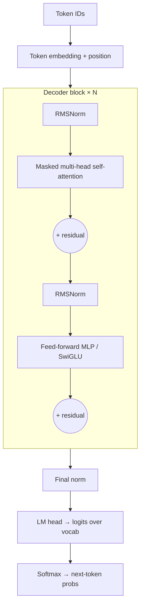

# Transformer Architecture



Introduced in *Attention Is All You Need* (Vaswani et al., 2017) for machine translation. It's now the backbone of every frontier LLM, embedding model and most vision/audio models.

## 1. Why Transformers Replaced RNNs
| | RNN / LSTM / GRU | Transformer |
|---|---|---|
| Long-range dependencies | Information decays through many sequential steps | Any token can attend directly to any other |
| Training parallelism | Sequential over time steps | All positions in parallel (GPU-friendly) |
| Scaling | Plateaus | Predictable scaling laws |
| Cost | O(n) per sequence | O(n²) attention |

## 2. Self-Attention
Every token produces three vectors:
- **Query (Q):** what this token is looking for
- **Key (K):** what this token offers to others
- **Value (V):** the information it passes on if attended to

Example: in "The animal didn't cross the street because **it** was too tired", the query for "it" matches the key for "animal" more strongly than "street", so "it" pulls in information from "animal".

```
Attention(Q, K, V) = softmax( QKᵀ / √d_k  + mask ) · V
```
Steps:
1. Project the embeddings: `Q = XW_q, K = XW_k, V = XW_v`
2. Score every pair: `QKᵀ` → n × n matrix
3. Scale by `√d_k` (keeps the softmax from saturating as dimensions grow)
4. **Mask:** causal (decoders) sets future positions to −∞; padding masks too
5. Softmax across each row → attention weights summing to 1
6. Weighted sum of V

```python
import torch, math
def attention(q, k, v, causal=True):          # (B, H, n, d)
    scores = q @ k.transpose(-2, -1) / math.sqrt(q.size(-1))
    if causal:
        n = q.size(-2)
        mask = torch.triu(torch.ones(n, n, dtype=torch.bool, device=q.device), 1)
        scores = scores.masked_fill(mask, float("-inf"))
    return torch.softmax(scores, dim=-1) @ v
```
**Causal** (decoder) attention: a token sees only the past, which is required for generation. **Bidirectional** (encoder, BERT) attention sees both directions, which is better for understanding and embeddings.

## 3. Multi-Head Attention
Split `d_model` into `h` heads (e.g. 4096 = 32 × 128). Each head runs attention independently, then the outputs are **concatenated** and projected by `W_o`. Different heads *can* specialize (syntax, coreference, position). That's an interpretability intuition, not a guarantee.

**Variants that matter for serving:**
| Variant | K/V heads | KV-cache size | Used by |
|---|---|---|---|
| MHA | = query heads | 1× | GPT-2/3 |
| **GQA** (grouped-query) | groups (e.g. 8 for 32 Q) | ~¼ | Llama 2 70B+, Llama 3, Mistral |
| MQA (multi-query) | 1 | ~1/h | PaLM, Falcon |
| MLA (multi-head latent) | compressed latent | much smaller | DeepSeek-V2/V3 |

## 4. The Transformer Block
- **Attention** moves information *between* positions.
- **FFN/MLP** transforms each position *independently*: `W_2 · act(W_1 x)`, usually 4× wider (SwiGLU in Llama). The FFN holds **most of the parameters** and is thought to store much of the factual knowledge.
- **Residual connections** let gradients flow through deep stacks (and act as a "residual stream" each layer reads from and writes to).
- **Normalization:** LayerNorm, or RMSNorm in modern models. **Pre-norm** (normalize before each sublayer) trains more stably than the original post-norm.
- **MoE variant:** replace the FFN with N experts plus a router that picks the top-k experts per token.

## 5. Positional Encoding
Attention is permutation-invariant, so position must be injected.
| Method | How | Models |
|---|---|---|
| Sinusoidal | Fixed sin/cos added to embeddings | Original Transformer |
| Learned absolute | Trainable vector per position | GPT-2, BERT |
| **RoPE** | Rotates Q/K by an angle proportional to position; dot product depends on relative distance | Llama, Mistral, Qwen, most modern LLMs |
| Relative / ALiBi | Bias attention scores by distance | T5, BLOOM, MPT |

Quality degrades **beyond the trained context length**. Context extension uses RoPE scaling (Position Interpolation, NTK-aware, YaRN) plus fine-tuning on long sequences.

## 6. Three Architecture Families
| Type | Attention | Best for | Examples |
|---|---|---|---|
| Encoder-only | Bidirectional | Embeddings, classification, NER, reranking | BERT, RoBERTa, DeBERTa |
| Decoder-only | Causal | Generation, chat, code, agents | GPT, Llama, Mistral, Qwen, Claude |
| Encoder-decoder | Encoder bidirectional + decoder causal with cross-attention | Translation, summarization | T5, BART, mBART, Whisper |

Decoder-only won for general LLMs: one simple objective, scales well, and any task can be phrased as text continuation.

## 7. The O(n²) Problem
| Sequence length | Attention scores per head/layer | Relative |
|---|---|---|
| 1K | 1M | 1× |
| 4K | 16M | 16× |
| 16K | 256M | 256× |
| 128K | 16.4B | 16,384× |

Consequences for apps:
- **Prefill time** (→ TTFT) grows with prompt length.
- **KV cache memory** grows linearly with context × batch: `2 × layers × kv_heads × head_dim × seq_len × bytes`. For Llama-3-8B (32 layers, 8 KV heads, 128 dim, fp16) that's ≈ **128 KB per token**, so 128K tokens ≈ 16 GB for a single sequence.
- **Cost:** providers charge per input token, and some charge more above a context threshold.

Mitigations:
| Technique | Idea |
|---|---|
| FlashAttention | IO-aware fused kernel; exact attention without materializing n×n in HBM |
| GQA / MQA / MLA | Fewer K/V heads → smaller KV cache |
| Sliding-window attention | Attend to the last W tokens only (Mistral; Gemma interleaves local and global layers) |
| Sparse / linear attention, SSMs (Mamba) | Sub-quadratic alternatives and hybrids |
| Ring / context parallel attention | Split long sequences across GPUs |
| Paged KV cache (vLLM) | Allocate the KV cache in pages → less fragmentation, higher batch |
| **App level:** RAG, summarization, trimming | Don't send tokens you don't need |

> **Long context is not a substitute for context engineering.** A focused 10K-token prompt usually beats an unfocused 200K one: lost-in-the-middle, distraction and cost all grow with irrelevant tokens.

## 8. End-to-End: One Forward Pass
1. Tokenize text → IDs
2. Look up embeddings (+ RoPE applied inside attention)
3. Pass through N blocks (attention + FFN)
4. Final norm → LM head projects to `vocab_size` logits
5. Decoding strategy picks the next token
6. Append it and repeat. The **KV cache** stores past K/V so each new token costs O(n), not O(n²)

**Prefill** (process the whole prompt) is parallel and compute-bound. **Decode** (one token at a time) is sequential and memory-bandwidth-bound. That's why output tokens are slower and pricier.

## 9. Parameter Count Intuition
Per layer ≈ `4·d²` (attention projections) + `8·d²` (4× FFN) ≈ **12·d²**. A model with `d=4096` and 32 layers ≈ 12 × 4096² × 32 ≈ 6.4B, plus embeddings (vocab × d) → the ~7–8B class.

## Takeaways
- Self-attention lets every token attend to every other token in parallel, which replaced sequential RNNs.
- A block is attention + MLP with residual connections and normalization, stacked dozens of times.
- Modern LLMs are decoder-only with rotary positional encodings.
- Attention is O(n²) in sequence length, which is why long context is expensive and KV caching matters.

## References
- Vaswani et al., *Attention Is All You Need* (arXiv 1706.03762)
- Jay Alammar, *The Illustrated Transformer*, *The Illustrated GPT-2*
- Phuong & Hutter, *Formal Algorithms for Transformers* (arXiv 2207.09238)
- Dao et al., *FlashAttention* (arXiv 2205.14135)
- Su et al., *RoFormer / RoPE* (arXiv 2104.09864); Ainslie et al., *GQA* (arXiv 2305.13245)

## Related
- [Tokenization](02-tokenization.md) · [How LLMs generate text](04-how-llms-generate-text.md)
- [LLM serving (repo)](../../12-systems-and-scale/03-llm-serving.md)
