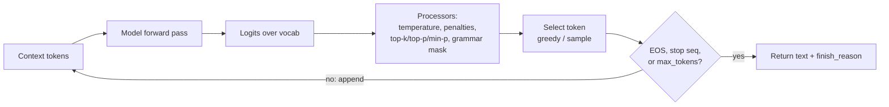

# How LLMs Generate Text



## 1. The Next-Token Prediction Loop
1. Feed the context (prompt + everything generated so far).
2. The model outputs a **logit** for every vocabulary entry (~100K–200K numbers).
3. Logit processors reshape the distribution (temperature, penalties, filters, grammar masks).
4. A decoding rule selects one token.
5. Append it; stop on EOS, a stop sequence, or `max_tokens`; otherwise repeat.

The model never "plans the sentence". Each token is a local decision conditioned on the prefix. Plans emerge only in the sense that later tokens are conditioned on earlier ones (which is why reasoning-first prompts work).

```python
import torch
def generate(model, ids, max_new=200, temperature=0.7, top_p=0.9, eos_id=None):
    past = None
    for _ in range(max_new):
        out = model(input_ids=ids if past is None else ids[:, -1:], past_key_values=past, use_cache=True)
        past, logits = out.past_key_values, out.logits[:, -1, :]
        if temperature == 0:
            nxt = logits.argmax(-1, keepdim=True)
        else:
            probs = torch.softmax(logits / temperature, -1)
            sp, si = probs.sort(descending=True)
            keep = sp.cumsum(-1) - sp < top_p            # nucleus
            sp = sp * keep; sp /= sp.sum(-1, keepdim=True)
            nxt = si.gather(-1, torch.multinomial(sp, 1))
        ids = torch.cat([ids, nxt], dim=-1)
        if eos_id is not None and nxt.item() == eos_id: break
    return ids
```

## 2. Decoding Strategies
| Strategy | How | Pros | Cons | Use |
|---|---|---|---|---|
| **Greedy** | argmax every step | Deterministic-ish, fast | Repetitive loops, bland | Extraction, classification, code |
| **Beam search** | Keep the B best partial sequences | Higher-likelihood sequences | Generic, repetitive; costly; rarely exposed by chat APIs | Translation, ASR (encoder-decoder) |
| **Pure sampling** | Sample from the full softmax | Diverse | Long-tail garbage tokens | Rarely alone |
| **Top-k** | Sample from the k most likely | Cuts the tail | Fixed k ignores how confident the model is | Older default (k=40–50) |
| **Top-p (nucleus)** | Smallest set with cumulative prob ≥ p | Adapts to confidence | Can still admit junk when flat | Most APIs (0.9–1.0) |
| **Min-p** | Keep tokens with prob ≥ min_p × p_max | Scales with confidence; good at high temperature | Not on all APIs | Local inference (llama.cpp, vLLM) |

## 3. Temperature
`p_i = softmax(z_i / T)`
- `T → 0`: approaches greedy (sharp)
- `T = 1`: the model's raw distribution
- `T > 1`: flatter → more creative and more errors

| Task | Temperature |
|---|---|
| Extraction, classification, tool calls, SQL | 0–0.2 |
| QA, summarization, RAG | 0.2–0.5 |
| Chat, writing | 0.7–1.0 |
| Brainstorming | 0.9–1.2 |

Tune **either** temperature **or** top-p, not both. Reasoning models often fix or ignore sampling parameters.

**Temperature 0 isn't fully deterministic** in hosted APIs: batched floating-point non-associativity, MoE routing and infrastructure changes still cause variance. Use `seed` where available, and design for variance anyway.

## 4. Controlling Repetition
| Knob | Effect |
|---|---|
| `frequency_penalty` | Subtract ∝ how many times a token already appeared |
| `presence_penalty` | Subtract a flat amount if it appeared at all → encourages new topics |
| `repetition_penalty` (HF/vLLM) | Divide the logits of seen tokens by a factor (e.g. 1.1) |
| `no_repeat_ngram_size` | Hard-ban repeated n-grams (beam search) |
Too strong a penalty breaks code and JSON, which legitimately repeat tokens (`"`, `{`, variable names).

## 5. Constrained Decoding
At every step, **mask** the logits of tokens that would violate a grammar (JSON Schema, regex, CFG). The output is guaranteed parseable.
- Provider features: OpenAI Structured Outputs (`strict: true`), Gemini `responseSchema`, Anthropic strict tool use.
- Open-source: Outlines, XGrammar, llguidance, vLLM `guided_json`, llama.cpp GBNF.
- Caveat: valid ≠ correct. Constraints can also hurt quality if the schema forces answers before reasoning (put a `reasoning` field first).

## 6. Stopping Conditions and `finish_reason`
| finish_reason | Meaning | Action |
|---|---|---|
| `stop` / `end_turn` | EOS or stop sequence | Normal |
| `length` / `max_tokens` | Hit the output cap | **Truncated**: continue, raise the cap, or shorten |
| `tool_calls` / `tool_use` | The model wants a tool | Execute and loop |
| `content_filter` / `refusal` | Safety block | Handle gracefully |
Always check it. Truncated JSON is the #1 parsing bug.

## 7. Prefill vs Decode and the KV Cache
| Phase | Work | Bottleneck | Metric |
|---|---|---|---|
| **Prefill** | Process all prompt tokens in parallel; fill the KV cache | Compute (FLOPs) | **TTFT** (time to first token) |
| **Decode** | One token per step, reading the whole KV cache | Memory bandwidth | **TPOT/ITL** (time per output token) |

Implications:
- Long prompts → slow TTFT; long outputs → long total latency (`latency ≈ TTFT + n_out × TPOT`).
- Output tokens cost more because decode uses the GPU inefficiently.
- **Prompt caching** reuses the KV cache of a shared prefix → lower TTFT and cost.

## 8. Speed Tricks (what providers do)
- **Speculative decoding:** a small draft model (or Medusa/EAGLE heads, or n-gram lookup) proposes k tokens; the big model verifies them in one forward pass. The output distribution is identical and you get 2–3× faster decode.
- **Continuous batching:** new requests join the batch every step.
- **Quantization** (FP8, INT4): less memory traffic per token.
- **Parallel sampling** (`n>1`): shares the prefill.

## 9. Reasoning Tokens
Reasoning models (OpenAI o-series/GPT-5 thinking, Claude extended thinking, Gemini thinking, DeepSeek-R1) generate a hidden or summarized chain of thought before the answer.
- Billed as output tokens; count toward the window and the latency.
- Controlled by `reasoning_effort` / `thinking.budget_tokens`.
- Big gains on math, code and planning; usually a waste for extraction or simple chat.

## 10. Why Generation Goes Wrong
| Failure | Cause | Mitigation |
|---|---|---|
| **Hallucination** / invented citations | Trained to produce plausible continuations; no notion of "I don't know" | Grounding (RAG), "say you don't know", citation verification |
| Repetition loops | Greedy or low-T with a self-reinforcing pattern | Penalties, higher T, stop sequences |
| Drift / losing the instruction | Long outputs; early tokens carry the constraints | Restate rules at the end, shorter outputs, chaining |
| Truncation | `max_tokens` too low, or the input ate the window | Check `finish_reason`, budget tokens |
| Early commitment | The answer comes first, then the justification is rationalized | Reasoning-before-answer, reasoning models |
| Format breaks | Free-form sampling | Structured outputs / constrained decoding |
| Sycophancy | Preference tuning rewards agreement | Neutral phrasing, ask for critique |

## 11. Debugging Cheat Sheet
| Symptom | First thing to try |
|---|---|
| Different answers every run | Lower temperature, set seed, check for prompt nondeterminism (timestamps, order) |
| Bland, generic text | Raise temperature, give examples of the desired style |
| Cut-off responses | `finish_reason == "length"` → raise `max_tokens` |
| Rambling | Explicit length limits, stop sequences, lower `max_tokens` |
| Invalid JSON | Structured outputs or a strict schema |
| Slow first token | Shorter prompt, prompt caching, smaller model |
| Slow overall | Fewer output tokens, faster model, streaming |

## Takeaways
- Generation is a loop: predict a distribution, sample a token, append, repeat until stop or max tokens.
- Decoding strategy (greedy, temperature, top-p) trades determinism for diversity.
- Prefill processes the prompt in parallel; decode is sequential and memory-bound, and the KV cache makes it feasible.
- Check `finish_reason`: `length` means truncated output, a common silent bug.

## References
- Holtzman et al., *The Curious Case of Neural Text Degeneration* (2020) · Leviathan et al., *Fast Inference via Speculative Decoding* (2023) · Hugging Face, *How to generate text* blog

## Related
- [Understanding LLM parameters](../03-first-ai-application/02-understanding-llm-parameters.md)
- [Transformer architecture](03-transformer-architecture.md) · [Training pipeline](05-llm-training-pipeline.md)
- [Latency optimization](../13-llm-optimization/04-latency-optimization.md)
