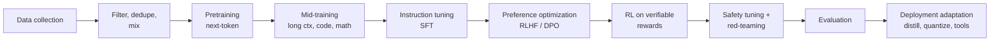

# LLM Training Pipeline

## 1. The Big Picture
| Stage | Input | Output | Compute share |
|---|---|---|---|
| Pretraining | Trillions of tokens | **Base model**: knowledge + language | ~95%+ |
| SFT | 10K–1M instruction/response pairs | Follows instructions, chat format | Small |
| Preference optimization | Ranked response pairs | Helpful, preferred style, fewer harmful outputs | Small |
| RL for reasoning | Problems with checkable answers | Long chains of thought, self-correction | Growing |
| Safety | Red-team data, policies | Refusals, robustness | Small |
| Adaptation | Distillation, quantization | Cheaper, faster deployable models | — |

Key idea for app engineers: **knowledge comes from pretraining; behaviour comes from post-training.** That's why fine-tuning is good at teaching format, style and tasks, and bad at teaching new facts.

## 2. Data Collection and Filtering
- **Sources:** web crawls (Common Crawl), code (GitHub), books, papers, Wikipedia, math, multilingual text, synthetic data.
- **Pipeline:** URL/language filtering → HTML extraction → heuristic quality filters (length, symbol ratio, repetition) → model-based quality classifiers (e.g. "educational value" classifiers like FineWeb-Edu) → **deduplication** (exact + MinHash near-dup) → PII/toxicity filtering → benchmark **decontamination**.
- **Data mixing:** the ratio of web/code/math/multilingual is tuned; high-quality data is often upsampled near the end of training ("annealing").
- Data quality is the biggest lever after scale: a filtered 1T-token set can beat an unfiltered 3T.

## 3. Pretraining
- **Objective:** minimize cross-entropy of next-token prediction (self-supervised, no labels).
- **Scaling laws:** loss falls predictably with params (N), data (D) and compute (C ≈ 6·N·D FLOPs).
- **Chinchilla** (2022): compute-optimal is ≈ **20 tokens per parameter**. Modern models are deliberately "over-trained" (Llama 3 8B: ~15T tokens ≈ 1,900 tokens/param) because **inference cost** dominates over a model's lifetime.
- **Infrastructure:** thousands of GPUs for weeks to months; data, tensor, pipeline and expert parallelism; checkpointing; handling loss spikes and hardware failures.
- **Mid-training:** extend the context (RoPE scaling + long documents), boost code/math/reasoning data.
- **Result:** a base model completes text ("The capital of France is" → "Paris…") but doesn't reliably answer questions or follow instructions.

## 4. Instruction Tuning (SFT)
- Fine-tune on (instruction, ideal response) pairs in the chat template (`system/user/assistant` special tokens).
- Data: human-written, distilled from stronger models, or synthetic (self-instruct). Quality and diversity beat quantity (*LIMA*: ~1K curated examples go far).
- Teaches format, persona, tool-call syntax, refusal style.
- Loss is usually computed only on assistant tokens.

## 5. Preference Optimization
| Method | How | Notes |
|---|---|---|
| **RLHF (PPO)** | Train a **reward model** on human comparisons (A > B), then optimize the policy with PPO + a KL penalty to the SFT model | InstructGPT/ChatGPT; complex, unstable, 4 models in memory |
| **DPO** | Directly optimize the policy on preference pairs with a closed-form loss; no reward model, no RL loop | Simpler and widely used (Llama 3, Zephyr); variants IPO, KTO, ORPO, SimPO |
| **RLAIF / Constitutional AI** | AI feedback guided by a written set of principles replaces most human labels | Anthropic; scalable |
| **Reward hacking** | The policy exploits reward-model flaws (verbosity, sycophancy) | KL penalty, reward-model ensembles, length control |

## 6. RL for Reasoning (RLVR)
- **Reinforcement learning with verifiable rewards:** generate solutions to math/code/logic problems; reward = correct answer / tests pass.
- **GRPO** (DeepSeekMath, DeepSeek-R1): sample a group of answers per prompt and use the group-relative advantage; no value network.
- Produces long chains of thought with self-verification and backtracking ("aha moments"). **Test-time compute** becomes a new scaling axis: think longer → better answers.
- Reasoning ability can then be **distilled** into small models via SFT on reasoning traces.

## 7. Safety Tuning and Red-Teaming
- Refusal training on harmful requests, while avoiding over-refusal on benign ones.
- Red-teaming: humans and automated attackers search for jailbreaks; findings become training data.
- System-prompt adherence and instruction hierarchy (system > developer > user > tool output) are trained in.
- Model cards / system cards document evaluations and residual risks.

## 8. Evaluation
| Area | Benchmarks (examples) |
|---|---|
| Knowledge | MMLU, MMLU-Pro, GPQA |
| Reasoning/math | GSM8K, MATH, AIME |
| Code | HumanEval, SWE-bench, LiveCodeBench |
| Agents/tools | τ-bench, BFCL, Terminal-Bench |
| Chat preference | LMArena (Elo), MT-Bench, AlpacaEval |
| Long context | RULER, needle-in-a-haystack |
| Safety | HarmBench, refusal rates |
Caveats: contamination, saturation, benchmark ≠ your task. **Always build your own eval set.**

## 9. Deployment Adaptation
- **Distillation:** a small student learns from a large teacher's outputs or logits (GPT-4o-mini-class, Llama 3.2 1B/3B, R1-distill).
- **Quantization:** FP16 → FP8/INT8/INT4 (GPTQ, AWQ, GGUF). ~2–4× smaller, a small quality loss.
- **Pruning / MoE / speculative-decoding drafts.**
- **Tool-use and agent tuning; long-context fine-tuning; domain fine-tunes** (LoRA/QLoRA adapters).

## 10. What Each Stage Can't Fix
| Stage | Can't fix |
|---|---|
| Pretraining | Facts after the cutoff; your private data; data it never saw |
| SFT | Knowledge missing from pretraining (it teaches the model to *sound* knowledgeable → hallucination) |
| Preference tuning | Correctness (it optimizes what raters *prefer*: confident, long, agreeable) |
| RLVR | Tasks without verifiable answers (writing quality, judgment) |
| Safety tuning | Prompt injection by design (instructions and data share one channel) |
| Quantization/distillation | Loses some capability, especially on long-tail and reasoning |

## 11. Implications for Application Engineers
| You want | Use |
|---|---|
| New or changing facts | RAG / tools, not fine-tuning |
| Consistent format, style, tone, a narrow task at lower cost | Prompting first → fine-tune (LoRA) if prompting plateaus or is too expensive |
| Better reasoning | Reasoning model or larger model; decomposition |
| Lower latency/cost at the same quality | Distill a small model on your task's outputs; quantize; route |
| Knowing the model's limits | Read the cutoff date, model card, eval on your data |

Decision ladder: **prompt → few-shot → RAG/tools → model upgrade → fine-tune → train from scratch (almost never).**

## Takeaways
- Pretraining builds knowledge and skills; SFT teaches format and instruction following; preference tuning (RLHF/DPO) shapes behaviour.
- RL with verifiable rewards produces reasoning models.
- Each stage has limits: fine-tuning shapes behaviour but adds facts poorly.
- For application engineers: knowledge gaps → RAG; behaviour gaps → prompting, then fine-tuning.

## References
- Kaplan et al., *Scaling Laws* (2020); Hoffmann et al., *Chinchilla* (2022)
- Ouyang et al., *InstructGPT* (2022); Rafailov et al., *DPO* (2023); Bai et al., *Constitutional AI* (2022)
- DeepSeek-AI, *DeepSeek-R1* (2025); Shao et al., *DeepSeekMath / GRPO* (2024)
- Penedo et al., *FineWeb* (2024); Zhou et al., *LIMA* (2023)

## Related
- [What are LLMs](01-what-are-llms.md) · [How LLMs generate text](04-how-llms-generate-text.md)
- [Self-hosting models](../13-llm-optimization/05-self-hosting-models.md)
