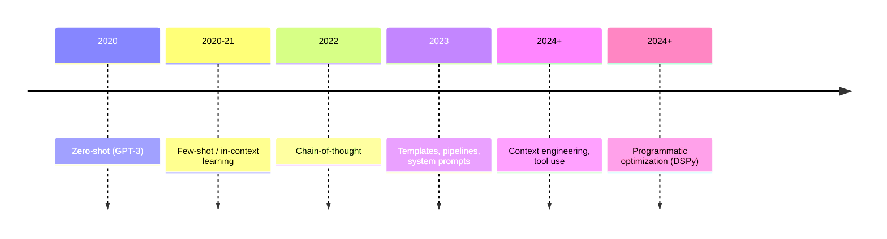

# What is Prompt Engineering



## 1. Definition
Prompt engineering is designing the inputs to an LLM so it reliably produces outputs that are useful for a task. **SQL analogy:** the database (the model) already holds the knowledge, and how you write the query decides what comes back and how efficiently.

## 2. Why It Matters: Cost × Quality at Scale
100K items at $3 / 1M input tokens:

| Prompt | Tokens | Accuracy | Cost |
|---|---|---|---|
| Naive | 500 | 78% | $150 |
| Engineered (clear, concise) | 300 | 94% | $90 |
| Few-shot | 450 | 97% | $135 |
Better prompts can be **both cheaper and more accurate**. At 78% accuracy, 22K items still need manual fixing.

## 3. Evolution
| Era | Technique | Idea |
|---|---|---|
| Zero-shot | Just ask | Relies on pretraining |
| Few-shot | Examples in the prompt | In-context learning |
| Chain-of-thought | "Think step by step" / worked examples | Intermediate reasoning improves multi-step tasks |
| Templates | Parametrized, versioned prompts | Engineering discipline |
| Context engineering | Curate *everything* in the window: instructions, retrieved docs, tools, memory, history | The prompt is ~50 tokens; the context is often 10K+ |
| Programmatic | DSPy, automatic prompt optimization | Optimize prompts against metrics |

Reasoning models (o-series, Claude extended thinking, Gemini thinking) internalize CoT, so explicit "think step by step" helps them less.

## 4. Core Principles
1. **Specificity:** state the task, audience, format, length, constraints, and what to do when unsure.
2. **Decomposition:** split complex tasks into steps or chained calls.
3. **Iteration:** draft → test → read failures → revise.
4. **Evaluation:** a test set and a metric decide, not vibes.

## 5. Prompt vs Context
```
┌──────────── Context window (~10K+ tokens) ─────────────┐
│ System prompt / rules                                    │
│ Tool definitions                                         │
│ Retrieved documents                                      │
│ Memory / user profile                                    │
│ Conversation history                                     │
│ ► User prompt (~50 tokens)                               │
└─────────────────────────────────────────────────────────┘
```

## 6. Prompting is NOT
- A substitute for retrieval (the model can't know your private data).
- A security boundary ("ignore malicious instructions" doesn't stop injection).
- Write-once (model upgrades change behaviour, so re-run evals).

## Takeaways
- Prompt engineering is designing inputs that reliably produce the desired output at acceptable cost.
- At scale, small prompt changes move quality and cost across millions of calls.
- Principles: be explicit, give context, show examples, specify the output format, and iterate against evals.
- Prompting has grown into context engineering: managing everything that enters the context window.

## References
- Anthropic prompt engineering docs · OpenAI prompt engineering guide · Schulhoff et al., *The Prompt Report* (2024)

## Related
- [Anatomy of an effective prompt](02-anatomy-of-an-effective-prompt.md)
- [Context engineering](04-context-engineering.md)
- [Prompt optimization & versioning (repo)](../../11-llm-applications/03-prompt-optimization-and-versioning.md)
