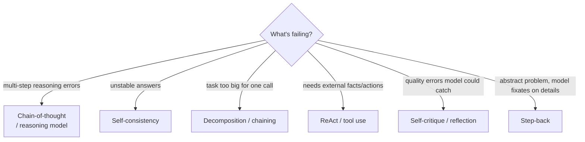
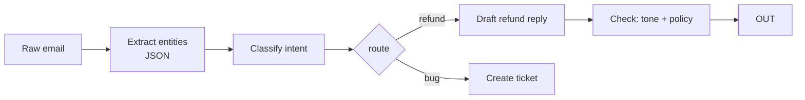

# Advanced Prompting Techniques



The basic structure (task, context, constraints, format) covers most cases. Advanced techniques are for **multi-step tasks, uncertain evidence, tool use and known failure patterns**. The goal isn't longer prompts; it's prompts that are **guidable, inspectable and testable**.

## 1. When Simple Prompts Break
| Symptom | Likely cause | Technique |
|---|---|---|
| Wrong answer on math/logic, right on retry | The answer comes before the reasoning | CoT, reasoning model |
| Answers vary run-to-run | High-variance reasoning path | Self-consistency |
| Instructions partly ignored | Too many requirements in one call | Decomposition, chaining |
| Confident but outdated/wrong facts | No access to evidence | ReAct, RAG |
| Small errors a careful reviewer would catch | No verification step | Self-critique, verifier model |
| Shallow plan for an open-ended problem | Single linear path | Tree-of-thoughts / plan-then-execute |

## 2. Chain-of-Thought (CoT)
Make the model generate intermediate reasoning **before** the final answer (Wei et al., 2022).
- **Few-shot CoT:** examples include worked reasoning.
- **Zero-shot CoT:** "Think step by step" (Kojima et al., 2022).
- **Structured CoT:** separate the reasoning and answer fields so the answer is parseable.

```
Solve the problem. First reason inside <thinking> tags, then give only the final
answer inside <answer> tags.
```
```python
class Solution(BaseModel):
    reasoning: str          # FIRST, so the answer is conditioned on it
    answer: float
```
| Pros | Cons |
|---|---|
| Big gains on arithmetic, logic, multi-hop QA | More output tokens → cost + latency |
| Inspectable for debugging | **Not always faithful**: stated reasoning may not be what drove the answer |
| | Little benefit on simple tasks; can hurt classification |

### Prompting reasoning models
o-series / GPT-5 thinking, Claude extended thinking, Gemini thinking, DeepSeek-R1 already reason internally.
- **Don't** add "think step by step" or long few-shot CoT examples; they can hurt.
- **Do** give a clear goal, constraints and success criteria; let the model plan.
- Control depth with `reasoning_effort` / `budget_tokens`, not prompt wording.
- Ask for the final answer format explicitly; the raw thinking may not be returned.

## 3. Self-Consistency
Sample N reasoning paths (T≈0.7) and take a **majority vote** on the final answer (Wang et al., 2022).
```python
from collections import Counter
answers = [solve(q, temperature=0.7).answer for _ in range(5)]
final, votes = Counter(answers).most_common(1)[0]
confidence = votes / len(answers)        # a cheap uncertainty signal → route low confidence to a human
```
Cost is N×. Works when answers are discrete and comparable. For free text, use an LLM to pick the most consistent answer ("universal self-consistency").

## 4. Decomposition and Least-to-Most
Break the problem into sub-questions, solve the easiest first, and feed the answers forward.
```
Q: "Which of our top-3 revenue customers had a support SLA breach last quarter?"
1. Who are the top-3 customers by revenue?        → SQL tool
2. For each, list SLA breaches in Q3.             → ticket API
3. Combine.
```
Use it when the model skips steps or a question needs multiple lookups.

## 5. Prompt Chaining
Split a pipeline into **separate LLM calls**, each with a focused prompt, typed output and its own eval.

| Pros | Cons |
|---|---|
| Each step is simpler → more reliable | More calls → latency, cost |
| Validate/repair between steps | Errors compound across steps |
| Different model per step (cheap for extraction, strong for writing) | More code and orchestration |
| Testable in isolation | |

## 6. ReAct (Reason + Act)
Interleave **Thought → Action (tool call) → Observation** until done (Yao et al., 2022). It's the core of tool-using agents.
```
Thought: I need the current order status.
Action: get_order(order_id="A123")
Observation: {"status": "shipped", "carrier": "UPS", "eta": "2026-10-21"}
Thought: I can answer now.
Final Answer: Your order shipped via UPS and should arrive Oct 21.
```
Today this is implemented with **native tool calling** rather than text parsing. See [tool use](../08-tool-use/02-designing-tool-schemas.md).

## 7. Tree of Thoughts / Plan-and-Solve
- **Plan-and-solve:** "First write a plan, then execute it step by step." Cheap and effective.
- **Tree of Thoughts** (Yao et al., 2023): generate several candidate steps, evaluate them, search (BFS/DFS) and backtrack. Powerful on puzzles and planning, but expensive; usually replaced in practice by reasoning models or agent loops.

## 8. Self-Critique and Reflection
Generate → critique against explicit criteria → revise.
```
Draft → "Check the draft against: (1) every claim is supported by the sources,
(2) ≤150 words, (3) no hype words. List violations, then output a corrected version."
```
- Works best with **concrete criteria** or external signals (test results, linter output, schema errors). That's *Reflexion*.
- Self-critique without new information has limited gains; models often can't find their own reasoning errors. A **separate verifier** (different prompt or model) is more reliable.

## 9. Other Useful Patterns
| Technique | Idea | Example |
|---|---|---|
| **Step-back prompting** | First ask the general principle, then apply it | "What physics principle governs this?" → then solve |
| **Generated knowledge** | Have the model list relevant facts first, then answer | Useful for commonsense QA; risky without grounding |
| **Meta-prompting** | Use an LLM to write/improve prompts | "Here's my prompt and 5 failures; propose a revised prompt" |
| **Prefill** (Anthropic) | Start the assistant turn yourself | Prefill `{` to force JSON, or `<answer>` to skip preamble |
| **XML tag structuring** | Wrap the parts in tags | `<context>`, `<rules>`, `<examples>`, `<output_format>` |
| **Role-play / persona panels** | Answer from several expert perspectives, then synthesize | Design reviews |
| **"Ask clarifying questions first"** | Let the model request missing information | Agentic assistants |
| **Emotion/stakes phrasing** ("this is important") | Mixed, model-dependent evidence | Don't rely on it |

## 10. Choosing a Technique
| Technique | Extra cost | Best for |
|---|---|---|
| Zero-shot CoT | 1.5–3× output | Reasoning on non-reasoning models |
| Reasoning model | 2–10× output, slower | Hard math/code/planning |
| Self-consistency | N× | Discrete answers where accuracy matters |
| Chaining | +1 call per step | Pipelines with distinct subtasks |
| ReAct | Many calls | Needs live data or actions |
| Reflection | 2–3× | Writing/code with checkable criteria |

Always measure: a technique that helps on GSM8K may not help your task.

## Takeaways
- Chain-of-thought improves multi-step reasoning on non-reasoning models; reasoning models need goals, not step scripts.
- Self-consistency, decomposition, and chaining trade more calls for accuracy and debuggability.
- ReAct interleaves reasoning with tool use, the basis of agents.
- Pick the cheapest technique that passes evals; complex techniques add latency and cost.

## References
- Wei et al., *Chain-of-Thought Prompting* (2022) · Kojima et al., *Large Language Models are Zero-Shot Reasoners* (2022)
- Wang et al., *Self-Consistency* (2022) · Zhou et al., *Least-to-Most* (2022)
- Yao et al., *ReAct* (2022), *Tree of Thoughts* (2023) · Shinn et al., *Reflexion* (2023)
- Zheng et al., *Step-Back Prompting* (2023) · Turpin et al., *Language Models Don't Always Say What They Think* (2023)

## Related
- [Anatomy of an effective prompt](02-anatomy-of-an-effective-prompt.md) · [Prompt templates & pipelines](05-prompt-templates-and-pipelines.md)
- [What are AI agents](../10-agents/01-what-are-ai-agents.md)
