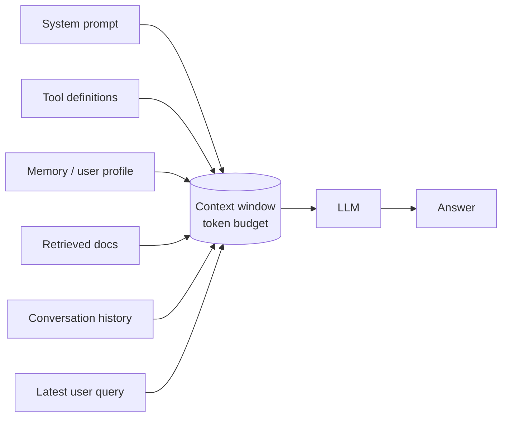

# Context Engineering



**Prompt engineering** is about the wording of the instructions. **Context engineering** decides *everything* the model sees on a call: what goes in, what stays out, in what order and format, and how it is compressed. In production, better context selection usually beats more prompt rewording.

## 1. What Goes Into the Context
| Context type | Source | Stable across calls? | Typical size |
|---|---|---|---|
| System prompt / policies | Code / registry | Yes → cache it | 300–3K tokens |
| Tool definitions | Tool registry / MCP | Mostly | 100–500 tokens per tool |
| Few-shot examples | Static or retrieved | Static: yes | 50–300 per example |
| User profile / long-term memory | Memory store | Per user | 100–1K |
| Retrieved documents | RAG | No | 1K–20K |
| Tool results | Runtime | No | Unbounded → must truncate |
| Conversation history | Session store | Grows | Unbounded → must manage |
| Current query | User | No | 10–500 |

## 2. Token Budgets
Treat the context window as a **budget**, not a bin to fill.

```
context_limit           = 128_000
reserved_output         =   4_000
system + tools          =   3_000   (fixed)
memory                  =   1_000
history                 =   6_000   (sliding + summary)
retrieved docs          =  12_000   (top-k after reranking)
query                   =     500
---------------------------------
used ≈ 26.5K. You have headroom, but more context ≠ better answers
```

```python
import tiktoken
enc = tiktoken.get_encoding("o200k_base")
def n_tokens(s: str) -> int: return len(enc.encode(s))

def fit(items: list[str], budget: int) -> list[str]:
    out, used = [], 0
    for it in items:                       # items already sorted by priority/relevance
        t = n_tokens(it)
        if used + t > budget: break
        out.append(it); used += t
    return out
```
Why not just fill 1M tokens?
- **Cost**: input tokens are billed on every call; 100K × 10K requests/day adds up fast.
- **Latency**: prefill time grows with input length (TTFT).
- **Quality**: distractors dilute attention. Accuracy drops with irrelevant context ("context rot").

## 3. Selection Strategies
| Strategy | Use for |
|---|---|
| **Relevance ranking** (embedding + reranker) | Documents, examples, memories |
| **Recency** | Recent turns, latest data |
| **Priority tiers** | Must-include (policy, query) > should (top docs) > nice (extra history) |
| **Metadata filters** | Tenant, permissions, date, product: filter *before* ranking |
| **Deduplication** | Near-duplicate chunks waste budget and over-weight a source |
| **Dynamic tool loading** | Only expose the tools relevant to this request (tool search / router) |
| **Just-in-time retrieval** | Give the agent tools to fetch details when needed, instead of preloading everything |

Rule of thumb: include what the model **needs to decide or answer**, and nothing it would have to ignore.

## 4. Formatting and Ordering
- **Static first, dynamic last** → maximizes prompt-cache hits (system, tools, examples, *then* docs, history, query).
- **Long documents at the top, question at the end** for long-context prompts.
- Wrap sources in tags with ids and metadata so they can be cited:
```xml
<documents>
  <doc id="kb-412" title="Refund policy" updated="2026-08-01">...</doc>
  <doc id="kb-077" title="Shipping times" updated="2026-05-12">...</doc>
</documents>
<question>Can I return a jacket bought 40 days ago?</question>
```
- Prefer compact formats for data (markdown tables, YAML, or CSV for tabular data over verbose JSON).
- Put the most important material at the **start or end**. Mid-context content is recalled worst ("lost in the middle").
- Label provenance and trust: `<untrusted_web_content>` vs `<company_policy>`.

## 5. Conversation History
| Strategy | How | Trade-off |
|---|---|---|
| Full history | Send everything | Simple; breaks at limits; cost grows O(n²) over a session |
| Sliding window | Last N turns / last T tokens | Forgets early facts (name, goal) |
| Summary + window | Rolling summary of old turns + recent turns verbatim | Summaries lose detail; extra LLM call |
| Fact extraction | Pull durable facts into a structured memory | Needs a schema; best for long-running assistants |
| Retrieval over history | Embed past turns; retrieve relevant ones | Good for very long sessions |
| Tool-result clearing | Drop/replace old, bulky tool outputs with a stub | Huge savings in agent loops |

```python
def build_history(turns, budget=6000, keep_recent=6):
    recent = turns[-keep_recent:]
    old = turns[:-keep_recent]
    summary = summarize(old) if old else ""          # cached; refreshed every k turns
    msgs = ([{"role": "system", "content": f"Conversation so far: {summary}"}] if summary else []) + recent
    while n_tokens(str(msgs)) > budget and len(msgs) > 2:
        msgs.pop(1 if summary else 0)               # drop the oldest verbatim turn
    return msgs
```
**Compaction** (agents): when the context nears its limit, have the model write a structured summary (goal, decisions, open TODOs, key file paths/ids) and start a fresh context from it.

## 6. How Long Context Fails
| Failure | Symptom | Mitigation |
|---|---|---|
| **Lost in the middle** | Facts in mid-context ignored | Rerank; put key info at the edges; fewer, better chunks |
| **Distraction** | Irrelevant but similar text pulls the answer off course | Stricter top-k, relevance thresholds |
| **Confusion / conflicts** | Contradictory sources → the model blends them | Dedupe, prefer the newest/most authoritative, surface the conflict explicitly |
| **Context poisoning** | An early hallucination or injected text is repeated as fact | Validate tool results; isolate untrusted content; compaction |
| **Instruction drift** | Late in long chats the model forgets the rules | Restate key constraints near the end; keep the system prompt short |
| **Tool overload** | 50+ tools → wrong tool choice | Dynamic tool subsets, clearer names, namespacing |
| **Effective < advertised window** | Model "supports" 1M but reasons well over far less | Benchmark on *your* task (RULER, NIAH variants) |

## 7. Context Isolation
- **Sub-agents** each get a clean, focused context and return a condensed result to the orchestrator.
- **Scratchpads / external memory**: write notes to files or state outside the window, read back on demand.
- **Structured state** (JSON task state) instead of free-text history for workflows.

## 8. Checklist
- [ ] Explicit token budget per context section; output reserved
- [ ] Filters before ranking; reranker before inclusion
- [ ] Static prefix for caching; dynamic content last
- [ ] Sources tagged with ids/metadata; untrusted content labelled
- [ ] History strategy chosen (window + summary / memory)
- [ ] Tool outputs truncated or summarized
- [ ] Log the assembled context (or its hash and section sizes) per request for debugging
- [ ] Eval quality at different context sizes; don't assume more is better

## Takeaways
- Context engineering decides what the model sees: instructions, retrieved data, memory, tool results, and history.
- Budget tokens per component, and select the most relevant items rather than everything.
- Ordering and formatting matter: stable content first (for caching), clear delimiters, key info at the start or end.
- Isolate contexts (sub-agents, summaries) to avoid distraction, poisoning, and confusion in long contexts.

## References
- Liu et al., *Lost in the Middle* (2023) · Hsieh et al., *RULER* (2024)
- Anthropic, *Effective context engineering for AI agents* (2025) · Chroma, *Context Rot* (2025)
- LangChain, *Context engineering for agents* (write / select / compress / isolate)

## Related
- [Anatomy of an effective prompt](02-anatomy-of-an-effective-prompt.md) · [Prompt templates & pipelines](05-prompt-templates-and-pipelines.md)
- [Streaming and conversation management](../03-first-ai-application/04-streaming-and-conversation-management.md)
- [Conversational RAG](../07-rag/06-conversational-rag.md) · [Agent memory systems](../10-agents/02-agent-memory-systems.md)
- [Caching strategies](../11-ai-system-architecture/07-caching-strategies-for-llm-applications.md)
