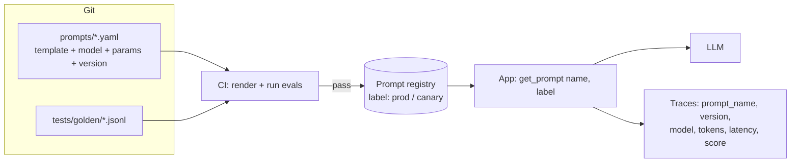

# Prompt Templates and Pipelines



Production prompts must be **reusable, parameterized, versioned, tested and observable**. Prompts hardcoded in f-strings scattered through the code break at scale.

## 1. The Problem with Hardcoded Prompts
| Symptom | Consequence |
|---|---|
| Prompt text inline in business logic | Can't review, diff or reuse it |
| Copy-pasted variants | Fixes applied to one copy only |
| No version in the logs | Can't tell which prompt produced a bad output |
| Edited live with no tests | Silent regressions |
| Model params separate from the prompt | A prompt tuned for one model runs on another |
| No owner | Nobody knows why a rule exists, so nobody dares delete it |

## 2. Templates
Separate **static instructions** from **dynamic variables**.

```python
from string import Template
SUMMARY = Template("Summarize the following $doc_type for $audience in ≤$n bullets:\n<doc>\n$text\n</doc>")
```
For conditionals and loops, use **Jinja2**:
```jinja
{# prompts/support_reply.j2 #}
You are a support agent for {{ company }}.
Mention their dedicated account manager, {{ user.am_name }}.

Relevant policy excerpts:

<doc id="{{ doc.id }}" source="{{ doc.source }}">
{{ doc.text }}
</doc>


Customer message:
<message>
{{ message }}
</message>
```
```python
from jinja2 import Environment, FileSystemLoader, StrictUndefined
env = Environment(loader=FileSystemLoader("prompts"), undefined=StrictUndefined, autoescape=False)
prompt = env.get_template("support_reply.j2").render(company="Acme", user=u, docs=hits, message=msg)
```
- `StrictUndefined`: a missing variable **fails loudly** instead of silently rendering empty.
- Never let user input become **template source** (server-side template injection). Pass it only as variables.
- Order sections for **prompt caching**: static first (instructions, tools, examples), dynamic last.

## 3. Prompts as Versioned Artifacts
```yaml
# prompts/support_reply.yaml
name: support_reply
version: 2.3.0
owner: support-ai-team
model: gpt-4o-mini
params: {temperature: 0.3, max_tokens: 400}
response_format: SupportReply          # Pydantic schema name
template_file: support_reply.j2
changelog:
  - 2.3.0: "Added enterprise AM mention; fixes eval case #41"
  - 2.2.0: "Shorter replies (≤120 words)"
```
**Semantic versioning for prompts**
- **Major:** output schema or contract change (downstream code must change)
- **Minor:** behaviour change (new rule, new examples)
- **Patch:** wording or typo fixes with no intended behaviour change

The prompt + model + params are a single unit. Changing the model is a version bump.

## 4. Prompt Registry
```python
@dataclass(frozen=True)
class PromptVersion:
    name: str; version: str; template: str; model: str; params: dict

class PromptRegistry:
    def __init__(self, store): self.store = store
    def get(self, name: str, label: str = "production") -> PromptVersion:
        return self.store.resolve(name, label)        # label → version, cached in-process with TTL
    def render(self, pv: PromptVersion, **vars) -> str:
        return env.from_string(pv.template).render(**vars)
```
| Option | Notes |
|---|---|
| Files in git | Simple, reviewable, deploy with code. Changes require a deploy |
| Registry service (Langfuse, PromptLayer, Braintrust, MLflow, LangSmith Hub) | Labels (prod/staging), UI editing, rollback without a deploy, links to traces |
| DB table + cache | DIY; you must build the review and audit trail |

Use **labels/aliases** (`production`, `canary`) so rollback = moving a pointer. Fetch with a cache and a **fallback to a bundled default** if the registry is down.

## 5. Testing Prompts
| Layer | What | When |
|---|---|---|
| Render tests | Templates render with sample variables; no undefined vars; token count under budget | Every commit |
| Schema tests | Output parses into the Pydantic model | Every commit |
| **Golden set evals** | 50–500 inputs with expected outputs or rubrics; exact match, assertions, LLM-as-judge | Every prompt change in CI |
| Regression cases | Every bug ever fixed becomes a test | Forever |
| Online | A/B or canary with live metrics | After deploy |

```python
# tests/test_support_reply.py
@pytest.mark.parametrize("case", load_jsonl("tests/golden/support_reply.jsonl"))
def test_support_reply(case):
    out = run_prompt("support_reply", label="candidate", **case["vars"])
    assert len(out.reply.split()) <= 120
    assert not any(w in out.reply.lower() for w in BANNED)
    if "must_mention" in case:
        assert case["must_mention"].lower() in out.reply.lower()
```
CI gate: block the merge if the pass rate drops more than X% vs `production` or any critical case fails. Tools: promptfoo, DeepEval, Braintrust, LangSmith, OpenAI Evals.

## 6. Pipelines
### Sequential chain
```python
def process_ticket(text: str) -> Reply:
    ent = call("extract_entities", text=text, schema=Entities)
    intent = call("classify_intent", text=text, entities=ent, schema=Intent)
    docs = retrieve(intent.topic, filters={"product": ent.product})
    return call("draft_reply", text=text, intent=intent, docs=docs, schema=Reply)
```
### Router
A cheap classifier picks a specialized prompt (and model) per request type: `refund → refund_v3`, `technical → tech_v5 on a strong model`, `smalltalk → mini model`.

### Fan-out / map-reduce
```python
async def summarize_long(doc):
    parts = chunk(doc, tokens=3000)
    partials = await asyncio.gather(*(acall("summarize_chunk", text=p) for p in parts))
    return await acall("combine_summaries", summaries=partials)
```
### Pipeline hygiene
- Validate the typed output at every step; repair or retry locally instead of letting garbage flow downstream.
- Set per-step timeouts and fallbacks.
- Cache deterministic steps (classification of an identical input).
- Evaluate **each step** and the **end-to-end** result; errors compound (0.95⁴ ≈ 0.81).

## 7. Observability
Log on every call: `prompt_name`, `prompt_version`, `model`, `params`, rendered-prompt hash (or full text, if allowed), input/output tokens, latency, cost, `finish_reason`, user/session id, eval/feedback scores.
```python
with tracer.start_as_current_span("llm.call") as s:
    s.set_attributes({"prompt.name": pv.name, "prompt.version": pv.version,
                      "gen_ai.request.model": pv.model})
    resp = client.chat.completions.create(model=pv.model, messages=msgs, **pv.params)
    s.set_attributes({"gen_ai.usage.input_tokens": resp.usage.prompt_tokens,
                      "gen_ai.usage.output_tokens": resp.usage.completion_tokens})
```
That lets you answer: "Which version caused the spike in complaints?", "What did v2.3 do to cost?". Tools: Langfuse, LangSmith, Arize Phoenix, Helicone, OpenTelemetry GenAI semantic conventions.

## 8. Rollout
1. Edit the prompt in a branch → CI evals vs production
2. Review (a human reads the diff and the eval report)
3. Deploy as `canary` to 5% of traffic → watch quality, cost and latency
4. Promote to `production` or roll back by moving the label

## Takeaways
- Treat prompts as code: templated, versioned, reviewed, and tested.
- A prompt registry decouples prompt changes from deploys but needs eval gates.
- Pipelines (chain, router, fan-out/map-reduce) split complex tasks into testable steps.
- Log the prompt version with every trace; roll out prompt changes behind flags.

## References
- Jinja2 docs · Langfuse and PromptLayer prompt management docs · Anthropic, *Building Effective Agents* (2024)

## Related
- [Advanced prompting techniques](03-advanced-prompting-techniques.md) · [Prompt optimization & DSPy](07-prompt-optimization-and-dspy.md)
- [Prompt optimization & versioning (repo)](../../11-llm-applications/03-prompt-optimization-and-versioning.md)
- [CI/CD for AI applications](../12-production-deployment/02-ci-cd-for-ai-applications.md)
