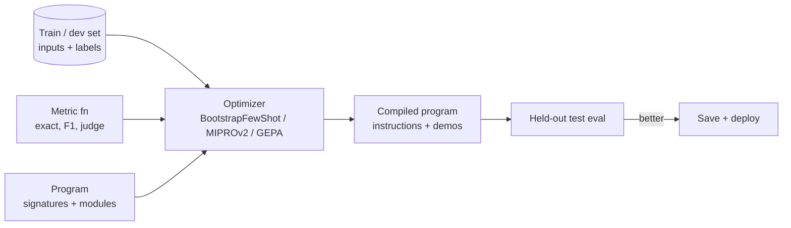

# Prompt Optimization and DSPy



Manual prompting is a loop of draft, test, inspect, refine. It is slow, hard to reproduce, and breaks when you switch models. **Prompt optimization** treats prompts as **tunable parameters** of a system, optimized against a dataset and a metric. The goal is better *measured* behaviour, not a prompt that reads well.

## 1. The Case for Automated Optimization
| Manual prompting | Automated optimization |
|---|---|
| Intuition-driven edits | Search guided by a metric |
| Tested on a handful of examples | Scored on a dev set (50–500+) |
| Prompt tied to one model | Recompile for a new model |
| Multi-step pipelines tuned one by one | Optimizes all steps jointly against the end-to-end metric |
| Hard to explain why v7 > v6 | Logged trials and scores |

Prerequisites (the real work): a **representative dataset** and a **metric you trust**. Without these, optimization overfits noise.

## 2. Eval-Driven Optimization Without a Framework
```python
def evaluate(prompt: str, dev: list[dict]) -> float:
    return sum(metric(run(prompt, ex["input"]), ex["expected"]) for ex in dev) / len(dev)

def optimize(seed_prompt, dev, rounds=5, k=4):
    best, best_score = seed_prompt, evaluate(seed_prompt, dev)
    for _ in range(rounds):
        failures = [ex for ex in dev if not metric(run(best, ex["input"]), ex["expected"])][:10]
        candidates = propose_rewrites(best, failures, n=k)     # LLM as "prompt engineer"
        for c in candidates:
            s = evaluate(c, dev)
            if s > best_score: best, best_score = c, s
    return best, best_score
```
This is the core of APE / OPRO / ProTeGi-style methods: an LLM proposes, the metric selects.

## 3. DSPy: Programming, Not Prompting
DSPy (Stanford) separates **what** a step does (signature) from **how** it is prompted (learned by an optimizer).

| Concept | Meaning |
|---|---|
| **Signature** | Typed I/O spec: `"question, context -> answer"` |
| **Module** | A strategy wrapping a signature: `Predict`, `ChainOfThought`, `ReAct`, `ProgramOfThought` |
| **Program** | Python class composing modules (`forward()`) |
| **Metric** | `def metric(example, pred, trace=None) -> float/bool` |
| **Optimizer** (teleprompter) | Tunes instructions and/or few-shot demos (or weights) to maximize the metric |
| **Compile** | Run the optimizer → a program with optimized prompts, saved as JSON |

```python
import dspy
dspy.configure(lm=dspy.LM("openai/gpt-4o-mini"))

class GenerateAnswer(dspy.Signature):
    """Answer the question using only the context. Say 'unknown' if not present."""
    context: list[str] = dspy.InputField()
    question: str = dspy.InputField()
    answer: str = dspy.OutputField(desc="short factual answer")

class RAG(dspy.Module):
    def __init__(self, k=5):
        self.k = k
        self.answer = dspy.ChainOfThought(GenerateAnswer)
    def forward(self, question):
        ctx = search(question, k=self.k)
        return self.answer(context=ctx, question=question)

def metric(ex, pred, trace=None):
    return ex.answer.lower() in pred.answer.lower()

trainset = [dspy.Example(question=q, answer=a).with_inputs("question") for q, a in pairs]
opt = dspy.MIPROv2(metric=metric, auto="medium")
compiled = opt.compile(RAG(), trainset=trainset)
compiled.save("rag_v1.json")
print(dspy.Evaluate(devset=devset, metric=metric)(compiled))
```

## 4. DSPy Optimizers
| Optimizer | What it tunes | Data needed | Notes |
|---|---|---|---|
| `LabeledFewShot` | Demos from labelled data | Few | Baseline |
| `BootstrapFewShot` | Demos generated by running the program and keeping traces that pass the metric | 10–50 | Cheap, strong baseline |
| `BootstrapFewShotWithRandomSearch` | Same + search over demo sets | 50+ | More calls |
| `MIPROv2` | Instructions **and** demos via Bayesian optimization | 50–500 | Common default |
| `GEPA` (2025) | Instructions via reflective evolution from textual feedback | Small sets OK | Sample-efficient; uses feedback text, not just scores |
| `BootstrapFinetune` | Distills the program into model **weights** | 100s+ | Prompt program → fine-tuned small model |
| `COPRO`, `SIMBA`, `KNNFewShot` | Instruction search / mini-batch ascent / per-input demo retrieval | Varies | |

## 5. Other Tools and Methods
| Tool | Approach |
|---|---|
| **TextGrad** | "Textual gradients": LLM feedback backpropagated through a computation graph |
| **OPRO** (DeepMind) | LLM as optimizer with the score history in its prompt |
| **APE** | Generate many instruction candidates, score, select |
| Promptfoo / Braintrust / LangSmith | Eval harnesses for manual or semi-automatic iteration |
| Provider prompt optimizers / "prompt improvers" | One-shot rewrites; no metric guarantee |

## 6. Pitfalls
- **Overfitting the dev set**: keep a held-out test set; don't peek repeatedly.
- **Metric gaming**: an LLM-judge metric can be satisfied by verbose or flattering outputs. Spot-check outputs manually.
- **Cost**: MIPROv2 "heavy" can make thousands of LM calls. Budget it; use a cheap model for proposals.
- **Opaque prompts**: optimized prompts can be weird. Version them, diff them, keep them reviewable.
- **Distribution shift**: re-optimize when the traffic mix or model changes.
- Optimizers can't fix missing **retrieval** or bad **data**. Fix those first.

## 7. When to Use What
| Situation | Approach |
|---|---|
| One prompt, few examples, early prototype | Manual iteration + small eval set |
| Stable task, 50+ labelled examples, clear metric | `BootstrapFewShot` → `MIPROv2` |
| Multi-stage pipeline (RAG, extraction → reasoning) | DSPy end-to-end compile |
| Switching to a cheaper model | Recompile on the new model; compare cost-adjusted quality |
| High volume, need lowest cost | `BootstrapFinetune` / distill into a small model |

## Takeaways
- Automated prompt optimization needs a metric and an eval set first.
- DSPy expresses LLM programs as signatures and modules, then compiles prompts and few-shot examples against the metric.
- Optimizers can overfit small dev sets; hold out a test set.
- Use manual iteration for small tasks and optimizers for multi-step pipelines with clear metrics.

## References
- Khattab et al., *DSPy: Compiling Declarative LM Calls into Self-Improving Pipelines* (2023)
- Opsahl-Ong et al., *MIPRO* (2024) · Agrawal et al., *GEPA* (2025)
- Yang et al., *OPRO: Large Language Models as Optimizers* (2023) · Yuksekgonul et al., *TextGrad* (2024) · Zhou et al., *APE* (2022)

## Related
- [Prompt templates & pipelines](05-prompt-templates-and-pipelines.md)
- [Prompt optimization (cost)](../13-llm-optimization/02-prompt-optimization.md)
- [Evaluating RAG systems](../07-rag/05-evaluating-rag-systems.md)
- [Prompt optimization & versioning (repo)](../../11-llm-applications/03-prompt-optimization-and-versioning.md)
