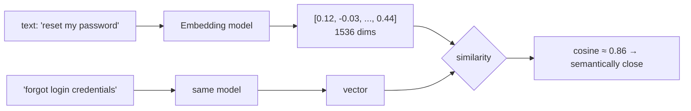
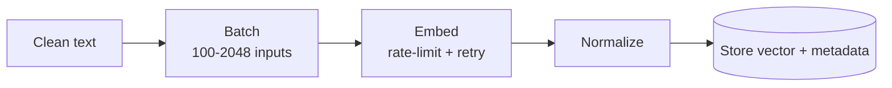

# What are Embeddings



## 1. Intuition
An embedding maps text (or an image or audio clip) to a point in a high-dimensional space where **distance ≈ semantic difference**. GPS analogy: coordinates let you compute nearness without understanding the places. Individual dimensions are **not** human-interpretable.

## 2. How Embedding Models Are Trained
- **Contrastive learning:** pull (query, relevant passage) pairs together and push negatives apart (InfoNCE loss, in-batch and hard negatives).
- **Pooling:** token vectors → one vector via mean pooling, the [CLS] token, or a learned head.
- Bi-encoder: query and doc are embedded **independently**, so docs can be precomputed. That's what makes vector search fast.

## 3. Dimensions
| Model | Dims | Notes |
|---|---|---|
| OpenAI text-embedding-3-small | 1536 | Cheap, solid baseline |
| OpenAI text-embedding-3-large | 3072 | Higher quality |
| all-MiniLM-L6-v2 | 384 | Local, fast, weaker |
| BGE / E5 / GTE / Nomic / Qwen3-Embedding | 384–4096 | Open-weight; check MTEB |
| Cohere embed v3/v4, Voyage | 1024+ | Strong retrieval, multilingual |

**Matryoshka (MRL):** models trained so prefixes are useful. `dimensions=512` truncates with modest quality loss; **re-normalize after truncating**.

## 4. Similarity Metrics
| Metric | Formula | Notes |
|---|---|---|
| Cosine | a·b / (‖a‖‖b‖) | Ignores magnitude; the default |
| Dot product | a·b | Equals cosine on unit-normalized vectors (fastest) |
| Euclidean (L2) | ‖a−b‖ | Ranking matches cosine for normalized vectors |
```python
import numpy as np
def normalize(v): return v / np.linalg.norm(v, axis=-1, keepdims=True)
sims = normalize(D) @ normalize(q)           # cosine for all docs at once
top = np.argsort(-sims)[:5]
```
Absolute scores aren't comparable across models (one model's 0.8 can be another's 0.5). Calibrate thresholds per model.

## 5. Visualization and Evaluation
- t-SNE/UMAP projections are for **debugging intuition only** (clusters, outliers); they distort distances.
- Evaluate retrieval with **Recall@K**, **MRR**, nDCG on labelled query→doc pairs from *your* domain.

## 6. Storage Math
`N × dims × 4 bytes` (float32):
- 1M × 1536 ≈ **6.1 GB**
- 1M × 3072 ≈ **12.3 GB**
- int8 quantization: ÷4; binary: ÷32 (rerank with full precision)

## 7. Production Embedding Pipeline

```python
def embed_batch(texts, model="text-embedding-3-small", dims=None):
    r = client.embeddings.create(model=model, input=texts, **({"dimensions": dims} if dims else {}))
    return [normalize(np.array(d.embedding, dtype=np.float32)) for d in r.data]
```
- Batch inputs and respect TPM limits; make jobs **resumable** with checkpoints.
- **Cache key:** `hash(text) + model + dims + normalization + chunk_version`. Change any of them and you must re-embed.
- **Same model for queries and documents.** Mixing models breaks similarity entirely.
- Changing models means re-embedding the whole corpus (plan dual-write / shadow indexes).
- Some models need prefixes (`"query: "`, `"passage: "` for E5; task types for Gemini/Cohere).

## Takeaways
- Embeddings map text (or images) to vectors where semantic similarity becomes geometric closeness.
- They are trained contrastively on pairs, so query/document conventions matter.
- Use cosine similarity on normalized vectors; dimensions trade quality for storage.
- Storage = vectors × dims × bytes; plan quantization early for large corpora.

## References
- Reimers & Gurevych, *Sentence-BERT* (2019) · Muennighoff et al., *MTEB* (2022) · OpenAI and Cohere embedding docs

## Related
- [Choosing embedding models](02-choosing-embedding-models.md)
- [Vector databases](03-vector-databases.md)
- [Embedding pipeline design (repo)](../../13-production-ml/08-embedding-pipeline-design.md)
