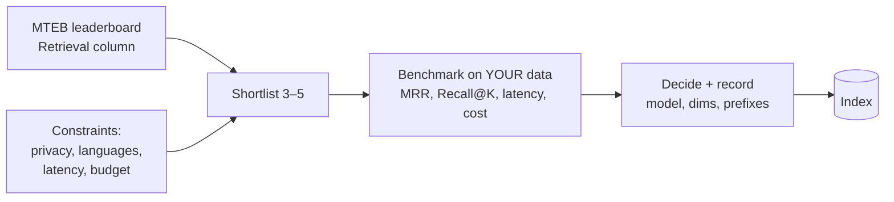

# Choosing Embedding Models



The embedding model is **retrieval infrastructure**: every vector in the index depends on the model, its dimension setting, its similarity behaviour and its query/document formatting rules. Changing it later means **re-embedding and reindexing everything**. It affects relevance, latency, storage, migration cost, multilingual support and privacy.

Approach: **public benchmarks to shortlist → test on your own retrieval task to decide.**

## 1. MTEB: A Starting Point
MTEB (Massive Text Embedding Benchmark) is for **finding candidates**, not making the final decision. For RAG and semantic search, the **Retrieval** task category matters most.

Columns: Model · Overall · Retrieval · Model size · Embedding dims · Max tokens.

How to read it:
1. Filter to your task and **sort by Retrieval**, not Overall.
2. **Model size**: a 7B model may beat a 300M model by a point but is slower and needs a GPU.
3. **Dimensions**: more dims = more storage and bandwidth, not automatically better retrieval.
4. **Max tokens**: longer limits reduce truncation but **don't replace chunking**; long chunks mix topics and retrieve poorly.
5. **Model contract**: some models need query/document prefixes or settings. Ignoring them can cost more quality than switching models.

Blind spots: domain performance, latency/throughput, cost, and multilingual (mostly English-weighted; check the multilingual subsets, e.g. MMTEB).

## 2. Dimensionality Trade-offs
| Dims | Examples | float32 per vector | Typical use |
|---|---|---|---|
| 384 | all-MiniLM-L6-v2, BGE-small | ~1.5 KB | Prototypes, small indexes |
| 768 | BGE-base, E5-base, GTE-base, nomic | ~3 KB | Open-weight middle ground |
| 1024 | BGE-large, BGE-M3, Voyage-4 default | ~4 KB | Strong retrieval, manageable storage |
| 1536 | OpenAI 3-small, Cohere embed-v4.0 default | ~6 KB | Common API range |
| 3072 | OpenAI 3-large | ~12 KB | Expensive at scale |

Storage and index RAM at **10M vectors** (approx.):

| Dims | Raw storage | Index RAM (HNSW) |
|---|---|---|
| 384 | ~15 GB | ~18 GB |
| 768 | ~30 GB | ~35 GB |
| 1024 | ~40 GB | ~47 GB |
| 1536 | ~60 GB | ~70 GB |
| 3072 | ~120 GB | ~140 GB |

Formula: `bytes = N × d × 4` (float32). 384→3072 is **8×** the storage and memory. That's trivial at 100K chunks and serious at 100M.

- Quality vs dims is **model-specific and non-linear**: a good 1024-d model can beat a weaker 3072-d one. Compare **cost-adjusted quality**. Test 768–1536 first.
- Dimension choice interacts with chunking, **quantization** (int8 = 4× smaller, binary = 32× smaller + rescoring) and reranking.

### Matryoshka embeddings (MRL)
Trained so that **prefixes** of the vector remain useful: truncate 3072 → 256/512/1024 and re-normalize.
```python
from openai import OpenAI
client = OpenAI()
r = client.embeddings.create(model="text-embedding-3-large", input=["refund policy"], dimensions=1024)
vec = r.data[0].embedding            # 1024 dims, already normalized
```
Use case: a cheap first-pass search on short vectors, then rescore with full vectors. Different dim settings = **different indexes**.

## 3. API-Based Models
Trade-offs: per-token cost, provider dependency, network latency, data leaves your environment (unless a private deployment is approved).

| | OpenAI | Cohere | Voyage AI |
|---|---|---|---|
| Models | text-embedding-3-small (1536), -3-large (3072) | embed-v4.0 (1536; 256/512/1024/1536), embed-*-v3.0 (1024) | voyage-4-large / 4 / 4-lite (1024), voyage-code-3, voyage-law-2, voyage-finance-2 |
| Flexible dims | Yes (`dimensions`) | Yes | Yes (4-series, selected) |
| Multilingual | Yes | Yes | Yes (4-series general) |
| Query/doc mode | No explicit parameter | Yes (`input_type`) | Yes (`input_type`) |
| Multimodal | No (text models) | Yes (embed-v4.0: images, PDFs, mixed) | Separate multimodal models |
| Domain-specific | No | No | Yes (code, law, finance) |

**Asymmetric embedding**: queries are short and intent-driven; documents are long and dense. Telling the model which is which (`input_type="search_query"` vs `"search_document"`) usually helps.
```python
import cohere
co = cohere.ClientV2()
docs = co.embed(model="embed-v4.0", texts=chunks, input_type="search_document", embedding_types=["float"])
q = co.embed(model="embed-v4.0", texts=[query], input_type="search_query", embedding_types=["float"])
```
Also worth testing: Google `gemini-embedding-001`, Jina v3/v4, Mistral embed, Amazon Titan v2.

## 4. Open-Weight Models
Benefits: control, no per-token fees, run locally or in your VPC. Costs: hardware, engineering time, monitoring, upgrades.

| Model | Dims | Params | Max tokens | Fit |
|---|---|---|---|---|
| bge-large-en-v1.5 | 1024 | 335M | 512 | General English |
| bge-m3 | 1024 | 568M | 8192 | Multilingual, long docs; dense + sparse + multi-vector |
| e5-large-v2 | 1024 | 335M | 512 | General retrieval |
| e5-mistral-7b-instruct | 4096 | 7B | 32768 | Quality-sensitive, GPU available |
| gte-Qwen2 / Qwen3-Embedding | varies | 0.6–8B | long | High-capacity multilingual |
| nomic-embed-text-v1.5 | 768 (MRL) | 137M | 8192 | Efficient, long docs |

```python
from sentence_transformers import SentenceTransformer
m = SentenceTransformer("BAAI/bge-large-en-v1.5")
doc_vecs = m.encode(chunks, batch_size=64, normalize_embeddings=True)   # unit length → cosine == dot
q_vec = m.encode("Represent this sentence for searching relevant passages: " + query,
                 normalize_embeddings=True)                              # BGE query instruction prefix
scores = doc_vecs @ q_vec
```
- E5 expects `"query: "` / `"passage: "` prefixes; nomic expects `"search_query: "` / `"search_document: "`. Same idea as `input_type`, implemented as text prefixes.
- Serve with **TEI** (Hugging Face Text Embeddings Inference), Infinity, or vLLM; batch requests and use ONNX/FP16 for throughput.

**When open-weight:** privacy or data residency is required, or volume is high enough that self-hosting lowers marginal cost. At moderate volume, an API is usually simpler. Optimize **total system cost**, not list price.

## 5. Text-Only vs Multimodal
Need multimodal when images, screenshots, scans, charts or layout-heavy PDFs carry meaning: text→image search, product matching, document understanding.

| Model | Modalities | Dims | Access |
|---|---|---|---|
| CLIP (OpenAI) | text, image | 512 | Open |
| SigLIP (Google) | text, image | 1152 | Open |
| Cohere embed-v4.0 | text, image, mixed docs | 1536 | API |
| Voyage multimodal | text, image | varies | API |
| Jina CLIP v2 | text, image | 1024 | Open + API |

Cross-modal retrieval works because text and images share one space. For most document RAG, a **strong text model remains the default**: if you can extract reliable text and users search with text, benchmark text-only first. (Also: ColPali-style late-interaction over page images. See [multimodal RAG](../07-rag/08-multimodal-rag.md).)

## 6. Domain-Specific vs General
General models stumble on legal clauses, clinical notes, code, filings and internal jargon ("injection" in medicine vs SQL; "cell" in biology vs a spreadsheet). The failure is **subtle**: plausible but wrong results (a "connection-pool memory leak" query returns generic memory-management docs).

Options, least to most effort:
1. Check for a credible **domain model** (code, law, finance, biomedical, scientific).
2. **Fine-tune** a strong general model on domain (query, positive, hard negative) triples or click logs. Hundreds of labels show direction; thousands are better. **Negative quality matters as much as positive count.** (sentence-transformers `MultipleNegativesRankingLoss`; synthetic queries generated by an LLM over your chunks work well.)
3. **Train from scratch**: rarely right (corpus, curation, eval infra, compute).

## 7. Practical Benchmarking
Build 50–200 (query, relevant doc) judgments from **your** data with realistic distractors, embed everything, rank by cosine, measure.

- **MRR**: mean of `1/rank` of the first relevant doc (rank 1 → 1, rank 3 → 0.33).
- **Recall@K**: fraction of queries with a relevant doc in the top K. **Recall@10 matters for RAG**: the LLM can only use what retrieval returns.
- Also: nDCG@10 (graded relevance), p50/p95 latency, $ per 1M tokens, index size.

```python
import numpy as np
def bench(embed_q, embed_d, queries, docs, gold):          # gold[i] = index of relevant doc
    D = np.array(embed_d(docs)); Q = np.array(embed_q(queries))
    ranks = []
    for i, q in enumerate(Q):
        order = np.argsort(-(D @ q))
        ranks.append(int(np.where(order == gold[i])[0][0]) + 1)
    r = np.array(ranks)
    return {"MRR": float(np.mean(1 / r)), **{f"R@{k}": float(np.mean(r <= k)) for k in (1, 5, 10)}}
```
Small test sets make every model look good. Real differences show up with many queries, **hard negatives**, metadata filters, and the **same chunking used in production**.

## 8. Decision Record (write this down)
`model` · `version` · `dims` · `normalize` · `distance metric` · `query/doc prefixes or input_type` · `max tokens / truncation` · `chunking config` · `quantization`. Store `embedding_model_version` on every vector so migrations can run side by side (dual-write → backfill → switch reads).

## Takeaways
- MTEB to narrow; evaluate on your queries, corpus, filters, chunking and latency budget.
- Compare dims by **cost-adjusted quality**; storage and RAM grow linearly with d.
- Respect each model's **query/document contract**.
- API vs open-weight depends on privacy, volume and ops capacity.
- Multimodal only when visual content is central to retrieval.
- Test domain models / fine-tuning when general models miss domain terms.
- Measure MRR and Recall@K before committing; switching later means reindexing.

## References
- Muennighoff et al., *MTEB: Massive Text Embedding Benchmark* (2022) · Kusupati et al., *Matryoshka Representation Learning* (2022)

## Related
- [What are embeddings](01-what-are-embeddings.md) · [Vector databases](03-vector-databases.md) · [Scaling vector search](05-scaling-vector-search.md)
- [Embedding pipeline design (repo)](../../13-production-ml/08-embedding-pipeline-design.md)
