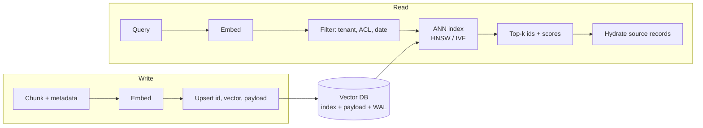

# Vector Databases



A vector database stores embeddings with their metadata and finds records by **similarity** instead of exact match. Production needs go beyond similarity search: **metadata filtering, tenant isolation, updates and deletes, persistence, backups, and observability**.

## 1. Similarity Metrics
| Metric | Formula | Notes |
|---|---|---|
| **Cosine** | `a·b / (‖a‖‖b‖)` | Direction only; the default for text embeddings |
| **Dot product** | `a·b` | Equals cosine for unit vectors; faster; use when the model is trained for it |
| **Euclidean (L2)** | `‖a−b‖` | For normalized vectors, ranking matches cosine (`‖a−b‖² = 2 − 2cos`) |

Use the metric the **model was trained with**. Normalize once at ingest and use dot product.

## 2. Why Not Just Use NumPy?
Brute force (exact kNN) is `O(N·d)` per query.
```python
import numpy as np
D = np.random.randn(1_000_000, 768).astype(np.float32)
D /= np.linalg.norm(D, axis=1, keepdims=True)
q = D[0]
top = np.argpartition(-(D @ q), 10)[:10]       # ~0.77 GFLOP per query
```
| N (768-d) | Memory | Exact search / query (1 CPU core) |
|---|---|---|
| 100K | 300 MB | ~ms: **fine, just use NumPy/FAISS Flat** |
| 1M | 3 GB | ~tens of ms |
| 10M | 30 GB | ~hundreds of ms: too slow for QPS > a few |
| 100M | 300 GB | Doesn't fit one machine |

What NumPy doesn't give you: persistence, concurrent writes, deletes, filtering, replication, auth, multi-tenancy, hybrid search, backups. That's the database part.

## 3. Approximate Nearest Neighbor (ANN) Indexes
Trade a little **recall** for orders-of-magnitude speed. Measure recall@k against exact search.

| Index | Idea | Pros | Cons | Key knobs |
|---|---|---|---|---|
| **Flat** | Brute force | 100% recall | O(N) | — |
| **HNSW** | Multi-layer proximity graph; greedy search from the top layer | Best recall/latency; incremental inserts | RAM-heavy (vectors + graph ~1.1–1.5×); slow builds; deletes leave tombstones | `M` (links, 16–64), `ef_construction` (100–400), `ef_search` (k–500) |
| **IVF** | k-means into `nlist` cells; search `nprobe` nearest cells | Less memory, fast builds | Needs training; recall drops with skew | `nlist ≈ √N…4√N`, `nprobe` |
| **PQ / IVF-PQ** | Compress vectors into codes (e.g. 768-d → 64 bytes) | 10–50× smaller | Lossy → rescore with full vectors | `m` sub-quantizers, bits |
| **ScaNN** (Google) | Anisotropic quantization | Very fast at high recall | Fewer DB integrations | |
| **DiskANN / Vamana** | Graph on SSD with compressed vectors in RAM | Billions of vectors per node cheaply | SSD latency; complex | |
| **Scalar / binary quantization** | float32 → int8 (4×) / 1-bit (32×) | Big memory cuts | Recall loss → oversample + rescore | |

```python
import faiss
d = 768
index = faiss.IndexHNSWFlat(d, 32, faiss.METRIC_INNER_PRODUCT)
index.hnsw.efConstruction = 200
index.add(D)
index.hnsw.efSearch = 64            # raise for recall, lower for latency
scores, ids = index.search(q[None, :], 10)
```
**Tuning loop:** fix a latency SLO → sweep `ef_search` / `nprobe` → choose the smallest value hitting recall@10 ≥ 0.95 vs Flat.

## 4. Metadata Filtering
Real queries: "similar docs **where tenant = acme AND doc_type = policy AND updated > 2025**".

| Strategy | How | Failure mode |
|---|---|---|
| **Post-filter** | ANN top-k, then drop non-matching | Selective filters return < k results (or zero) |
| **Pre-filter** | Filter first, brute-force the subset | Slow if the subset is large |
| **Filtered/in-graph search** | Index traversal skips non-matching nodes (Qdrant, Weaviate, Milvus, pgvector iterative scans) | Graph connectivity breaks under very selective filters → engines fall back to brute force |
| **Partitioning** | Separate index/collection per tenant or category | Many small indexes to manage |

Index the payload fields you filter on (payload indexes). Test recall **with your real filters**: filters are the most common cause of "recall dropped in prod".

## 5. Data Model and Operations
```python
# Qdrant example
from qdrant_client import QdrantClient, models
qc = QdrantClient(url="http://localhost:6333")
qc.create_collection("kb", vectors_config=models.VectorParams(size=1024, distance=models.Distance.COSINE))
qc.create_payload_index("kb", field_name="tenant_id", field_schema="keyword")
qc.upsert("kb", points=[models.PointStruct(
    id=chunk.uuid, vector=vec,
    payload={"tenant_id": "acme", "doc_id": chunk.doc_id, "chunk_ix": chunk.ix,
             "source_url": chunk.url, "updated_at": chunk.ts, "acl": chunk.groups,
             "embedding_model": "bge-large-en-v1.5"})])
hits = qc.query_points("kb", query=qvec, limit=10,
    query_filter=models.Filter(must=[
        models.FieldCondition(key="tenant_id", match=models.MatchValue(value="acme")),
        models.FieldCondition(key="acl", match=models.MatchAny(any=user.groups))]))
```
- **Stable ids** (`hash(doc_id, chunk_ix)`) → idempotent upserts and clean re-ingestion.
- **Updates** = delete old chunks of the doc + insert new ones; HNSW deletes are tombstones → periodic compaction/optimize.
- Store the **source text pointer** (or the text itself) to hydrate results and cite sources.
- Keep the vector DB **derived**: the source of truth is your document store; you must be able to rebuild the index.

## 6. Multi-Tenancy
| Model | Isolation | Scale |
|---|---|---|
| Shared collection + `tenant_id` filter | Logical (a bug leaks data) | Millions of tenants |
| Partition / namespace per tenant (Pinecone namespaces, Qdrant tenant-aware sharding, Milvus partition key) | Stronger, efficient | Large |
| Collection/index per tenant | Strong | Hundreds to thousands |
| Database/cluster per tenant | Strongest | Few, high-value tenants |

Enforce the tenant filter **server-side** in the retrieval service, never from model output.

## 7. Choosing: Dedicated vs Built-In
| Option | Examples | When |
|---|---|---|
| **Extension to your existing DB** | **pgvector** (+ pgvectorscale), MongoDB Atlas Vector Search, Elasticsearch/OpenSearch kNN, Redis, SQLite-vec | < ~10–50M vectors; want transactions, joins, one system to run; already have the DB |
| **Dedicated, self-host/OSS** | Qdrant, Weaviate, Milvus, Chroma (dev), LanceDB (embedded) | High QPS, large scale, advanced filtering, hybrid search, quantization control |
| **Managed serverless** | Pinecone, Turbopuffer, Zilliz Cloud, Qdrant Cloud, Vertex AI Vector Search | Don't want ops; spiky load; pay per use |
| **Library** | FAISS, hnswlib, ScaNN, Annoy | Offline/batch, embedded, research |

```sql
-- pgvector
CREATE EXTENSION vector;
CREATE TABLE chunks (id bigserial PRIMARY KEY, tenant_id text, doc_id text, body text, embedding vector(1024));
CREATE INDEX ON chunks USING hnsw (embedding vector_cosine_ops) WITH (m = 16, ef_construction = 200);
SET hnsw.ef_search = 80;
SELECT id, body, 1 - (embedding <=> $1) AS score
FROM chunks WHERE tenant_id = $2
ORDER BY embedding <=> $1 LIMIT 10;
```
Decision questions: How many vectors in 1–2 years? Filter selectivity? QPS and p99 SLO? Hybrid (BM25) needed? Update rate? Team ops capacity? Data residency?

## 8. Operational Checklist
- [ ] Recall@k vs exact measured with production filters
- [ ] p50/p95/p99 latency and QPS dashboards; index memory and disk
- [ ] Backups/snapshots; tested rebuild from source of truth
- [ ] Embedding-model version on each record; dual-index migration plan
- [ ] Delete propagation (GDPR "right to be forgotten") verified
- [ ] Tenant isolation tests in CI
- [ ] Compaction/optimization scheduled

## Takeaways
- Vector DBs combine ANN indexes (HNSW, IVF, PQ) with metadata filtering, CRUD, and persistence.
- ANN trades exact recall for speed; tune index parameters against measured recall.
- Filtering and multi-tenancy are where vector DBs differ most; test filtered recall.
- Start with pgvector or your existing database; move to a dedicated store when scale or features require it.

## References
- Malkov & Yashunin, *HNSW* (2016) · Jégou et al., *Product Quantization* (2011) · Subramanya et al., *DiskANN* (2019)
- ann-benchmarks.com · pgvector, Qdrant, Milvus, Pinecone docs

## Related
- [Choosing embedding models](02-choosing-embedding-models.md) · [Semantic search engine](04-building-a-semantic-search-engine.md) · [Scaling vector search](05-scaling-vector-search.md)
- [Data architecture for AI](../11-ai-system-architecture/03-data-architecture-for-ai.md)
