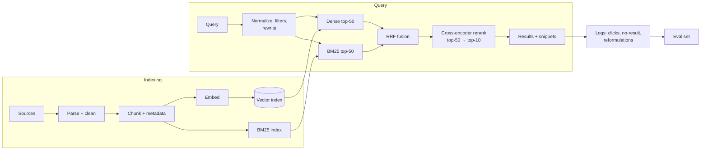

# Building a Semantic Search Engine



Embeddings + a vector DB = a demo. The gap between **"related"** and **"answers the question"** is where retrieval engineering happens:
- "how to handle database connection timeouts" → returns *HTTP request timeouts* (related, wrong).
- "Python list comprehension" → returns a *decorators* paragraph that mentions lists.

Levers: **chunking, hybrid retrieval, reranking, metadata, measurement.**

## 1. Pipeline: Big Picture
| Stage | Decision | Default |
|---|---|---|
| Parse | HTML/PDF/Markdown → clean text with structure | Keep headings, tables, code blocks |
| Chunk | Unit of retrieval | 200–500 tokens, structure-aware, ~10–15% overlap |
| Enrich | Metadata + context | Title, section path, URL, date, ACL, doc type |
| Embed | Model + prefixes | See [choosing models](02-choosing-embedding-models.md) |
| Index | Dense + sparse | HNSW + BM25 |
| Retrieve | Candidate generation | Hybrid, k=50 each |
| Rerank | Precision | Cross-encoder → top 10 |
| Present | Snippets, highlights, grouping by document | Dedupe chunks from the same doc |

## 2. Chunking
| Strategy | How | Good for |
|---|---|---|
| Fixed-size tokens + overlap | Every N tokens | Baseline; uniform text |
| Recursive character | Split on `\n\n` → `\n` → `. ` → ` ` until under the limit | General default (LangChain `RecursiveCharacterTextSplitter`) |
| **Structure-aware** | Split on headings/sections; keep code blocks and tables intact | Docs, wikis, manuals |
| Semantic | Split where embedding similarity between sentences drops | Long unstructured prose |
| Sentence-window | Index sentences; return ± N neighbours | Precise QA |
| Parent-child | Index small chunks, return the parent section | Precision + context |
| Late chunking | Embed the whole doc with a long-context model, then pool per chunk | Keeps cross-chunk context |

Prepend context to each chunk before embedding: `"{doc_title} > {section_path}\n\n{chunk_text}"`. This cheaply fixes many "orphan chunk" failures.

```python
def chunk_markdown(doc, max_tokens=400, overlap=50):
    for section in split_by_headings(doc.text):              # keeps heading path
        for piece in token_windows(section.body, max_tokens, overlap):
            yield {
                "id": f"{doc.id}:{section.ix}:{piece.ix}",
                "text": f"{doc.title} > {' > '.join(section.path)}\n\n{piece.text}",
                "doc_id": doc.id, "url": doc.url + "#" + section.anchor,
                "updated_at": doc.updated_at, "acl": doc.acl,
            }
```
Too small → no context, fragmented answers. Too large → mixed topics, diluted embeddings, wasted LLM tokens. **Tune on your eval set.**

## 3. Hybrid Search (Dense + Sparse)
| | Dense (embeddings) | Sparse (BM25 / SPLADE) |
|---|---|---|
| Strength | Paraphrase, synonyms, intent | Exact terms: error codes, SKUs, names, acronyms, rare words |
| Weakness | Misses exact tokens, numbers, new jargon | Vocabulary mismatch |

Combine with **Reciprocal Rank Fusion** (scale-free, no score calibration needed):
```python
def rrf(result_lists: list[list[str]], k: int = 60) -> list[str]:
    scores = {}
    for results in result_lists:
        for rank, doc_id in enumerate(results, start=1):
            scores[doc_id] = scores.get(doc_id, 0) + 1 / (k + rank)
    return sorted(scores, key=scores.get, reverse=True)

fused = rrf([dense_search(q, k=50), bm25_search(q, k=50)])
```
Alternative: a weighted score blend `α·dense_norm + (1−α)·bm25_norm` (needs normalization, tune α). Built-in hybrid: Elasticsearch/OpenSearch, Weaviate, Qdrant (sparse vectors + fusion), Vespa, pgvector + `tsvector`.

## 4. Reranking
Bi-encoders embed query and doc **separately** (fast, indexable). **Cross-encoders** read `(query, doc)` **together** → much more precise, but O(candidates) per query.

```python
from sentence_transformers import CrossEncoder
reranker = CrossEncoder("BAAI/bge-reranker-v2-m3")
cands = fused[:50]
scores = reranker.predict([(q, text_of(c)) for c in cands], batch_size=32)
top = [c for _, c in sorted(zip(scores, cands), reverse=True)][:10]
```
| Reranker | Type |
|---|---|
| Cohere Rerank 3.5, Voyage rerank-2.5, Jina reranker | API |
| bge-reranker-v2-m3, mxbai-rerank, ms-marco-MiniLM | Open cross-encoders |
| ColBERT (late interaction) | Token-level MaxSim; between bi- and cross-encoder |
| LLM-as-reranker (listwise) | Highest quality, highest cost/latency |

Typical: retrieve 50–100, rerank to 5–10. Adds ~50–300 ms. Often the **single biggest quality gain** after hybrid.

## 5. Query Processing
- Normalize (case, unicode, whitespace); detect language.
- Extract **filters** from the query ("pricing docs from 2025" → `doc_type=pricing, year=2025`), via rules or an LLM with a schema.
- Spell correction; synonym/acronym expansion from a domain dictionary ("SSO" → "SAML single sign-on").
- Optional LLM rewrite / HyDE for vague queries. See [advanced retrieval](../07-rag/03-advanced-retrieval-techniques.md).
- Score thresholds → return "no good results" instead of junk.

## 6. Results and UX
- Group chunks by document; show title, highlighted snippet, section anchor link, date.
- Dedupe near-identical chunks (MMR for diversity: `λ·rel − (1−λ)·max_sim_to_selected`).
- Facets from metadata; recency boosts where freshness matters (`score × decay(age)`).
- Log impressions, clicks, dwell time, reformulations and zero-result queries.

## 7. Measurement
| Metric | Meaning |
|---|---|
| Recall@K | Did a relevant result appear in the top K? (candidate stage) |
| MRR | How high was the first relevant result? |
| **nDCG@10** | Graded relevance with position discount (the standard search metric) |
| Precision@K | Fraction of the top K that are relevant |
| Zero-result rate, CTR@1, reformulation rate | Online signals |
| p95 latency | Per stage: embed, ANN, BM25, rerank |

Build the eval set from: real query logs + human labels, LLM-generated questions per chunk (cheap, biased toward easy lexical overlap), and known hard cases. **Evaluate each stage**: if recall@50 is low, reranking can't help.

```python
def ndcg_at_k(ranked_ids, rel: dict[str, int], k=10):
    import math
    dcg = sum((2**rel.get(d, 0) - 1) / math.log2(i + 2) for i, d in enumerate(ranked_ids[:k]))
    ideal = sorted(rel.values(), reverse=True)[:k]
    idcg = sum((2**r - 1) / math.log2(i + 2) for i, r in enumerate(ideal))
    return dcg / idcg if idcg else 0.0
```

## 8. Iteration Playbook
| Symptom | Fix |
|---|---|
| Exact codes/names missed | Add BM25 / hybrid |
| Right doc retrieved, wrong section | Smaller chunks; parent-child; heading context |
| Relevant doc at rank 20 | Reranker |
| Old versions outrank new ones | Recency boost; filter superseded docs |
| Results from the wrong product | Metadata filters; query → filter extraction |
| Domain jargon misunderstood | Synonym dictionary; domain/fine-tuned embeddings |

## Takeaways
- Pipeline: chunk → embed → index → query processing → hybrid retrieve → rerank → present.
- Hybrid (dense + BM25) search fixes exact-term misses; a cross-encoder reranker fixes ordering.
- Measure Recall@k, MRR, and nDCG on a labeled query set before and after each change.
- Iterate on the weakest stage: chunking, query rewriting, or reranking.

## References
- Robertson & Zaragoza, *The Probabilistic Relevance Framework: BM25 and Beyond* (2009) · Cormack et al., *Reciprocal Rank Fusion* (2009) · Nogueira & Cho, *Passage Re-ranking with BERT* (2019)

## Related
- [Vector databases](03-vector-databases.md) · [Scaling vector search](05-scaling-vector-search.md)
- [Advanced retrieval techniques](../07-rag/03-advanced-retrieval-techniques.md) · [Production RAG pipeline](../07-rag/02-building-a-production-rag-pipeline.md)
