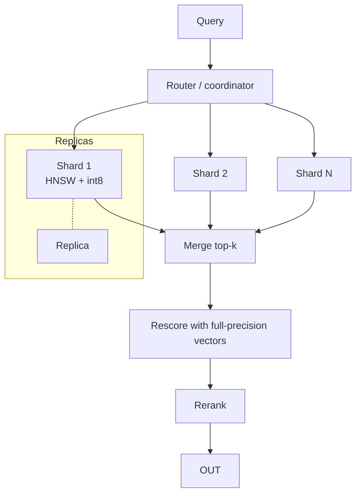

# Scaling Vector Search



What works at 10K chunks struggles at 10M. Degradation is **gradual**: latency creeps up, recall drops under filters, reindexing takes hours, memory pressure grows, the cloud bill gets noticed. Scaling means managing **memory, latency, recall and operational complexity** at once.

## 1. The Scaling Wall: Practical Math
**Memory** for HNSW with float32: `N × d × 4 B` (vectors) + `N × M × 2 × 4 B` (graph links, roughly) + metadata.

| N | d | Vectors | + HNSW graph (M=16) | Total |
|---|---|---|---|---|
| 1M | 768 | 3.1 GB | ~0.13 GB | ~3.5 GB |
| 10M | 1024 | 41 GB | ~1.3 GB | ~45 GB |
| 100M | 1024 | 410 GB | ~13 GB | ~450 GB |
| 1B | 768 | 3.1 TB | ~130 GB | multi-node or disk-based |

**Compute**: brute force = `N × d` multiply-adds per query. 10M × 1024 ≈ 10 GFLOP per query → too slow at any real QPS. HNSW visits ~`ef × M × log N` nodes ≈ thousands of distance computations.

**Capacity sketch** (a template; plug in your numbers):
```
docs = 5M, avg 8 chunks/doc        → N = 40M chunks
d = 1024, float32                   → 164 GB raw vectors
int8 quantization                   → 41 GB + HNSW graph ~5 GB
replication factor 2 (HA + QPS)     → ~92 GB RAM across the cluster
target 500 QPS, ~1.5 ms CPU/query/shard at ef=64, 4 shards
→ 500 × 4 × 1.5 ms = 3 CPU-s/s → 3+ cores busy; size for 3× headroom
```

## 2. Lever 1: Reduce Memory
| Technique | Memory saving | Recall impact | Notes |
|---|---|---|---|
| Fewer dims (MRL truncation) | 2–6× | Small to moderate | Needs a Matryoshka model |
| **Scalar quantization (int8)** | 4× | ~1% with rescoring | Safe default at scale |
| **Binary quantization** | 32× | Large alone; small with oversample + rescore | Works best with high-dim models (≥1024) |
| Product quantization | 8–64× | Moderate | IVF-PQ; tune `m` |
| Disk-based index (DiskANN, Qdrant on-disk, LanceDB, Turbopuffer on object storage) | RAM holds only compressed vectors / graph | Slightly higher latency | Cost-efficient at billions |
| Float16 storage | 2× | Negligible | Easy win |

**Oversample + rescore** pattern:
```python
cands = index.search(quantized(q), k=k * 4)              # fast, approximate
exact = [(c, full_vec(c) @ q) for c in cands]             # full-precision vectors (RAM or disk)
top = sorted(exact, key=lambda x: -x[1])[:k]
```

## 3. Lever 2: Shard and Replicate
| | Sharding | Replication |
|---|---|---|
| Solves | Data doesn't fit one node; index build time | QPS, availability |
| How | Split vectors across nodes; query all shards (scatter-gather) and merge | Copies of each shard behind a load balancer |
| Cost | Tail latency = the slowest shard; more fan-out | More RAM |

- **Random/hash sharding**: balanced; every query hits every shard.
- **Partition by tenant/category**: queries hit one shard; risks hot spots → large tenants get dedicated shards.
- Per-shard top-k must be ≥ the global k (often 1.5–2× to protect recall).
- Tail latency at fan-out: p99 of max over N shards ≫ single-shard p99. Use hedged requests and timeouts.

## 4. Lever 3: Tune the Index
| Knob | ↑ Effect |
|---|---|
| HNSW `M` | Recall ↑, memory ↑, build time ↑ |
| `ef_construction` | Graph quality ↑, build time ↑ |
| `ef_search` | Recall ↑, latency ↑ (set per query) |
| IVF `nlist` / `nprobe` | Partition granularity / recall vs latency |

Run a **recall-latency curve** offline (vs exact search on a sample) and pick the knee. Re-check after large data growth or distribution shift.

## 5. Filtered Search at Scale
Recall often collapses when filters are selective (e.g. 0.1% of vectors match):
- HNSW graph traversal through mostly filtered-out nodes → disconnected search → missing results.
- Fixes: payload indexes + engines with filter-aware traversal (Qdrant ACORN-style, Weaviate, Milvus); **partition by high-cardinality filter** (tenant); brute-force fallback when the filtered set is small (planner); pgvector iterative index scans.
- **Benchmark recall per filter selectivity bucket**, not just unfiltered.

## 6. Ingestion and Reindexing at Scale
- **Embedding throughput**: batch (64–512), GPU TEI/vLLM servers, async with rate limiting for APIs. 100M chunks × 300 tokens = 30B tokens → at $0.02/1M = $600 API cost, but **days** of throughput limits; plan for parallelism.
- **Incremental indexing**: CDC/event-driven upserts by stable chunk ids; content hashes to skip unchanged chunks.
- **Model migrations**: blue/green indexes. Build the new index in the background → shadow-query and compare → switch the alias → keep the old one for rollback.
- **Index builds**: HNSW builds are CPU-heavy (hours at 100M). Bulk-load with indexing deferred, then build; GPU builds (CAGRA/cuVS) are much faster.
- **Deletes**: tombstones degrade the graph → schedule compaction/vacuum.

## 7. Latency Budget (example p95 target 300 ms for search + rerank)
| Stage | Budget |
|---|---|
| Query embedding (API) | 30–80 ms (self-hosted: 5–15 ms) |
| ANN + filters | 10–40 ms |
| BM25 | 10–30 ms |
| Fusion + hydrate | 5–20 ms |
| Rerank 50 cands | 50–150 ms |
Caching: query-embedding cache (exact string), result cache for popular queries (invalidate on index updates).

## 8. Cost Levers Summary
| Lever | Typical win |
|---|---|
| int8 / binary quant + rescore | 4–32× RAM |
| Smaller/MRL dims | 2–4× |
| Tiered storage (hot in RAM, cold on disk/object storage) | Large at billions |
| Serverless / pay-per-query for spiky, low-QPS workloads | Avoid idle clusters |
| Drop unused chunks (dedupe, boilerplate, nav text) | 10–30% fewer vectors |
| pgvector until ~10–50M, then dedicated | Avoid premature infra |

## 9. Monitoring
- Recall canaries: a fixed query set with known answers, checked every N minutes.
- p50/p95/p99 per stage; QPS; per-shard latency skew.
- Memory/disk per node; index segment counts; tombstone ratio.
- Ingestion lag (source updated → searchable).
- Zero-result rate and score distributions (drift after model or data changes).

## Takeaways
- Memory is the scaling wall: reduce it with quantization (int8, binary, PQ) and rescoring.
- Shard for size, replicate for QPS.
- Tune index parameters (ef, nprobe) against a recall target; filtered search needs special handling at scale.
- Plan reindexing (blue-green indexes) and monitor recall, latency, and memory.

## References
- Jayaram Subramanya et al., *DiskANN* (2019) · Patel et al., *ACORN: filtered vector search* (2024)
- Guo et al., *ScaNN* (2020) · Qdrant/Weaviate/Milvus quantization docs · NVIDIA cuVS CAGRA

## Related
- [Vector databases](03-vector-databases.md) · [Choosing embedding models](02-choosing-embedding-models.md)
- [Scaling AI applications](../11-ai-system-architecture/04-scaling-ai-applications.md)
- [Embedding pipeline design (repo)](../../13-production-ml/08-embedding-pipeline-design.md)
