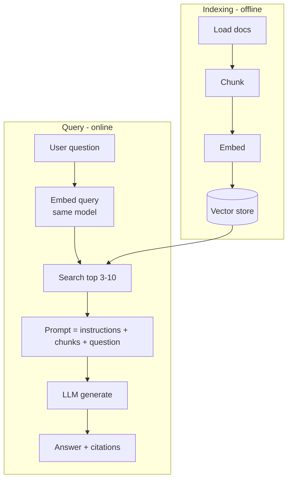

# What is RAG



**Retrieval-Augmented Generation** (Lewis et al., 2020): fetch relevant external knowledge at query time and give it to the model as context.

## 1. The Knowledge Gaps RAG Fills
| Gap | Example |
|---|---|
| Temporal | Events after the training cutoff |
| Organizational | Internal docs, policies, tickets |
| Domain/long-tail | Niche technical manuals, product specs |
| Per-user | A user's own files, emails, account data |

## 2. RAG vs Fine-Tuning vs Long Context
| Dimension | Fine-tuning | RAG | Long context |
|---|---|---|---|
| Adds knowledge | Poorly, prone to hallucination | Yes | Yes (if it fits) |
| Changes behaviour/style | **Yes** | No | Somewhat (examples) |
| Update speed | Retrain (hours–days) | Re-index (minutes) | Instant |
| Cost per query | Low | Medium (retrieval + context) | High (huge input) |
| Citations | No | **Yes** | Possible |
| Access control | No | Yes (filter at retrieval) | Manual |
| Corpus size | N/A | Unlimited | Bounded by the window |
| Failure mode | Confident wrong facts | Bad retrieval → bad answer | Lost in the middle, cost |
They combine: fine-tune for format and behaviour, RAG for facts, long context for the few documents that need deep reading.

## 3. Why RAG Works
- **Separation of concerns:** the model reasons; the retriever supplies facts.
- **Fast updates:** edit a document, re-embed, done.
- **Bounded cost:** only the top-k chunks go into the prompt.
- **Transparency:** citations users can verify.
- **Model-agnostic:** swap LLMs without rebuilding the knowledge.

## 4. When NOT to Use RAG
- You need behaviour or format change → prompt or fine-tune.
- A tiny knowledge base (a few pages) → just put it in the prompt (and cache it).
- Highly redundant near-duplicate docs → retrieval returns conflicting versions; dedupe first.
- Real-time data (prices, inventory) → call a **tool/API** instead.
- Complex multi-hop or aggregate questions ("how many tickets in Q3?") → SQL, GraphRAG, agentic RAG.

## 5. Minimal RAG
```python
import chromadb
from chromadb.utils.embedding_functions import OpenAIEmbeddingFunction

col = chromadb.Client().create_collection(
    "kb", embedding_function=OpenAIEmbeddingFunction(model_name="text-embedding-3-small"))
col.add(ids=[d["id"] for d in docs], documents=[d["text"] for d in docs],
        metadatas=[{"source": d["source"]} for d in docs])

def answer(q):
    hits = col.query(query_texts=[q], n_results=4)
    ctx = "\n\n".join(f"[{m['source']}] {t}" for t, m in zip(hits["documents"][0], hits["metadatas"][0]))
    return llm([
        {"role": "system", "content": "Answer ONLY from the context. Cite sources in [brackets]. "
                                      "If the context doesn't contain the answer, say you don't know."},
        {"role": "user", "content": f"Context:\n{ctx}\n\nQuestion: {q}"}])
```
The abstain instruction is what makes a question like "What programming languages does Acme use?" get "I don't know" instead of a guess.

## 6. Gaps Between the Demo and Production
| Demo | Production needs |
|---|---|
| Clean .txt files | PDF/HTML/table parsing, OCR |
| Fixed-size chunks | Structure-aware chunking, overlap |
| No metadata | Source, date, ACL, section, version |
| Vector-only search | Hybrid (BM25 + vector) + reranking |
| Raw user query | Query rewriting, expansion, decomposition |
| No errors | Retries, empty-result handling, fallbacks |
| "Looks right" | Retrieval + generation evals, monitoring |

## Takeaways
- RAG fills knowledge gaps (private, fresh, long-tail facts) by retrieving context at query time.
- Prefer RAG for knowledge and fine-tuning for behaviour; long context suits small, static corpora.
- Minimal RAG = embed, retrieve top-k, stuff into the prompt, generate.
- Production adds ingestion, hybrid retrieval, reranking, citations, evals, and permissions.

## References
- Lewis et al., *Retrieval-Augmented Generation for Knowledge-Intensive NLP Tasks* (2020) · Gao et al., *Retrieval-Augmented Generation for Large Language Models: A Survey* (2023)

## Related
- [Building a production RAG pipeline](02-building-a-production-rag-pipeline.md)
- [Evaluating RAG systems](05-evaluating-rag-systems.md)
- [RAG deep dive (repo)](../../11-llm-applications/02-rag.md)
