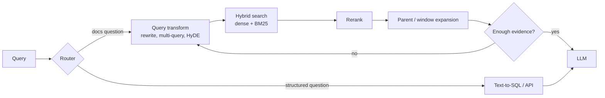

# Advanced Retrieval Techniques



Basic vector search misses in three classic ways:
1. **Paraphrase mismatch**: asks about a "refund policy"; the doc says "returns of physical products within 30 days of delivery".
2. **Vocabulary mismatch**: "SSO setup" vs "SAML identity provider configuration".
3. **Exact-match need**: an error code like `ERR_CONN_4012`, where semantic similarity is the wrong tool.

These are **retrieval failures, not generation failures**. If the right evidence never reaches the model, no prompt fixes it.

## 1. Why Basic Vector Search Misses
| Cause | Example | Technique |
|---|---|---|
| Query too short or vague | "pricing?" | Query rewriting, clarification |
| Query ≠ document style | Question vs declarative doc | HyDE, doc-side question generation |
| Rare tokens | Codes, SKUs, names | Hybrid (BM25) |
| Chunk lacks context | "It supports up to 50 users." (what's "it"?) | Contextual retrieval, heading prefixes |
| Answer spans sections | Multi-part question | Multi-query, parent-child, multi-hop |
| Relevant doc ranked 15th | Bi-encoder imprecision | Reranking |
| The answer lives in a table/DB | "Revenue in Q3 for EMEA?" | Structured routing (text-to-SQL) |

**Diagnose first:** label 50 failures as *retrieval miss* (gold doc not in top-k) vs *generation miss* (gold doc present, answer wrong).

## 2. Query Transformation
### Rewriting
Use an LLM to turn a vague or conversational query into a precise search query (add product names, expand acronyms, remove chit-chat).

### Multi-query (RAG-Fusion)
```python
def multi_query(q, n=4):
    variants = llm(f"Write {n} different search queries that would find documents answering: {q}\nOne per line.").splitlines()
    results = [hybrid_search(v, k=30) for v in [q, *variants]]
    return rrf(results)[:50]
```
Improves recall for ambiguous queries; costs one LLM call + N searches.

### HyDE (Hypothetical Document Embeddings)
Generate a **fake answer**, embed it, and search with it. Answers look like documents, so they land closer in embedding space.
```python
hypo = llm(f"Write a short passage from technical documentation that answers: {q}")
hits = dense_search(embed(hypo), k=30)
```
Good for zero-shot domains and question/document style gaps. Risk: if the model's guess is wrong, it can steer retrieval wrong. Combine with the original query.

### Step-back and decomposition
- Step-back: "What's our policy on X for enterprise plans?" → also search "enterprise plan policies".
- Decomposition: split multi-part questions into sub-queries and retrieve for each.

## 3. Hybrid Search and Reranking (recap)
Dense + BM25 fused with RRF, then a cross-encoder reranker over the top 50–100. This is the highest-ROI upgrade for most systems. Details: [semantic search engine](../06-embeddings-vector-search/04-building-a-semantic-search-engine.md).

Learned sparse retrieval (**SPLADE**, BGE-M3 sparse) gives BM25-like exact matching with learned term expansion.

## 4. Parent-Child (Small-to-Big) Retrieval
Index **small** chunks for precise matching; return the **parent** (section/page) for context.
```python
child_hits = dense_search(q, k=20)                         # 100–200 token children
parent_ids = list(dict.fromkeys(h.parent_id for h in child_hits))[:5]
context = [doc_store.get(pid) for pid in parent_ids]       # 1–2K token parents
```
Variants: **sentence-window** (return ±k sentences), auto-merging (if most children of a parent hit, return the parent).

## 5. Contextual Retrieval
Chunks lose context once split. Prepend an LLM-generated, chunk-specific context **before embedding and BM25 indexing** (Anthropic, 2024):
```
<document>{whole_doc}</document>
Here is a chunk from it: <chunk>{chunk}</chunk>
Give a short (50–100 token) context situating this chunk within the document, to improve search retrieval. Answer only with the context.
```
→ `"This chunk is from Acme's 2025 Enterprise pricing page, section on seat limits. " + chunk`

- Reported ~35% fewer retrieval failures (contextual embeddings), ~49% with contextual BM25, ~67% adding reranking.
- Cost is one LLM call per chunk at ingest. Prompt caching of the whole doc makes it cheap.
- Cheaper alternative: prepend `title > section path` deterministically.

## 6. Document-Side Enrichment
- **Hypothetical questions**: generate 3–5 questions each chunk answers; index those (pointing to the chunk).
- **Summaries**: index document summaries for "what is X about" queries; route to chunks after.
- **Metadata extraction**: entities, product, version, dates → filterable fields.
- **Multi-vector / late interaction** (ColBERT, ColPali): token-level vectors for fine-grained matching.

## 7. Multi-Step (Iterative / Multi-Hop) Retrieval
For questions needing chained facts ("Who manages the team that owns the billing service?"):
```python
def iterative_retrieve(q, max_hops=3):
    evidence = []
    query = q
    for _ in range(max_hops):
        evidence += hybrid_search(query, k=10)
        step = llm_json(f"Question: {q}\nEvidence: {evidence}\nIs it sufficient? If not, give the next search query.",
                        schema={"sufficient": bool, "next_query": str})
        if step["sufficient"]: break
        query = step["next_query"]
    return evidence
```
Approaches: IRCoT (interleave retrieval with CoT), Self-Ask, FLARE (retrieve when the model's confidence drops). This becomes [agentic RAG](09-agentic-rag.md).

## 8. Structured-Data Routing
Not everything should be vector-searched. Route by question type:
| Question | Route |
|---|---|
| "How do I configure SSO?" | Docs RAG |
| "How many tickets did ACME open last month?" | **Text-to-SQL** over the ticket DB (read-only role, schema in prompt, query validation) |
| "Status of order A123?" | API / tool call |
| "Which customers use feature X and churned?" | SQL + docs (hybrid) |
| Relationship questions across entities | Knowledge graph ([GraphRAG](07-graphrag-and-knowledge-graphs.md)) |

```python
route = llm_json(f"Classify: {q}", schema={"route": ["docs", "sql", "api", "none"]})
```
Self-querying retriever: the LLM extracts **metadata filters** + a semantic query (`{"query": "seat limits", "filter": {"plan": "enterprise", "year": 2025}}`).

## 9. Choosing Techniques
| Technique | Latency added | Cost | Typical gain | Use when |
|---|---|---|---|---|
| Hybrid BM25 | Low | Low | High for codes/names | Almost always |
| Reranker | 50–300 ms | Low–med | High | Almost always |
| Heading/title prefix | 0 | 0 | Medium | Always |
| Contextual retrieval | 0 at query time | Ingest LLM calls | High | Docs with ambiguous chunks |
| Parent-child | Low | Low | Medium | Answers need surrounding context |
| Query rewrite | +1 LLM call | Low | Medium | Conversational / vague queries |
| Multi-query / HyDE | +1 call + N searches | Medium | Medium | Ambiguous, recall-limited |
| Multi-hop | +N calls | High | High on multi-hop | Complex questions |
| Routing | +1 small call | Low | High where structured data exists | Mixed sources |

**Order of adoption:** good parsing + chunking → hybrid → rerank → contextual chunks → query rewriting → routing → multi-hop/agentic. **Measure each step** on the eval set.

## Takeaways
- Fix query-side gaps with rewriting, multi-query fusion, HyDE, step-back, and decomposition.
- Fix document-side gaps with contextual retrieval, parent-child chunks, and enrichment (summaries, questions).
- Route structured questions to SQL or APIs instead of vector search.
- Add techniques only when retrieval metrics show the gap; each adds latency.

## References
- Gao et al., *HyDE* (2022) · Anthropic, *Contextual Retrieval* (2024) · Formal et al., *SPLADE* (2021)
- Khattab & Zaharia, *ColBERT* (2020) · Trivedi et al., *IRCoT* (2022) · Jiang et al., *FLARE* (2023) · Raudaschl, *RAG-Fusion*

## Related
- [Production RAG pipeline](02-building-a-production-rag-pipeline.md) · [Evaluating RAG](05-evaluating-rag-systems.md) · [Agentic RAG](09-agentic-rag.md)
- [Semantic search engine](../06-embeddings-vector-search/04-building-a-semantic-search-engine.md)
