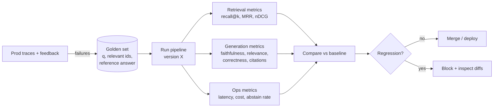

# Evaluating RAG Systems



Building RAG is half the job; the harder half is knowing **whether it works** and **whether it still works after each change**. Quality depends on the whole pipeline (parsing, chunking, embeddings, filters, retrieval, reranking, prompt, model, abstention), and any stage can fail on its own. "The model hallucinated" is not a diagnosis.

## 1. Why RAG Evaluation Is Hard
- **Compound system**: a bad answer can come from any stage; end-to-end scores hide the cause.
- **No single correct answer**: many valid phrasings; exact match fails.
- **Labels are expensive**: relevance judgments need domain experts.
- **Data drifts**: new documents make old gold labels stale.
- **Judges are models too**: LLM-as-judge has biases and variance.

Answer: **evaluate each stage separately**, on a **fixed dataset**, with **automated metrics validated against human labels**, run on **every change**.

## 2. What to Measure
| Layer | Metric | Question |
|---|---|---|
| Retrieval | **Recall@k** / hit rate | Is the gold evidence in the top k? (Ceiling for everything downstream) |
| | MRR, **nDCG@k** | Is it ranked high? |
| | Context precision | How much of the context is relevant (noise)? |
| Generation | **Faithfulness / groundedness** | Are all claims supported by the retrieved context? |
| | **Answer relevance** | Does it answer the question asked? |
| | **Correctness** | Does it match the reference answer's facts? |
| | Citation precision/recall | Do citations support claims; are claims cited? |
| Behavior | Abstention accuracy | Abstains on unanswerable, answers answerable |
| | Refusal / safety | Injection resistance, policy compliance |
| Ops | p50/p95 latency, cost/query, tokens | Within budget? |

**Diagnosis grid**
| Retrieval recall | Faithfulness | Correctness | Diagnosis |
|---|---|---|---|
| Low | – | Low | Retrieval problem (chunking, embeddings, hybrid, filters) |
| High | Low | Low | Generation ignores/misreads context (prompt, model, context order) |
| High | High | Low | Context is wrong/stale, or the gold label is wrong |
| High | High | High | Working; check latency/cost |

## 3. Building the Evaluation Dataset
| Source | Pros | Cons |
|---|---|---|
| Real user queries (sampled from logs) + expert labels | Realistic distribution | Slow, costly, privacy review |
| **Synthetic**: LLM generates Qs from chunks | Fast, scalable, gold chunk known | Too easy (lexical overlap); not the user distribution |
| Adversarial / hard cases | Targets known weaknesses | Must be curated manually |
| Production failures (thumbs down, escalations) | Highest value | Requires feedback plumbing |

Composition targets (example, 200–500 items):
- 60% realistic single-hop, 15% multi-hop/compare, 10% **unanswerable**, 10% ambiguous/conversational, 5% adversarial (injection, out-of-scope).
- Stratify by product, doc type, language, and tenant.
- Each item: `{id, question, relevant_chunk_ids|doc_ids, reference_answer, key_facts[], answerable, tags}`.

```python
SYNTH = """Given this passage, write one question a real user might ask that this passage answers.
Avoid copying phrases from the passage. Then give the answer and the key facts.
Return JSON {question, answer, key_facts}."""
```
Make synthetic questions harder: paraphrase, remove keywords, combine two chunks, and filter out questions answerable without context.

## 4. Retrieval Evaluation
```python
def retrieval_metrics(items, retrieve, k=10):
    hits, rr = 0, 0.0
    for it in items:
        got = [c.doc_id for c in retrieve(it["question"], k=k)]
        rel = set(it["relevant_doc_ids"])
        first = next((i for i, d in enumerate(got, 1) if d in rel), None)
        hits += first is not None
        rr += 1 / first if first else 0
    return {"recall@k": hits / len(items), "mrr": rr / len(items)}
```
- Evaluate **candidate recall@50** (before rerank) and **precision@5** (after rerank) separately.
- Score at the doc level if chunk ids change between versions; use a stable mapping.
- Sweep chunk size, k, hybrid α, and reranker on/off; plot quality vs latency.

## 5. Generation Evaluation with LLM Judges
```python
FAITHFULNESS = """You are grading an answer for faithfulness to the CONTEXT only.
1. List each factual claim in the ANSWER.
2. For each claim, mark SUPPORTED, UNSUPPORTED, or CONTRADICTED by the CONTEXT.
Return JSON {"claims":[{"claim":..., "verdict":...}]}.
CONTEXT: {context}
ANSWER: {answer}"""

def faithfulness(answer, context):
    out = judge_json(FAITHFULNESS.format(context=context, answer=answer))
    v = [c["verdict"] for c in out["claims"]]
    return v.count("SUPPORTED") / max(len(v), 1)
```
Judge best practices:
- **Decompose** (claim-level, binary decisions) instead of asking for a 1–10 score.
- Use reference answers / key facts for correctness ("does the answer contain fact X?").
- Use a strong judge model, temperature 0, JSON output; pin the judge version.
- **Validate the judge**: label 100–200 items by hand; measure agreement (Cohen's κ, accuracy). Re-validate after changing the judge.
- Known biases: position, verbosity, self-preference. Randomize order in pairwise comparisons; penalize unnecessary length.

## 6. Tooling
| Tool | Strength |
|---|---|
| **Ragas** | RAG metrics (faithfulness, answer relevancy, context precision/recall), synthetic test sets |
| DeepEval | Pytest-style LLM tests, many metrics |
| TruLens | RAG triad (context relevance, groundedness, answer relevance) |
| Arize Phoenix, Langfuse, LangSmith, Braintrust | Tracing + datasets + experiments + online evals |
| promptfoo | Config-driven prompt/model comparisons in CI |
| BEIR, MTEB retrieval, FRAMES, CRAG | Public benchmarks (sanity checks, not substitutes) |

## 7. Regression Workflow
1. Pin the dataset version; snapshot the corpus/index (or use doc-level labels).
2. Every PR touching prompts, chunking, models, or retrieval runs the eval suite (a fast subset on PRs, the full suite nightly).
3. Compare against the baseline per metric **and per slice**; show item-level diffs (newly failing questions).
4. Gate on thresholds: e.g. faithfulness ≥ 0.9, recall@10 must not drop > 2 points, p95 latency ≤ budget.
5. Run multiple seeds or report confidence intervals: with 200 items, ±3–5 points is noise.

```yaml
# eval-gates.yaml
dataset: rag-golden@v7
gates:
  retrieval.recall_at_10: {min: 0.85, max_drop: 0.02}
  generation.faithfulness: {min: 0.90}
  generation.correctness: {max_drop: 0.03}
  behavior.unanswerable_abstain_rate: {min: 0.80}
  ops.p95_latency_ms: {max: 3500}
  ops.cost_per_query_usd: {max: 0.01}
```

## 8. Online Evaluation
| Signal | Use |
|---|---|
| Thumbs up/down + reason | Direct, sparse, biased toward complaints |
| Copy/click-through on citations | Implicit usefulness |
| Reformulation / follow-up "that's wrong" | Implicit failure |
| Escalation to a human / ticket created | Strong failure signal |
| Sampled online LLM-judge (faithfulness) on 1–5% of traffic | Drift detection |
| A/B tests on prompt or retriever versions | Causal impact on task success |

Close the loop: failed traces → triage (retrieval vs generation vs content gap) → fix → add to the golden set.

## 9. Common Mistakes
- Only end-to-end scoring; no retrieval metrics.
- No unanswerable questions → the system never learns to abstain.
- Synthetic-only datasets → inflated scores.
- Judge never validated against humans.
- Treating a 1-point change on 100 items as signal.
- Evaluating on a corpus snapshot that differs from production.

## Takeaways
- Evaluate retrieval and generation separately: Recall@k/MRR for retrieval; faithfulness and relevance for answers.
- Build a golden set from real queries, with expected sources and reference answers.
- Calibrate LLM judges against human labels; run evals as regression tests in CI.
- Online, track feedback, no-answer rate, reformulations, and citation clicks.

## References
- Es et al., *RAGAS* (2023) · Saad-Falcon et al., *ARES* (2023) · Zheng et al., *Judging LLM-as-a-Judge* (2023)
- Thakur et al., *BEIR* (2021) · Yang et al., *CRAG* (2024) · Krishna et al., *FRAMES* (2024)

## Related
- [Citations & grounding](04-rag-with-citations-and-grounding.md) · [Production RAG pipeline](02-building-a-production-rag-pipeline.md)
- [Agent evaluation](../10-agents/06-agent-evaluation-and-testing.md) · [CI/CD for AI](../12-production-deployment/02-ci-cd-for-ai-applications.md)
