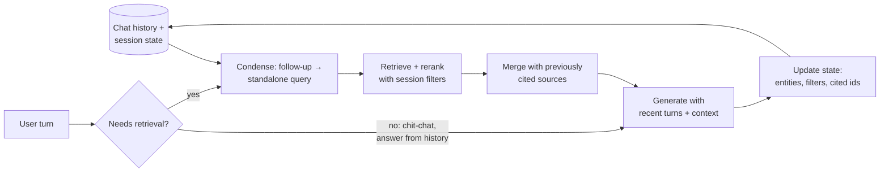

# Conversational RAG



Single-turn RAG assumes every question is self-contained. In chat, users write **"what about the enterprise plan?"** or **"does it support SSO?"**: they lean on earlier turns. Embedding that raw follow-up retrieves junk.

## 1. Conversational Failure Modes
| Failure | Example | Fix |
|---|---|---|
| Unresolved reference | "Does **it** support SSO?" | Query condensation |
| Lost constraint | Earlier: "we're on the EU region"; later answers ignore it | Session state / sticky filters |
| Topic switch not detected | Rewriter drags old context into a new topic | Rewriter instructed to detect switches |
| Over-retrieval | "Thanks!" triggers a search | Retrieval router |
| Contradicting earlier answers | New context differs from what was said | Keep cited sources; flag changes |
| History bloat | 40 turns blow the context budget | Window + summary |
| Answer drift | Model answers from history instead of sources | Prompt: history for intent, sources for facts |

## 2. Query Condensation (Standalone Question Rewriting)
```python
CONDENSE = """Rewrite the user's latest message as a standalone search query.
Resolve pronouns and references using the conversation. Keep product names, versions, and constraints.
If the latest message starts a new topic, ignore earlier turns.
If no search is needed (greeting, thanks, meta question), return {"search": false}.
Return JSON {"search": bool, "query": str, "filters": object}.

Conversation:
{history}
Latest: {message}"""

def condense(history, message):
    return llm_json(CONDENSE.format(history=last_n_turns(history, 6), message=message),
                    model="small-fast-model")
```
- Use a **small, fast model**: this sits on the critical path (+100–300 ms).
- Pass only the last ~4–8 turns plus the session state, not the full history.
- Retrieve with **both** the condensed query and the raw message (fuse with RRF) when rewrites are risky.
- Log raw → condensed pairs; they are the first thing to inspect on bad answers.

## 3. Session State (Structured Memory)
Keep explicit state instead of relying on the model to reread history:
```python
@dataclass
class SessionState:
    entities: dict[str, str]          # {"product": "Acme Sync", "plan": "Enterprise"}
    filters: dict[str, str]           # sticky retrieval filters {"region": "eu"}
    cited_source_ids: list[str]       # sources used in earlier answers
    open_questions: list[str]
    summary: str                      # rolling summary of older turns
```
- Update state after each turn (an LLM extraction step or rules).
- Apply **sticky filters** to retrieval until the user changes them.
- Re-include recently cited sources when the user asks about "that" answer ("expand on point 2").

## 4. Context Assembly per Turn
| Component | Budget (example, 16K) |
|---|---|
| System prompt + rules | 1K |
| Session state + summary of older turns | 0.5–1K |
| Last 3–6 turns verbatim | 2–4K |
| Retrieved sources (fresh + carried-over) | 6–10K |
| Output reserve | 1–2K |

Prompt rule: **"Use the conversation to understand what the user means; use only the sources for facts."** Otherwise the model repeats its own earlier (possibly wrong) answers as truth.

## 5. Retrieval Router for Chat
| Turn type | Action |
|---|---|
| New factual question | Condense → retrieve |
| Follow-up on the same topic | Condense → retrieve; merge with prior sources |
| "Explain that more simply" / reformat | No retrieval; reuse prior sources |
| Clarification answer ("the enterprise one") | Update state → re-run the pending query |
| Chit-chat / thanks | No retrieval |
| Ambiguous | Ask a clarifying question (cheaper than a wrong answer) |

## 6. Clarifying Questions
Ask when the ambiguity changes the answer and can't be resolved from state: "Which plan are you on: Team or Enterprise?" Limit to one question; offer options; remember the answer in state. Measure the clarification rate; too high is annoying.

## 7. Long Conversations
- Rolling summary of turns older than the window (update every N turns).
- Store long-term facts (user's plan, region) in user memory, separate from the session. See [agent memory](../10-agents/02-agent-memory-systems.md).
- Reset or fork the context on topic switches.

## 8. Evaluating Conversational RAG
- Multi-turn test cases: `[(turn1, expected), (turn2-follow-up, expected), …]`.
- **Rewrite quality**: compare the condensed query to a gold standalone question (judge: "same intent and constraints?"), and retrieval recall using the condensed query.
- Per-turn faithfulness + **consistency across turns**.
- Datasets: CoQA, QuAC, TopiOCQA, MTRAG; build in-domain multi-turn sets from logs.

## Takeaways
- Follow-up questions break naive RAG; condense each turn into a standalone query.
- Track session state (entities, filters) in structured memory, not just raw history.
- Route per turn: retrieve, answer from history, or ask a clarifying question.
- Evaluate whole multi-turn conversations, not single turns.

## References
- Anantha et al., *QReCC: Open-Domain Question Rewriting* (2021) · Adlakha et al., *TopiOCQA* (2022)
- LangChain `create_history_aware_retriever`, LlamaIndex `CondenseQuestionChatEngine`

## Related
- [Streaming and conversation management](../03-first-ai-application/04-streaming-and-conversation-management.md)
- [Context engineering](../05-prompt-engineering/04-context-engineering.md) · [Advanced retrieval](03-advanced-retrieval-techniques.md)
