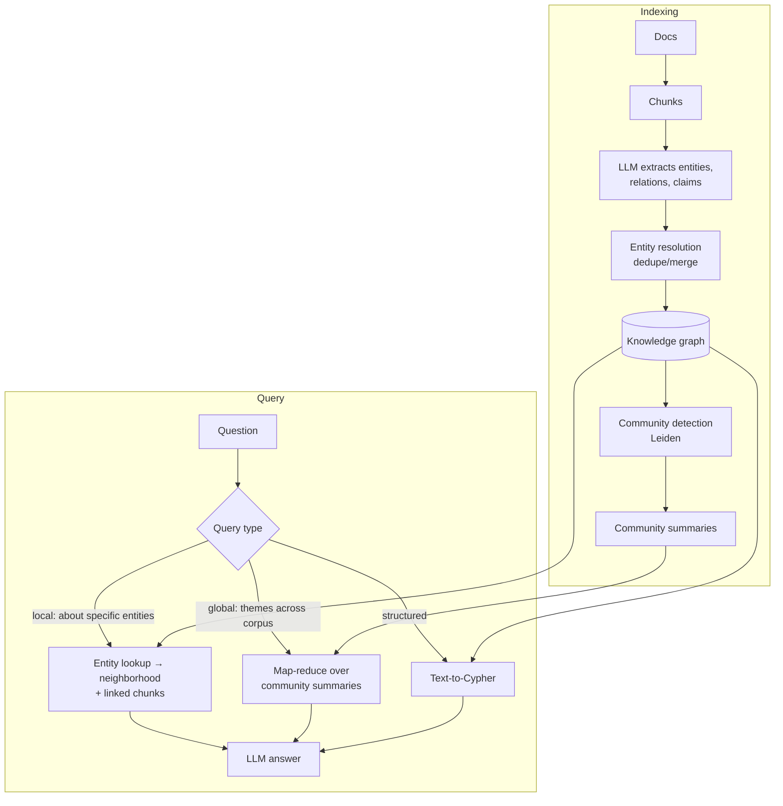

# GraphRAG and Knowledge Graphs



Vector search finds **similar passages**. It struggles with:
- **Multi-hop relationships**: "Which services depend on a library maintained by the team that had the March outage?"
- **Global questions**: "What are the main themes across all customer complaints this quarter?" (no single chunk contains the answer)
- **Aggregation over entities**: "Which suppliers are linked to more than three delayed shipments?"

A **knowledge graph** (KG) stores entities (nodes) and relations (edges) explicitly so these questions become graph traversals or summaries.

## 1. Knowledge Graph Basics
| Concept | Example |
|---|---|
| Node (entity) | `(:Service {name: "billing"})`, `(:Team {name: "Payments"})` |
| Edge (relation) | `(billing)-[:OWNED_BY]->(Payments)` |
| Properties | `since: 2024`, `source_chunk: "doc12:3"` |
| Triple | (subject, predicate, object) |
| Schema / ontology | Allowed node and edge types |

Models: **property graphs** (Neo4j, Memgraph, Neptune, Kùzu, FalkorDB; query with Cypher/Gremlin) vs **RDF** (triplestores; SPARQL). Most LLM apps use property graphs.

## 2. Building the Graph with LLMs
```python
EXTRACT = """Extract entities and relationships from the text.
Entity types: Person, Team, Service, Library, Incident, Customer.
Relation types: OWNS, DEPENDS_ON, MEMBER_OF, CAUSED, AFFECTED.
Return JSON {"entities":[{"name","type","description"}],
             "relations":[{"source","target","type","description"}]}.
Only extract what the text states.
Text: {chunk}"""
```
Steps:
1. **Extract** per chunk (schema-guided: constrained types improve consistency; schema-free finds more but is noisier).
2. **Entity resolution**: merge "Payments team", "payments-team", "Team Payments" (normalize, embed names + descriptions, cluster, LLM-confirm).
3. **Link provenance**: every node/edge keeps its source chunk ids → citations.
4. **Load** into the graph DB; also embed entity descriptions for entry-point search.
5. (Microsoft GraphRAG) **Community detection** (Leiden) on the graph → hierarchical clusters → LLM-written **community summaries**.

Cost: extraction is ~1 LLM call per chunk (plus gleaning passes), summaries per community. Roughly 10–50× the cost of embedding-only indexing. Use a cheaper model, cache, and update incrementally.

Existing structured sources (CRMs, service catalogs, org charts, CMDBs) often give you a better graph than LLM extraction. **Prefer them where they exist.**

## 3. Query Patterns
### Local search (entity-centric)
1. Find entry entities (embedding search over entity names/descriptions, or NER on the query).
2. Expand the neighborhood (1–2 hops, filtered by relation types).
3. Gather linked chunks + relation descriptions → context → answer.

### Global search (corpus-wide)
Map-reduce: ask each relevant community summary for partial answers → rank → reduce into a final answer. Good for "main themes" questions; expensive (many LLM calls).

### Text-to-Cypher
```python
CYPHER = """Schema:
(:Service {name})-[:OWNED_BY]->(:Team {name})
(:Service)-[:DEPENDS_ON]->(:Library {name})
(:Incident {id, date})-[:AFFECTED]->(:Service)
Write a read-only Cypher query for: {question}. Return only the query."""
```
```cypher
MATCH (i:Incident)-[:AFFECTED]->(s:Service)-[:OWNED_BY]->(t:Team)
WHERE i.date >= date('2026-03-01') AND i.date < date('2026-04-01')
MATCH (dep:Service)-[:DEPENDS_ON]->(:Library)<-[:MAINTAINS]-(t)
RETURN DISTINCT dep.name
```
Guardrails: read-only DB user, query validation/allowlist of clauses, `LIMIT`, timeouts, retry on syntax error with the error message.

### Hybrid (vector + graph)
Vector search finds the entry chunks → map them to entities → expand via the graph → combine. Usually the most practical design.

## 4. Variants
| Approach | Idea | Notes |
|---|---|---|
| Microsoft **GraphRAG** | Extraction + Leiden communities + summaries; local/global/DRIFT search | Strong on global questions; costly indexing |
| **LightRAG** | Graph + vector, dual-level (low/high) retrieval, incremental updates | Cheaper than GraphRAG |
| LazyGraphRAG | Defers LLM summarization to query time | Much lower indexing cost |
| HippoRAG | Personalized PageRank over the KG from query entities | Multi-hop recall |
| Neo4j GraphRAG / LlamaIndex PropertyGraphIndex | Library integrations | Fast start |
| RAPTOR (tree, not a graph) | Recursive cluster-and-summarize tree of chunks | Hierarchical summaries without a KG |

## 5. When GraphRAG Is Worth It
| Use GraphRAG | Stick with vector/hybrid RAG |
|---|---|
| Questions about **relationships** across many docs | Lookup questions answered by one passage |
| Global sensemaking / themes | Small corpus, fits in a long context |
| Entities matter (people, systems, contracts, drugs) | Unstructured prose with few recurring entities |
| You already have structured relational data | Fast-changing content where re-extraction is expensive |
| Explainability via paths | Tight latency/cost budgets |

Start with hybrid RAG + metadata; add a graph for the **specific question types** that fail, measured on the eval set.

## 6. Pitfalls
- Extraction noise: hallucinated relations, inconsistent types → schema constraints + provenance + spot checks.
- Entity resolution is the hardest part; bad merges corrupt answers.
- Graph staleness: incremental extraction on changed chunks; tombstone removed facts.
- Text-to-Cypher errors on complex schemas → few-shot examples, smaller schema views, query templates for common intents.
- Evaluation: global questions have no single gold answer; use pairwise judging (comprehensiveness, diversity, empowerment) as the GraphRAG paper did.

## Takeaways
- GraphRAG extracts entities and relations with LLMs to answer multi-hop and global questions.
- Local search is entity-centric; global search uses community summaries for corpus-wide questions.
- Graph construction is expensive and noisy; entity resolution is the hard part.
- Use it only when vector RAG demonstrably fails on relationship or aggregate questions.

## References
- Edge et al., *From Local to Global: A GraphRAG Approach to Query-Focused Summarization* (Microsoft, 2024)
- Guo et al., *LightRAG* (2024) · Gutiérrez et al., *HippoRAG* (2024) · Sarthi et al., *RAPTOR* (2024)

## Related
- [Advanced retrieval techniques](03-advanced-retrieval-techniques.md) · [Agentic RAG](09-agentic-rag.md)
- [Data architecture for AI](../11-ai-system-architecture/03-data-architecture-for-ai.md)
