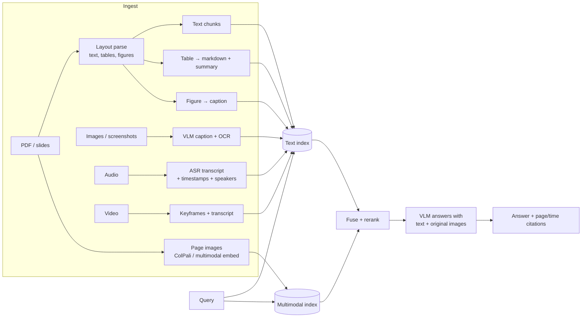

# Multimodal RAG



Real knowledge bases aren't plain text: evidence lives in **tables, charts, diagrams, screenshots, scanned PDFs, audio and video**. Multimodal RAG **extracts, describes, embeds, retrieves and cites** these, then passes the relevant evidence (often the original image) to a model. Cost decides how far to go.

## 1. The Multimodal Content Problem
| Content | What text-only parsing loses |
|---|---|
| Tables | Row/column relations; numbers become a jumble |
| Charts | The data itself (trends, values) |
| Diagrams / architecture images | Components and arrows |
| Screenshots | UI text and state |
| Scanned PDFs | Everything (no text layer) |
| Slides | Layout meaning; speaker notes |
| Audio / video | Everything without transcription; visual-only info |

## 2. Three Architectures
| Approach | How | Pros | Cons |
|---|---|---|---|
| **A. Convert everything to text** | OCR, table → markdown, VLM captions, ASR | Reuses text RAG stack, cheap queries | Captions lose detail; captioning cost at ingest |
| **B. Multimodal embeddings** | Embed images/pages and text in one space (CLIP/SigLIP, Cohere Embed v4, Voyage multimodal, Jina CLIP) | Direct image retrieval | Weaker on dense text; separate index |
| **C. Page-as-image retrieval** | **ColPali / ColQwen**: embed page screenshots with late interaction; skip OCR | Best on visually rich docs; no parsing pipeline | Multi-vector storage (~1K vectors/page); needs a VLM for the answer |

Common production combination: **A for indexing + retrieval, then send the original page/image region to a VLM for answering** (retrieve via text, reason over pixels).

## 3. Documents (PDFs, Slides)
- Layout-aware parsers: Docling, Unstructured (hi_res), Marker, LlamaParse, Azure Document Intelligence, AWS Textract, Google Document AI, Reducto, or VLM-based parsing (Gemini/Claude/GPT reading page images).
- Keep **page numbers and bounding boxes** per element for citations and cropping.
- Reading order for multi-column layouts; strip headers/footers.

## 4. Tables
| Strategy | When |
|---|---|
| Table → markdown/HTML as its own chunk (never split mid-table) | Small/medium tables |
| Table summary embedded + raw table returned | Large tables (embed the summary, give the model the table) |
| Row-level chunks with header repetition | Lookup tables ("price of SKU X") |
| Load into SQL/DataFrame + text-to-SQL | Aggregations, numeric questions |

```python
def table_chunks(table, title, max_rows=20):
    header = "| " + " | ".join(table.columns) + " |"
    for i in range(0, len(table), max_rows):
        rows = table.iloc[i:i + max_rows].to_markdown(index=False)
        yield f"{title} (rows {i+1}-{i+len(table.iloc[i:i+max_rows])})\n{rows}"
```

## 5. Images, Charts, Diagrams
```python
CAPTION = """Describe this figure for search indexing.
Include: figure type, title, axis labels, units, key values and trends, all visible text,
and what question this figure answers. Be factual; don't infer beyond what is shown."""
```
- Store `{caption, ocr_text, image_uri, page, bbox, doc_id}`; index caption + OCR text.
- At answer time, pass the **image itself** to the VLM (captions miss details).
- Skip decorative images (logos, icons) with a size/classifier filter to save cost.

## 6. Audio and Video
- **ASR**: Whisper / faster-whisper, Deepgram, AssemblyAI, Gemini; add **diarization** (who spoke) and word-level timestamps.
- Chunk transcripts by time window (30–90 s) or topic, with overlap; keep `start_ts`, `end_ts`, `speaker`.
- Video: transcript + keyframes (scene-change detection, or 1 frame every N s) → captions; or native video models (Gemini) for short clips.
- Cite as deep links: `video_url?t=754`.

## 7. Query Time
- Route by intent: "what does the architecture diagram show" → image index; numeric → table/SQL.
- Fuse text and image results (RRF), then rerank (text rerankers on captions; multimodal rerankers exist).
- Context: text chunks + up to N images (each image costs ~hundreds to 1.5K+ tokens, depending on resolution and provider).
- Crop to the bounding box instead of full pages to save tokens and reduce distraction.

## 8. Cost Trade-offs
| Choice | Ingest cost | Query cost | Quality |
|---|---|---|---|
| Text-only parsing | Lowest | Lowest | Misses visuals |
| + table structure | Low | Low | Big win for numeric docs |
| + VLM captions for figures | Medium (1 VLM call/figure) | Low | Good |
| + page-image retrieval (ColPali) | Medium (GPU embedding) | Medium (multi-vector storage) | Best on visual docs |
| + VLM answering over images | – | High (image tokens) | Best answers |

Decide by measuring: how many eval questions need visual evidence? If it's 5%, caption those docs only.

## 9. Evaluation
- Tag eval items by modality (`table`, `chart`, `scan`, `audio`).
- Retrieval: did the right page/figure/time-range appear?
- Answer: numeric exactness for table/chart questions; citation to page/timestamp.
- Benchmarks: ViDoRe (visual document retrieval), DocVQA, ChartQA, MMLongBench-Doc.

## Takeaways
- Three architectures: convert everything to text, multimodal embeddings, or page-image retrieval (ColPali-style).
- Tables need structure-preserving parsing; charts and diagrams need captions or VLM descriptions.
- Audio and video are retrieved through transcripts and keyframes with timestamps.
- VLM-at-ingest raises cost; evaluate per modality.

## References
- Faysse et al., *ColPali* (2024) · Radford et al., *CLIP* (2021) · Zhai et al., *SigLIP* (2023)
- Radford et al., *Whisper* (2022) · IBM Docling

## Related
- [Vision models](../15-multimodal/01-vision-models-and-image-understanding.md) · [Audio and speech](../15-multimodal/03-audio-and-speech.md)
- [Production RAG pipeline](02-building-a-production-rag-pipeline.md) · [Choosing embedding models](../06-embeddings-vector-search/02-choosing-embedding-models.md)
