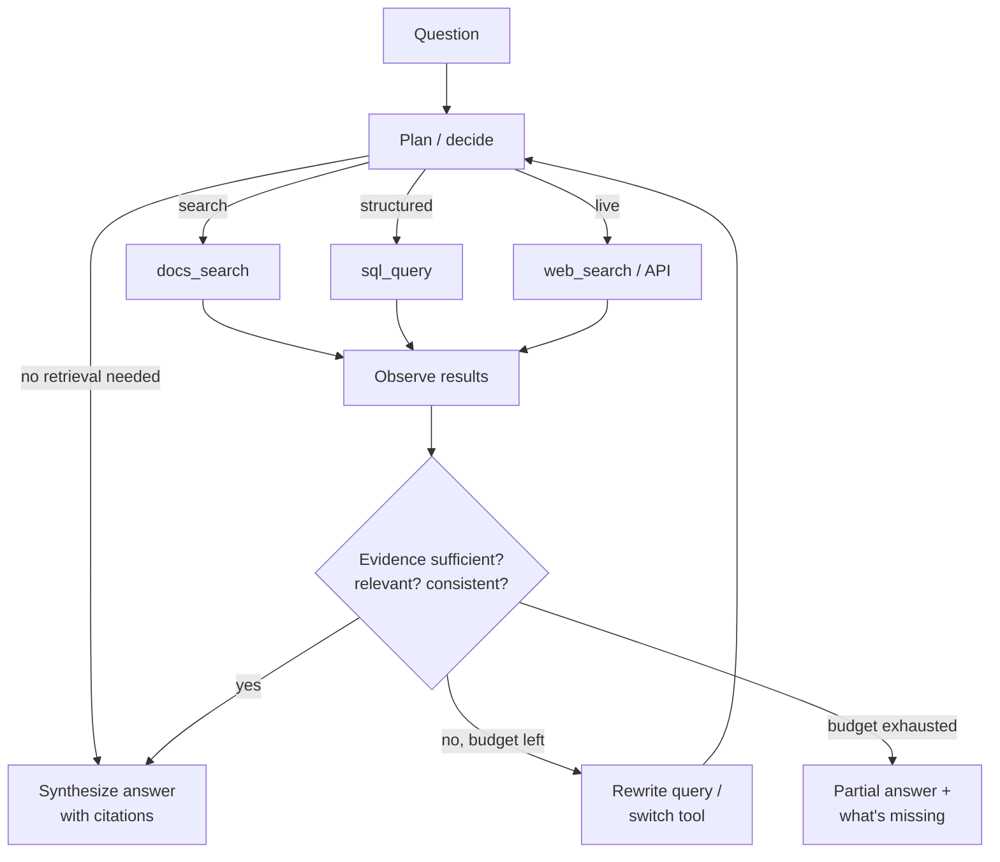

# Agentic RAG



Standard RAG is a fixed pipeline: retrieve once → generate. It works for direct factual questions. It struggles when a question needs **planning, multiple searches, tool selection, or checking whether the evidence is sufficient**.

**Agentic RAG** wraps retrieval in a **bounded decision loop**: the model plans, calls tools, evaluates intermediate results, retries with a different strategy, and stops once it has enough evidence. The retrieval path becomes **conditional**, not fixed.

## 1. Where Fixed Pipelines Struggle
| Question | Why fixed RAG fails |
|---|---|
| "Compare our SLA with Vendor X's" | Needs two separate retrievals |
| "Which customers on v2 hit the bug fixed in 3.4?" | Docs + database |
| "What changed in the pricing since last year?" | Two time-filtered searches + diff |
| "Hi, what can you do?" | Retrieval is wasted |
| Vague first query returns junk | No chance to reformulate |
| Answer requires a chain of facts | One retrieval can't know the next hop |

## 2. Levels of Agency
| Level | Pattern | Control | Cost |
|---|---|---|---|
| 0 | Fixed RAG | Code | 1 LLM call |
| 1 | **Router RAG**: classify → pick a source/pipeline | Code + 1 decision | +1 small call |
| 2 | **Corrective / adaptive**: grade retrieval, retry or fall back | Code-defined loop | +1–3 calls |
| 3 | **Multi-step / iterative**: decompose, retrieve per sub-question | Model plans steps in a fixed graph | +N calls |
| 4 | **Tool-using agent (ReAct)**: model chooses tools freely until done | Model | Unbounded → needs budgets |

Pick the **lowest level** that solves the failing question types.

## 3. Router RAG
```python
ROUTES = {"docs": docs_rag, "sql": sql_answer, "web": web_answer, "none": direct_answer}
route = llm_json(f"""Pick the best source for the question.
docs: product documentation and policies
sql: counts, metrics, account data
web: current external events
none: greetings or questions about the assistant
Question: {q}""", schema={"route": list(ROUTES)})["route"]
answer = ROUTES[route](q)
```
Cheap, predictable, easy to evaluate (routing accuracy on a labeled set).

## 4. Adaptive and Corrective Retrieval
- **Adaptive-RAG**: classify query complexity → no retrieval / single-step / multi-step.
- **CRAG (Corrective RAG)**: a retrieval evaluator grades the docs → *correct* (use), *ambiguous* (refine + supplement), *incorrect* (rewrite query / web search).
- **Self-RAG**: a model trained to emit reflection tokens (retrieve? relevant? supported? useful?). The idea is reusable with prompts: grade relevance and support at each step.

```python
def corrective_rag(q, max_tries=2):
    query = q
    for _ in range(max_tries + 1):
        docs = hybrid_search(query, k=20)
        graded = [d for d in docs if grade_relevance(q, d) == "relevant"]
        if len(graded) >= 2:
            return generate(q, graded)
        query = rewrite(q, failed_query=query, seen=docs)
    return generate(q, web_search(q)) if allow_web else abstain(q)
```

## 5. Multi-Step Retrieval (Decomposition)
```python
plan = llm_json(f"Break into independent sub-questions: {q}", schema={"subqs": [str]})
evidence = {sq: hybrid_search(sq, k=8) for sq in plan["subqs"]}   # parallelizable
answer = generate(q, evidence)
```
For dependent hops (the answer to step 1 feeds step 2), use an iterative loop. See [advanced retrieval §7](03-advanced-retrieval-techniques.md).

## 6. Agent with Retrieval Tools
Expose retrieval as tools with **narrow, well-described** interfaces:
```python
tools = [
  {"name": "search_docs",
   "description": "Search product docs and policies. Use for how-to, features, limits, policies. Returns top passages with ids.",
   "input_schema": {"type": "object", "properties": {
       "query": {"type": "string", "description": "Standalone keyword-rich query"},
       "product": {"type": "string", "enum": ["sync", "vault", "analytics"]},
       "doc_type": {"type": "string", "enum": ["guide", "api", "policy", "release_notes"]}},
     "required": ["query"]}},
  {"name": "query_accounts",
   "description": "Read-only account metrics for the current tenant (counts, usage, plan). Not for documentation.",
   "input_schema": {"type": "object", "properties": {"question": {"type": "string"}}, "required": ["question"]}},
  {"name": "fetch_document",
   "description": "Get the full text of a document by id when a passage is not enough.",
   "input_schema": {"type": "object", "properties": {"doc_id": {"type": "string"}}, "required": ["doc_id"]}},
]
```
Tool design for retrieval:
- Return **ids + short passages + metadata**, not whole documents (the agent can call `fetch_document`).
- Return explicit empty results ("0 results for query X; try broader terms") instead of nothing.
- Apply tenant/ACL filters inside the tool, never from model arguments.

## 7. Budgets and Stopping
| Control | Example |
|---|---|
| Max steps / tool calls | 6 |
| Token budget for accumulated evidence | 20K (summarize or drop low-value results) |
| Wall-clock timeout | 20 s, then partial answer |
| Duplicate-query detection | Stop if the same query repeats |
| Sufficiency check | "Do you have enough evidence to answer every part?" |
| Cost cap per request | $0.05 |

Stream intermediate status ("Searching docs… Checking account data…") so latency feels purposeful.

## 8. When It's Worth the Cost
| Signal | Agentic helps |
|---|---|
| Many questions are multi-part or comparative | Yes |
| Multiple heterogeneous sources (docs + DB + APIs) | Yes (router first) |
| Retrieval recall is fine; generation is the problem | No |
| p95 latency budget < 2–3 s | Mostly no (router/adaptive only) |
| High QPS, cost-sensitive | Use adaptive routing so only hard queries take the agent path |

Typical: agentic paths cost **3–10× the tokens** and **2–5× the latency** of single-shot RAG. Measure the gain on the question types that motivated it.

## 9. Evaluating Agentic RAG
- End-to-end correctness + faithfulness (as in [evaluating RAG](05-evaluating-rag-systems.md)).
- **Trajectory metrics**: routing accuracy, tool-call validity, steps per question, redundant searches, budget hits.
- Compare against the fixed pipeline on the same set: quality delta vs cost and latency delta.

## Takeaways
- Agentic RAG lets the model decide whether, what, and how often to retrieve.
- Levels: router → corrective/adaptive → multi-step decomposition → full agent with retrieval tools.
- Set step and token budgets with clear stopping criteria.
- Worth the cost for complex research questions; overkill for simple lookups.

## References
- Asai et al., *Self-RAG* (2023) · Yan et al., *Corrective RAG* (2024) · Jeong et al., *Adaptive-RAG* (2024)
- Yao et al., *ReAct* (2022) · Trivedi et al., *IRCoT* (2022)

## Related
- [Advanced retrieval techniques](03-advanced-retrieval-techniques.md) · [What are AI agents](../10-agents/01-what-are-ai-agents.md)
- [Designing tool schemas](../08-tool-use/02-designing-tool-schemas.md) · [Deep research agents](../14-agentic-ai/03-deep-research-agents.md)
