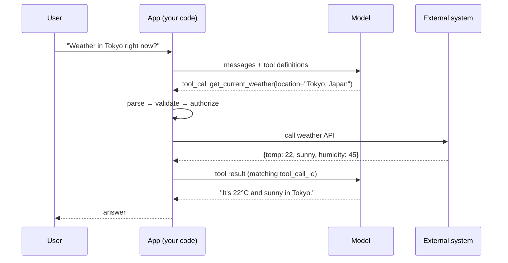

# From Text Generation to Action



LLMs generate text from the context they receive. Real applications also need **live data** and **actions in external systems**. Function calling makes the model emit a **structured request** (tool name + JSON arguments). Your code decides whether to allow it and how to run it.

> **The model proposes; your code validates, authorizes, executes, logs, retries, and handles errors.**

## 1. Why Text Alone Cannot Act
| Task | Plain model call? | Why |
|---|---|---|
| Explain how weather APIs work | Yes | Training data |
| Return the current weather in Tokyo | No | Needs a live API |
| Write SQL for inactive users | Yes | Text generation |
| Run that SQL | No | Needs DB access |
| Draft a Slack message | Yes | Text |
| Send it | No | Needs the Slack API |
| Describe how to create a calendar event | Yes | Text |
| Create it | No | Needs the Calendar API |

Rule of thumb: if the task depends on **live state, private data, or a real side effect**, text isn't enough. RAG (the previous module) is mostly read-only. Tools add actions.

| Tool type | Who executes | Examples |
|---|---|---|
| **Custom (client) tools** | Your application | DB lookups, internal APIs, refunds |
| **Hosted (server) tools** | Provider runtime, under its controls | Web search, file search, code execution, computer use, remote MCP connectors |

Even with hosted tools, there's a controlled execution layer between the model and the world.

## 2. The Four Phases
1. **Define tools**: send `name`, `description`, `parameters` (JSON Schema) with the request.
2. **Model decides**: answer directly, or emit one or more tool calls.
3. **Execute**: parse args → validate against *your* rules → run the mapped implementation.
4. **Return results**: send each result back linked to its call id; the model answers or asks for another tool.

The extra round trip is where latency, retries, permissions, and logging live.

### Provider wire formats
| API | Tool call appears as | Result goes back as |
|---|---|---|
| OpenAI Chat Completions | `message.tool_calls[i]` (`id`, `function.name`, `function.arguments` JSON string) | `{"role":"tool","tool_call_id":id,"content":...}` |
| OpenAI Responses | output item `type: "function_call"` (`call_id`) | input item `type: "function_call_output"`, `call_id` |
| Anthropic Messages | content block `type: "tool_use"` (`id`, `name`, `input` object); `stop_reason: "tool_use"` | user message with block `type: "tool_result"`, `tool_use_id` |
| Gemini | `functionCall` part | `functionResponse` part |

## 3. Defining Tools
```python
TOOLS = [
  {"type": "function", "function": {
    "name": "get_current_weather",
    "description": "Current conditions (temp, sky, humidity) for a city. Use for 'now/today/currently'. "
                   "Not for future days (use get_forecast) or past dates (use get_weather_history).",
    "parameters": {"type": "object", "properties": {
        "location": {"type": "string", "description": "City and country, e.g. 'Tokyo, Japan'"},
        "units": {"type": "string", "enum": ["celsius", "fahrenheit"]}},
      "required": ["location"], "additionalProperties": False}}},
  {"type": "function", "function": {
    "name": "get_forecast",
    "description": "Daily forecast for the next 1-10 days. Use for 'tomorrow', 'this weekend', 'next week'.",
    "parameters": {"type": "object", "properties": {
        "location": {"type": "string"}, "days": {"type": "integer", "minimum": 1, "maximum": 10}},
      "required": ["location", "days"], "additionalProperties": False}}},
]
```
- **name**: verb_noun (`get_current_weather`, `create_ticket`).
- **description**: what it does, what it returns, **when to use it, when not to**, how it differs from siblings.
- **parameters**: types, per-field descriptions, `enum`, `required`, bounds.

Wrong tool picked? **Fix the schema first**: add negative cases, explicit triggers, tighter enums, then test with real ambiguous queries. Details in [designing tool schemas](02-designing-tool-schemas.md).

## 4. The Execute-Respond Loop
```python
import json
from openai import OpenAI
client = OpenAI()

AVAILABLE_FUNCTIONS = {"get_current_weather": get_current_weather, "get_forecast": get_forecast}

def run(messages, max_steps=8):
    for _ in range(max_steps):
        resp = client.chat.completions.create(model="gpt-4.1-mini", messages=messages, tools=TOOLS)
        msg = resp.choices[0].message
        messages.append(msg)
        if not msg.tool_calls:
            return msg.content                       # done: plain answer
        for call in msg.tool_calls:                  # may be several (parallel)
            fn = AVAILABLE_FUNCTIONS.get(call.function.name)
            try:
                args = json.loads(call.function.arguments)
                result = fn(**args) if fn else {"error": f"unknown tool {call.function.name}"}
            except Exception as e:                   # bad JSON, validation, API failure
                result = {"error": type(e).__name__, "message": str(e)}
            messages.append({"role": "tool", "tool_call_id": call.id,
                             "content": json.dumps(result)})
    return "Stopped: step limit reached."
```
Anthropic equivalent:
```python
resp = client.messages.create(model="claude-sonnet-5-5", max_tokens=1024, tools=tools, messages=messages)
while resp.stop_reason == "tool_use":
    messages.append({"role": "assistant", "content": resp.content})
    results = [{"type": "tool_result", "tool_use_id": b.id,
                "content": json.dumps(dispatch(b.name, b.input))}
               for b in resp.content if b.type == "tool_use"]
    messages.append({"role": "user", "content": results})
    resp = client.messages.create(model="claude-sonnet-5-5", max_tokens=1024, tools=tools, messages=messages)
```
Invariants:
- Every tool call gets **exactly one result** with the matching id. A missing result causes an API error; a mismatched one confuses the model.
- **Return errors as data** (`{"error": ...}`), never crash the loop. The model can often recover (fix args, ask the user).
- Always cap steps; a model can loop.

## 5. How Models Choose Tools
Selection is semantic, not keyword matching: "Is it going to rain tomorrow in Berlin?" → `get_forecast`.

| `tool_choice` | Behavior | Use when |
|---|---|---|
| `"auto"` (default) | Model decides | Normal chat |
| `"none"` | Text only | Answer from context already gathered; final summarization step |
| `"required"` / Anthropic `{"type":"any"}` | Must call some tool | Step must be grounded in a tool result |
| Specific function / `{"type":"tool","name":...}` | Must call that one | You already know the action and only need argument extraction (structured output trick) |

Other knobs: `parallel_tool_calls=False` (OpenAI) / `disable_parallel_tool_use` (Anthropic) when calls must be sequential; `strict: true` for schema-guaranteed arguments.

| Failure mode | Example | Fix |
|---|---|---|
| Ambiguous request | "Tell me about Tokyo weather" | Ask a clarifying question; describe defaults |
| Overlapping tools | Two "search" tools with similar descriptions | Distinct descriptions, merge, or route |
| No suitable tool | Model forces the closest wrong tool | Say "if no tool fits, answer directly" |
| Hallucinated args | Invented IDs, dates | Enums, formats, validation + error message |
| Unnecessary calls | Tool called for general knowledge | "Use only for live data" in description |

## 6. Multi-turn Behavior
| Turn | Expected |
|---|---|
| "What's the weather in Tokyo?" | `get_current_weather(Tokyo)` |
| "What about next week?" | `get_forecast(Tokyo, 7)`: location resolved from history |
| "How does that compare to London right now?" | `get_current_weather(London)` |
| "What's the capital of France?" | No tool call |

Knowing when **not** to call a tool is part of tool use.

## 7. What the Course Doesn't Cover (additions)
- **Token cost of tools**: definitions are injected into the prompt every call (often hundreds of tokens per tool). 50 tools ≈ 5–15K tokens. Cache them (prompt caching) or load tools dynamically ("tool search").
- **Latency**: each tool round trip is a full model call. Parallelize independent calls; stream "Checking weather…" status.
- **Security**: tool results are **untrusted input** (indirect prompt injection). Never let a result change permissions. See [prompt injection](../05-prompt-engineering/06-defending-against-prompt-injection.md).
- **Authorization lives in code**: user identity and tenant come from the session, never from model arguments.
- **Idempotency**: write tools take an idempotency key so retries don't double-charge.

## Takeaways
- Models propose actions; application code executes and governs them.
- Schema quality drives selection quality.
- Loop until there are no tool calls, with a step cap.
- Link every result to its call id; return errors as data.
- `tool_choice` controls whether tools are optional, required, or forced.

## References
- OpenAI function calling guide · OpenAI Responses API · Anthropic tool use docs · JSON Schema reference
- Schick et al., *Toolformer* (2023) · Yao et al., *ReAct* (2022)

## Related
- [Designing tool schemas](02-designing-tool-schemas.md) · [Multi-tool orchestration](03-multi-tool-orchestration.md)
- [Structured output](../03-first-ai-application/03-structured-output-from-llms.md) · [What is MCP](../09-mcp/01-what-is-mcp.md)
