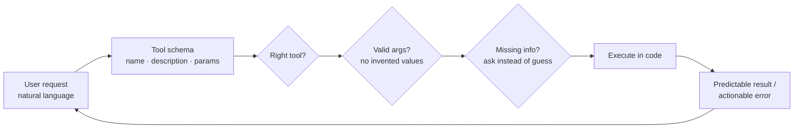

# Designing Tool Schemas



A tool schema is the **interface between natural language and your systems**. A good schema helps the model pick the right tool, produce valid arguments, avoid unsupported values, and **ask a clarifying question when information is missing**. Weak schemas (generic names, broad tools, missing enums, vague descriptions) lead to wrong calls, invented parameters, or actions that should have been blocked.

Design tool schemas like **production APIs**: small bounded capabilities, clear descriptions, explicit constraints, predictable errors, and tests for confusing requests.

## 1. Anatomy of a Tool Schema
```json
{
  "name": "search_orders",
  "description": "Find a customer's orders by status and date range. Returns up to 20 orders (id, date, status, total). Use when the user asks about their orders without an order id. If they give an order id, use get_order instead. Read-only.",
  "input_schema": {
    "type": "object",
    "properties": {
      "status":   {"type": "string", "enum": ["pending", "shipped", "delivered", "cancelled", "returned"],
                   "description": "Filter by status. Omit to include all."},
      "placed_after": {"type": "string", "format": "date", "description": "ISO date YYYY-MM-DD, inclusive."},
      "limit":    {"type": "integer", "minimum": 1, "maximum": 20, "default": 10}
    },
    "required": [],
    "additionalProperties": false
  }
}
```
| Part | Job | Common mistake |
|---|---|---|
| `name` | Identify the capability (verb_noun, snake_case, ≤64 chars) | `process`, `handle_data`, `tool1` |
| `description` | When to use, when not to, what it returns, side effects | One vague sentence |
| `properties` | Typed, described, constrained inputs | Free-form `query: string` for everything |
| `required` | What must be present | Marking everything required → invented values |
| `additionalProperties: false` | Reject unknown fields | Model invents fields |

Note: the customer id is **not** a parameter; it comes from the authenticated session.

## 2. Writing Descriptions
Descriptions are prompts. The model reads them on every call. Include:
1. **What** it does and **returns** (shape, max size).
2. **When to use** (trigger phrases, intents).
3. **When not to** + which sibling tool to use instead.
4. **Side effects** ("Sends an email to the customer. Irreversible.").
5. **Preconditions** ("Call `get_order` first to obtain `order_id`.").

Rough length: 3–6 sentences for important tools. Anthropic's guidance: detailed descriptions are the single biggest lever on tool-use quality.

## 3. Parameter Design
| Technique | Example | Prevents |
|---|---|---|
| `enum` for closed sets | `priority: low/medium/high/urgent` | Invented values ("critical-ish") |
| Formats + examples | `"YYYY-MM-DD"`, `"E.164 phone, e.g. +14155550100"` | Unparseable values |
| Bounds | `minimum`, `maximum`, `maxLength`, `maxItems` | Huge limits, runaway queries |
| Optional with documented defaults | `"Omit for all statuses"` | Guessing |
| IDs from earlier calls | `"order_id from search_orders results"` | Fabricated ids |
| Flat over deep nesting | `start_date`, `end_date` vs `{range: {start: {...}}}` | Malformed structure |
| Semantic names | `refund_amount_cents` vs `amt` | Unit confusion |
| Avoid model-supplied identity | No `user_id`, `tenant_id`, `is_admin` | Privilege escalation |

**Strict mode** (`strict: true`, OpenAI; Anthropic strict tool use; constrained decoding in vLLM/SGLang) guarantees schema-valid JSON. It requires `additionalProperties: false` and all fields listed in `required` (use `["string","null"]` for optional ones). Strict mode guarantees **shape**, not **truth**: still validate values (existence, ownership, business rules).

## 4. Granularity: How Big Should a Tool Be?
| Too broad | Right-sized | Too narrow |
|---|---|---|
| `manage_customer(action, ...)`, `run_sql(query)` | `search_orders`, `get_order`, `request_refund` | `get_order_status`, `get_order_total`, `get_order_date`… |
| Hard to secure; model must know your internals | One task per tool; matches user intents | Tool explosion; many round trips |

Guidelines:
- Design around **user tasks**, not your REST endpoints one-to-one. Combine "look up then fetch" into one tool if the model always needs both.
- Separate **read** and **write** tools so policy can differ.
- Keep the active tool set small (~5–20). More tools → lower selection accuracy and more prompt tokens. Use routing or dynamic tool loading for large catalogs.
- Namespace related tools: `orders_search`, `orders_get`, `billing_get_invoice`.

## 5. Designing Tool Outputs
- Return **only what the model needs**: drop internal fields, ids it won't use, and HTML.
- Prefer human-readable values with stable ids: `{"id": "ord_123", "status": "shipped", "carrier": "UPS"}`.
- Truncate and paginate: `{"results": [...20], "total": 340, "next_cursor": "..."}`.
- Consistent envelope across tools:
```json
{"ok": true, "data": {...}}
{"ok": false, "error": {"code": "ORDER_NOT_FOUND", "message": "No order ord_999 for this customer.", "hint": "Call search_orders to list valid ids.", "retryable": false}}
```
**Errors are instructions for the model.** "Invalid input" teaches nothing; "`placed_after` must be YYYY-MM-DD; got '3/4'" lets it self-correct in one step.

## 6. Validation in Code
```python
from pydantic import BaseModel, Field, ValidationError
from datetime import date

class SearchOrders(BaseModel, extra="forbid"):
    status: Literal["pending", "shipped", "delivered", "cancelled", "returned"] | None = None
    placed_after: date | None = None
    limit: int = Field(10, ge=1, le=20)

def search_orders_tool(raw: dict, session):
    try:
        args = SearchOrders.model_validate(raw)
    except ValidationError as e:
        return {"ok": False, "error": {"code": "INVALID_ARGS", "message": e.errors()[0]["msg"],
                                       "field": e.errors()[0]["loc"], "retryable": True}}
    rows = orders_repo.search(customer_id=session.customer_id, **args.model_dump(exclude_none=True))
    return {"ok": True, "data": [r.public() for r in rows]}

TOOL_SCHEMA = {"name": "search_orders", "description": DESC,
               "input_schema": SearchOrders.model_json_schema()}   # one source of truth
```
Generate schemas from Pydantic models (or Zod in TS) so the schema and validator never drift.

## 7. Handling Missing Information
| Situation | Desired behavior | Schema lever |
|---|---|---|
| Required info absent ("refund my order") | Ask which order, or list orders first | Don't make the model guess: description says "If order_id is unknown, call search_orders or ask the user" |
| Ambiguous value ("next Friday") | Resolve with known context (inject today's date) | Put the current date in the system prompt |
| Unsupported request | Say it's unsupported | "If no tool fits, answer without calling a tool" |

## 8. Testing Tool Schemas
Build a tool-selection eval set of 50–200 real or realistic requests:
```python
CASES = [
  {"q": "where's my last order?", "tool": "search_orders", "args": {"limit": 1}},
  {"q": "status of ord_123", "tool": "get_order", "args": {"order_id": "ord_123"}},
  {"q": "refund it", "tool": None, "expect": "clarify"},            # no order in context
  {"q": "what's your return policy?", "tool": "search_docs"},
  {"q": "delete my account", "tool": None, "expect": "refuse_or_handoff"},
]
```
Metrics: **tool selection accuracy**, **argument accuracy** (exact or judge), **invalid-call rate**, **clarification precision** (asked only when needed), **unnecessary-call rate**. Run on every schema or description change, and across model versions; selection behavior shifts between models.

## 9. Schema Anti-Patterns
- `execute(command: string)`, `run_sql(query)` exposed to users: a whole system behind one string.
- Booleans that flip behavior (`dry_run`, `force`) without explaining consequences.
- Descriptions copied from internal API docs ("Wrapper for /v2/ord").
- Returning 50KB JSON blobs.
- Two tools whose descriptions could both match the same request.
- Identity or permission fields as parameters.

## Takeaways
- Tool names and descriptions are prompts: say when to use the tool, when not to, and what it returns.
- Use typed, constrained parameters (enums, formats) and validate again in code.
- Size tools to user intents, not to raw API endpoints; return concise, model-readable outputs and errors.
- Test tool selection and arguments with scenario evals.

## References
- Anthropic, *Writing tools for agents* (2025) and tool use docs · OpenAI function calling (strict mode)
- Patil et al., *Gorilla* (2023) · Berkeley Function-Calling Leaderboard (BFCL) · τ-bench (Sierra, 2024)

## Related
- [From text to action](01-from-text-generation-to-action.md) · [Multi-tool orchestration](03-multi-tool-orchestration.md)
- [Type hints and Pydantic](../02-python-for-ai/04-type-hints-and-pydantic.md) · [Production MCP server patterns](../09-mcp/04-production-mcp-server-patterns.md)
