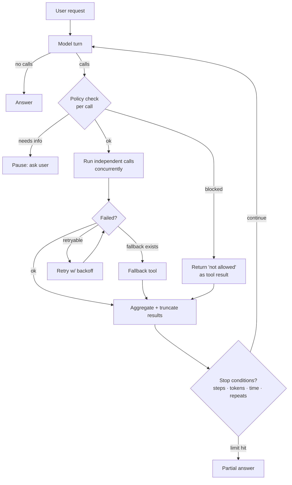

# Multi-Tool Orchestration



Real tasks need several tools. A support assistant looks up an order, checks shipping, reads the refund policy, and drafts a reply. A travel assistant searches flights and hotels, checks weather, and converts currency. Getting **one** call right is easy; **coordinating many while keeping control** is the job.

Multi-tool orchestration is the application code that handles: independent calls (concurrent), dependent calls (sequential), pausing for clarification, and blocking calls that policy forbids.

## 1. Parallel Tool Calls
Modern models emit several tool calls in one turn when they're independent ("weather in Tokyo and London" → 2 calls).
```python
import asyncio, json

async def run_call(call, session):
    fn = ASYNC_TOOLS[call.name]
    try:
        return call.id, await asyncio.wait_for(fn(session=session, **call.args), timeout=10)
    except asyncio.TimeoutError:
        return call.id, {"ok": False, "error": {"code": "TIMEOUT", "retryable": True}}
    except Exception as e:
        return call.id, {"ok": False, "error": {"code": type(e).__name__, "message": str(e)}}

async def execute_turn(calls, session, max_concurrency=5):
    sem = asyncio.Semaphore(max_concurrency)
    async def guarded(c):
        async with sem:
            return await run_call(c, session)
    results = await asyncio.gather(*(guarded(c) for c in calls))
    return [{"type": "tool_result", "tool_use_id": cid, "content": json.dumps(r)} for cid, r in results]
```
- Latency = max(call latencies) instead of the sum.
- Return results **in one message**, one per call id (order doesn't need to match, ids do).
- Don't parallelize **writes with ordering constraints**: disable parallel calls (`parallel_tool_calls=False` / `disable_parallel_tool_use`) or serialize write tools in your executor.
- Bound concurrency per downstream API (rate limits).

## 2. Sequential Chains (Dependent Calls)
"Refund my last order" → `search_orders(limit=1)` → `get_order(id)` → `check_refund_eligibility(id)` → `request_refund(id)`.

| Approach | How | Trade-off |
|---|---|---|
| **Model-driven** | Loop; the model sees each result and picks the next call | Flexible; more round trips; may skip steps |
| **Code-driven chain** | Fixed sequence in code; model only extracts inputs / writes the reply | Predictable, cheap; rigid |
| **Composite tool** | One tool does lookup+fetch internally | Fewer hops; less flexible |

Rule: if a sequence **always** happens, move it into code or a composite tool. Let the model drive only where the path genuinely varies. Enforce **preconditions** in code (e.g. `request_refund` rejects unless eligibility was checked in this session).

## 3. Fallbacks
| Failure | Strategy |
|---|---|
| Transient (timeout, 429, 5xx) | Retry with exponential backoff + jitter, 2–3 attempts, inside the executor (the model never sees it) |
| Primary source down | Fallback tool (cache → secondary API → "data unavailable") |
| Bad arguments | Return a structured error with a hint; let the model fix it (cap repairs at 2) |
| Empty result | Return explicit "0 results; try broader terms" |
| Permanent failure | Tell the model it's unavailable so it can say so honestly |

```python
async def get_rates(base, quote):
    for source in (primary_fx, secondary_fx):
        try:
            return {"ok": True, "data": await with_retry(source, base, quote), "source": source.__name__}
        except UpstreamError:
            continue
    cached = cache.get(f"fx:{base}:{quote}")
    if cached:
        return {"ok": True, "data": cached.value, "stale_as_of": cached.ts.isoformat()}
    return {"ok": False, "error": {"code": "FX_UNAVAILABLE", "retryable": False}}
```

## 4. Result Aggregation
Tool outputs accumulate in context and become the main cost driver.
- **Trim at the source**: tools return only needed fields; paginate.
- **Summarize** large results before they enter context (a small model, or deterministic extraction).
- **Store, reference**: keep big payloads in an artifact store; give the model an id + summary, plus a `fetch` tool if needed.
- **Deduplicate** repeated calls with a per-request cache keyed on `(tool, normalized_args)`.
- **Normalize** units and formats across sources before the model compares them (currency, time zones).

## 5. Pausing: Clarification and Approval
Some calls shouldn't run yet:
- **Missing info**: the model asks the user; state is saved; the next user turn resumes.
- **Needs approval**: the executor returns `{"status": "pending_approval"}` and the UI shows a confirm dialog. See [structured workflows](04-structured-workflows-with-tool-use.md) and [human-in-the-loop](../10-agents/07-human-in-the-loop-patterns.md).
- **Blocked by policy**: return `{"ok": false, "error": {"code": "NOT_PERMITTED", "message": "Refunds over $500 require an agent."}}`. The model explains instead of retrying.

## 6. Stopping Conditions
| Condition | Example threshold |
|---|---|
| Max model turns | 8–15 |
| Max tool calls total / per tool | 20 / 5 |
| Token budget for accumulated context | 50K |
| Wall clock | 30–60 s interactive |
| Cost cap | $0.10/request |
| Repetition | Same `(tool, args)` 2× → stop or inject a "you already tried this" note |
| No progress | N turns without new information |

On a limit: produce the best partial answer with what's known plus what's missing. Never fail silently.

## 7. Orchestrator Skeleton
```python
async def orchestrate(messages, session, limits=Limits()):
    state = RunState()
    while True:
        resp = await llm(messages, tools=session.allowed_tools())
        if not resp.tool_calls:
            return resp.text
        if state.exceeded(limits) or state.repeating(resp.tool_calls):
            messages.append(note("Stop calling tools; answer with what you have."))
            return (await llm(messages, tool_choice="none")).text
        decisions = [policy.check(c, session) for c in resp.tool_calls]   # allow / block / approve
        runnable = [c for c, d in zip(resp.tool_calls, decisions) if d.allow]
        results = await execute_turn(runnable, session)
        results += [blocked_result(c, d) for c, d in zip(resp.tool_calls, decisions) if not d.allow]
        messages += [assistant(resp), tool_results(results)]
        state.record(resp.tool_calls, results)
        trace.log(step=state.step, calls=resp.tool_calls, results=results, usage=resp.usage)
```

## 8. Observability
Trace every step: model input/output tokens, tool name, args (redacted), latency, result size, error code. Key metrics: calls per request, parallelism ratio, tool error rate by tool, retries, limit hits, cost per request. See [monitoring](../12-production-deployment/03-monitoring-and-observability.md).

## Takeaways
- Run independent tool calls in parallel and chain dependent calls in sequence.
- Plan fallbacks for failing tools, and aggregate results before answering.
- Pause for clarification or approval when information or authority is missing.
- Enforce stopping conditions (max steps, budget, done signal) and trace every call.

## References
- OpenAI parallel function calling · Anthropic parallel tool use and token-efficient tool use
- Kim et al., *LLMCompiler: An LLM Compiler for Parallel Function Calling* (2023) · Xu et al., *ReWOO* (2023)

## Related
- [Designing tool schemas](02-designing-tool-schemas.md) · [Structured workflows](04-structured-workflows-with-tool-use.md)
- [Async Python](../02-python-for-ai/06-async-python.md) · [Agent reliability](../10-agents/05-agent-reliability-and-debugging.md)
