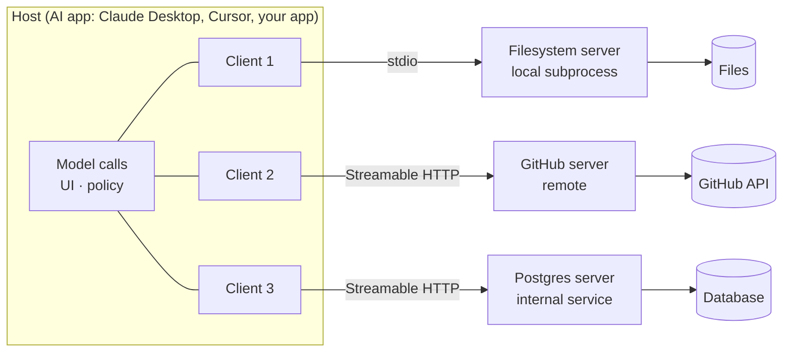
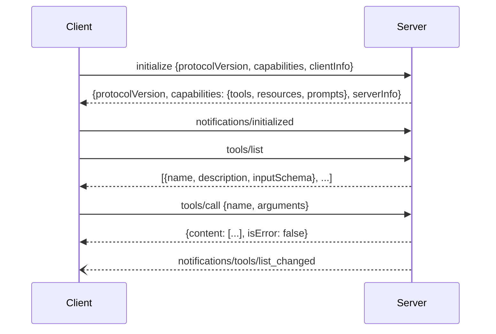

# What is MCP



The **Model Context Protocol (MCP)** standardizes how AI applications connect to external systems: tools, data, and prompt templates. The **model never speaks MCP; the application does.** The app discovers capabilities from MCP servers, presents them to the model (usually as function-calling tools), and routes calls back.

MCP is an **integration protocol**. It is not a reasoning framework, not an agent runtime, and not a replacement for function calling.

## 1. The N×M Integration Problem
| | Without MCP | With MCP |
|---|---|---|
| 3 apps × 3 systems | 9 custom integrations | 3 clients + 3 servers |
| 10 apps × 20 systems | ~200 adapters | ~30 implementations |
| Who maintains | Every app team, for every system | System owner ships one server |

Like LSP did for editors and languages: build once per side and reuse everywhere.

Caveat: compatibility is **not automatic**. Hosts differ in supported transports, auth flows, approval UX, and which features they implement (many support only tools).

**Origin**: Anthropic introduced MCP in late 2024. It is now an open, versioned spec maintained by the Model Context Protocol project. Spec revisions are date-stamped (e.g. `2025-06-18`), so **track the protocol version** your SDK and hosts negotiate.

## 2. Architecture: Host, Client, Server
| Role | Responsibility | Examples |
|---|---|---|
| **Host** | The AI application. Owns the conversation, model calls, UI, user consent, and safety policy. Runs many clients. | Claude Desktop, Claude Code, Cursor, VS Code/Copilot, your app |
| **Client** | One per server connection (1:1). Handles transport, the initialize handshake, capability discovery, and request routing. Isolates failures between servers. | Created by the SDK inside the host |
| **Server** | Wraps a system and exposes it as primitives. Runs as a local subprocess or a remote HTTP service. | filesystem, GitHub, PostgreSQL, Slack, Sentry |

Design rule: **one server per clear domain boundary** (GitHub, billing DB), not one mega-server.

## 3. The Three Server Primitives
| Primitive | Controlled by | Side effects | What it is |
|---|---|---|---|
| **Tools** | Model (host approves) | Yes | Functions with name, description, JSON Schema input. `tools/list`, `tools/call` |
| **Resources** | Application | None | Read-only data addressed by URI (`file:///…`, `postgres://…/schema`). `resources/list`, `resources/read`, `resources/subscribe`. Cache-friendly |
| **Prompts** | User | None | Reusable templates surfaced as slash commands/menus. `prompts/list`, `prompts/get` |

Servers usually start with tools only and add resources and prompts as they mature.

### Client primitives (server → client requests)
| Primitive | Purpose |
|---|---|
| **Sampling** | Server asks the host's model for a completion (`sampling/createMessage`), so the server needs no API key of its own. The host keeps control and can require approval. |
| **Elicitation** | Server asks the user for structured input mid-call (e.g. "which repo?"), validated by a schema. |
| **Roots** | Client tells the server which filesystem/URI boundaries it may operate in. |

Plus utilities: progress notifications, cancellation, logging, `list_changed` notifications, and pagination.

## 4. Protocol and Lifecycle
All messages are **JSON-RPC 2.0**: requests (with `id`), responses, and notifications (no `id`).


- **Capability negotiation**: each side declares what it supports. Never call a method the other side didn't advertise.
- **Tool errors** go back as `isError: true` results the model can read. Protocol errors use JSON-RPC errors.
- Tool results can carry text, images, audio, embedded resources, resource links, and `structuredContent` (validated against an optional `outputSchema`).

## 5. Transports
| | **stdio** | **Streamable HTTP** |
|---|---|---|
| Setup | Host spawns the server as a child process | Server runs as a web service at a URL |
| Messages | Newline-delimited JSON on stdin/stdout | POST to one endpoint; SSE stream for streaming responses and server notifications; optional GET for a server→client stream |
| Auth | None needed (inherits the user's process) | Bearer tokens / OAuth 2.1 |
| Latency | Lowest | Network round trip |
| Sharing | One host, one machine | Many users and agents |
| Lifetime | Tied to the host process | Independent; sessions via `Mcp-Session-Id` |
| Security work | Local trust | TLS, origin validation, auth, rate limits, timeouts, observability |
| Best for | Dev tools, personal and local files | Team/shared services, cloud agents, SaaS |

The older HTTP+SSE transport (two endpoints) is deprecated in favor of Streamable HTTP. Common path: **build on stdio, then expose over HTTP**.

## 6. A Minimal Server (Python SDK)
```python
# server.py  (pip install "mcp[cli]")
from mcp.server.fastmcp import FastMCP

mcp = FastMCP("orders")

@mcp.tool()
def get_order(order_id: str) -> dict:
    """Get one order by id (status, items, total). Read-only.
    Use search_orders first if the user doesn't give an id."""
    return orders_repo.get(order_id).public()

@mcp.resource("orders://schema")
def order_schema() -> str:
    """Field definitions for the orders table."""
    return SCHEMA_DOC

@mcp.prompt()
def summarize_order(order_id: str) -> str:
    return f"Summarize order {order_id} for a support agent, flagging delays."

if __name__ == "__main__":
    mcp.run()                    # stdio by default; mcp.run(transport="streamable-http") for remote
```
FastMCP derives the input schema from type hints and the description from the docstring, so the [schema-design rules](../08-tool-use/02-designing-tool-schemas.md) apply unchanged.

Host config (Claude Desktop / Claude Code style):
```json
{"mcpServers": {"orders": {"command": "uv", "args": ["run", "server.py"], "env": {"DB_URL": "..."}}}}
```

## 7. Ecosystem
- **Hosts**: Claude Desktop, Claude Code, Cursor, Windsurf, VS Code/GitHub Copilot, Continue, ChatGPT connectors, plus custom apps built on the Python/TypeScript (also Java, C#, Go, Kotlin, Rust) SDKs.
- **Server categories**: filesystem, Git/GitHub/GitLab, databases, cloud (AWS, GCP, Cloudflare), communication (Slack, email), monitoring (Sentry, Datadog), docs (Notion, Confluence), search, browsers (Playwright).
- **Registries** (the official MCP Registry, vendor catalogs) help with discovery. In companies, prefer a **curated internal registry or allowlist**: third-party servers run code and see data.

## 8. MCP vs Function Calling
| Dimension | Function calling | MCP |
|---|---|---|
| Layer | Model API feature | App ↔ system protocol |
| Discovery | Tools hard-coded in each request | Runtime `tools/list`, change notifications |
| Standardization | Per provider format | One protocol across providers |
| Reuse | Per app | Any MCP host |
| Ecosystem | Your code | Thousands of servers |
| Versioning | Your deploys | Server versions independently |
| Separation | App owns tool code | System owner owns the server |

They compose: **discover MCP tools → convert to the provider's tool format → when the model calls one, route it through MCP.**
```python
tools = [{"name": t.name, "description": t.description, "input_schema": t.inputSchema}
         for t in (await session.list_tools()).tools]
# ... model returns tool_use block b ...
result = await session.call_tool(b.name, b.input)
```
- **Plain function calling**: a few tools tightly coupled to one app.
- **MCP**: integrations that are reused across apps, owned by another team, or come from vendors.
- Production systems mix both.

## 9. Security (beyond the course)
| Risk | What happens | Mitigation |
|---|---|---|
| **Tool poisoning** | Malicious instructions hidden in a tool description or result | Review/pin server versions; treat descriptions and results as untrusted; allowlists |
| **Rug pull** | Server changes its tool definitions after approval | Hash and pin tool definitions; alert on `list_changed` |
| **Tool shadowing** | One server's description manipulates how another server's tools are used | Isolate servers; namespace tools; limit servers per session |
| **Confused deputy** | A server uses its own broad credentials on behalf of any caller | Per-user tokens (OAuth); no token passthrough; audience-bound tokens |
| **Data exfiltration** | Private data + untrusted content + an outbound tool (the "lethal trifecta") | Don't combine all three in one session; egress controls |
| **Local server compromise** | stdio servers run with the user's privileges | Sandbox/containers; minimal env vars |

Hosts should show **human approval** for consequential tool calls and log every call.

## Takeaways
- MCP standardizes the app ↔ system connection; the model still sees ordinary tools.
- Host owns policy, client owns one connection, server owns one domain.
- Tools act, resources read, prompts template.
- Start on stdio, move to Streamable HTTP for shared use.
- MCP complements function calling and doesn't replace it.

## References
- modelcontextprotocol.io: specification, architecture, transports, security best practices
- Anthropic, *Introducing the Model Context Protocol* (Nov 2024) · MCP Python SDK (FastMCP) · TypeScript SDK
- Invariant Labs, *MCP tool poisoning attacks* (2025) · Simon Willison, *The lethal trifecta* (2025)

## Related
- [From text to action](../08-tool-use/01-from-text-generation-to-action.md) · [Building MCP clients](02-building-mcp-clients.md)
- [Remote MCP servers](03-remote-mcp-servers.md) · [Production MCP server patterns](04-production-mcp-server-patterns.md)
- [Agent protocols (MCP vs A2A)](../14-agentic-ai/04-agent-protocols.md)
