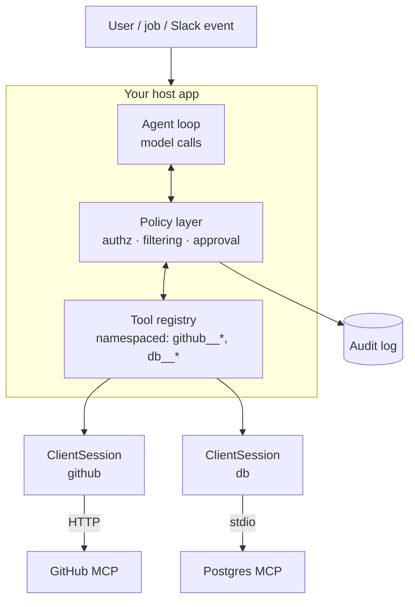

# Building MCP Clients from Scratch



Claude Desktop and Cursor already connect to MCP servers: you configure a server and its tools show up. Those hosts suit a **person at a screen choosing actions**. They're limiting when MCP becomes part of **your product**:
- A Slack bot that may call only approved tools.
- A scheduled job that reads resources from an internal MCP server.
- An agent runtime with its own approval rules.
- A router that connects to several servers but exposes only the tools that are safe for the current user.

**Division of labor**: the SDK handles the protocol (JSON-RPC, handshake, transports). **You** own product behavior: authorization, logging, retries, tool filtering, workflow state, and user approval.

## 1. Where Your Client Fits
| Layer | Owns |
|---|---|
| Host app | Conversation state, model calls, UI, policy |
| Client (one per server) | Connection, initialize, list/call, notifications |
| Server | Domain logic and credentials for its system |

Your host turns MCP tool definitions into provider tool schemas, runs the model loop, and routes each tool call to the right `ClientSession`.

## 2. Connecting to a Server
```python
from contextlib import AsyncExitStack
from mcp import ClientSession, StdioServerParameters
from mcp.client.stdio import stdio_client
from mcp.client.streamable_http import streamablehttp_client

async def connect_stdio(stack: AsyncExitStack, cmd: str, args: list[str], env: dict):
    read, write = await stack.enter_async_context(
        stdio_client(StdioServerParameters(command=cmd, args=args, env=env)))
    session = await stack.enter_async_context(ClientSession(read, write))
    init = await session.initialize()          # handshake + capability negotiation
    return session, init.capabilities

async def connect_http(stack: AsyncExitStack, url: str, token: str):
    read, write, _ = await stack.enter_async_context(
        streamablehttp_client(url, headers={"Authorization": f"Bearer {token}"}))
    session = await stack.enter_async_context(ClientSession(read, write))
    init = await session.initialize()
    return session, init.capabilities
```
- `AsyncExitStack` keeps the connections open for the host's lifetime and closes them cleanly.
- Check `capabilities` before calling `list_resources()` or `list_prompts()`. Many servers expose tools only.
- Pass only the env vars the server needs; stdio servers run with your process's privileges.

## 3. Discovering and Converting Tools
```python
async def load_tools(name: str, session: ClientSession) -> list[dict]:
    tools, cursor = [], None
    while True:                                   # list endpoints are paginated
        page = await session.list_tools(cursor=cursor)
        tools += page.tools
        cursor = page.nextCursor
        if not cursor:
            break
    return [{"name": f"{name}__{t.name}",           # namespace across servers
             "description": t.description or "",
             "input_schema": t.inputSchema,
             "_server": name, "_tool": t.name,
             "_annotations": t.annotations}         # readOnlyHint, destructiveHint, ...
            for t in tools]
```
- **Namespace** tool names (`github__create_issue`), because two servers can both expose `search`.
- Annotations (`readOnlyHint`, `destructiveHint`, `idempotentHint`, `openWorldHint`) are **hints from the server, not guarantees**. Use them as defaults and let your own policy override them.
- Re-list on `notifications/tools/list_changed`, and diff against the approved set (see rug pulls in [what is MCP §9](01-what-is-mcp.md)).

## 4. Tool Filtering and Authorization
```python
POLICY = {
    "github__search_issues":  {"roles": {"eng", "support"}, "risk": 0},
    "github__create_issue":   {"roles": {"eng"},            "risk": 2},
    "db__query":              {"roles": {"analyst"},        "risk": 1},
    # anything not listed is hidden
}

def visible_tools(all_tools, user):
    return [t for t in all_tools
            if (p := POLICY.get(t["name"])) and user.role in p["roles"]]
```
- **Default deny**: a new tool from a server update stays hidden until someone adds it to policy.
- Filter **before** the model sees tools (fewer tokens, better selection), and **re-check at call time**, since the model can still emit a hidden tool's name.
- Large catalogs: retrieve the top-k relevant tools per request (embedding search over descriptions) instead of sending 100 schemas.

## 5. The Host Loop
```python
async def run(user, messages, registry, max_steps=10):
    tools = visible_tools(registry.tools, user)
    for _ in range(max_steps):
        resp = await llm(messages, tools=[strip_private(t) for t in tools])
        if resp.stop_reason != "tool_use":
            return resp.text
        results = []
        for b in resp.tool_uses:
            t = registry.get(b.name)
            if t is None or t not in tools:
                out = {"isError": True, "text": "Tool not permitted."}
            elif POLICY[b.name]["risk"] >= 3 and not await approve(user, b):
                out = {"isError": True, "text": "User declined this action."}
            else:
                out = await call_with_timeout(registry.session(t), t["_tool"], b.input)
            audit.log(user=user.id, tool=b.name, args=redact(b.input), ok=not out["isError"])
            results.append(tool_result(b.id, out))
        messages += [assistant(resp), user_msg(results)]
    return "Stopped: step limit."

async def call_with_timeout(session, tool, args, timeout=30):
    try:
        r = await asyncio.wait_for(session.call_tool(tool, args), timeout)
        return {"isError": r.isError, "text": render_content(r.content), "structured": r.structuredContent}
    except asyncio.TimeoutError:
        return {"isError": True, "text": f"{tool} timed out after {timeout}s"}
```
`render_content` flattens MCP content blocks: text stays as text, images become image blocks, and resource links become a short reference instead of the full payload.

## 6. Resources and Prompts in a Custom Client
| Use | How |
|---|---|
| Inject context without a tool call | `read_resource("db://schema")` and put it in the system prompt, cached |
| Live data | `subscribe_resource(uri)`; refresh on `notifications/resources/updated` |
| Slash commands | `list_prompts()` → menu; `get_prompt(name, args)` → messages inserted into the conversation |
| Scheduled jobs | Read resources directly; no model needed for the read step |

## 7. Client-Side Capabilities
Declare these only if you implement them:
- **Sampling** handler: the server requests a model completion. Enforce a model allowlist, token caps, and (for user-facing apps) approval; log it as your spend.
- **Elicitation** handler: render the requested schema as a form, or reject in headless contexts.
- **Roots**: advertise the directories or URIs the server may touch.

## 8. Reliability and Operations
| Concern | Practice |
|---|---|
| Server crash (stdio) | Detect EOF, restart with backoff, re-initialize, re-list tools |
| HTTP session expiry (404 on session) | Start a new session transparently |
| Slow tools | Per-tool timeouts; send `notifications/cancelled` on abort |
| Partial availability | One failed server shouldn't fail the run; drop its tools and tell the model |
| Startup latency | Connect lazily, or pool long-lived sessions per worker |
| Observability | Span per `tools/call` (server, tool, latency, isError, bytes) |
| Testing | MCP Inspector for manual tests; in-memory transport for unit tests; contract tests against pinned server versions |

## Takeaways
- Build your own client when authorization, safety, and workflow are part of the product.
- The SDK speaks the protocol; you write policy, filtering, approval, retries, and audit.
- Namespace tools, deny by default, and re-check permissions at call time.
- Treat server metadata and results as untrusted input.

## References
- MCP Python SDK: `ClientSession`, stdio and Streamable HTTP clients · MCP spec: client features (sampling, elicitation, roots)
- MCP Inspector · Anthropic API MCP connector (hosted client option)

## Related
- [What is MCP](01-what-is-mcp.md) · [Remote MCP servers](03-remote-mcp-servers.md)
- [Multi-tool orchestration](../08-tool-use/03-multi-tool-orchestration.md) · [Structured workflows](../08-tool-use/04-structured-workflows-with-tool-use.md)
