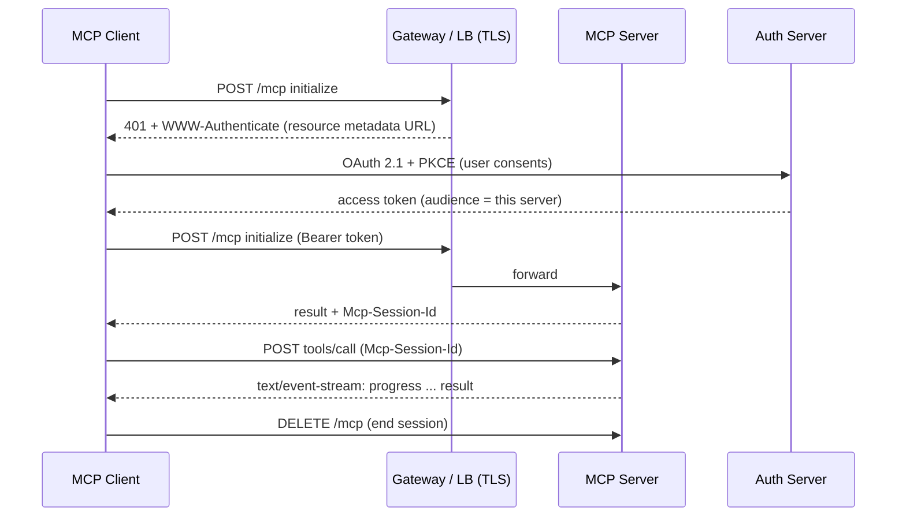
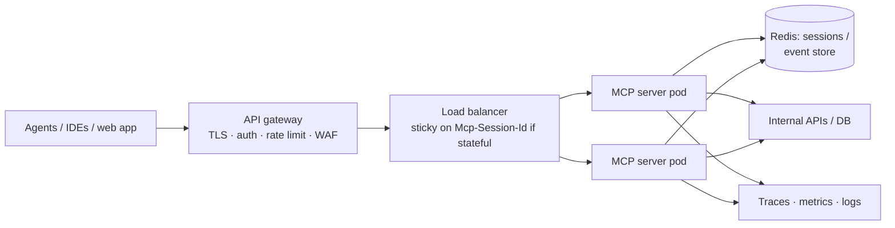

# Remote MCP Servers with Streamable HTTP



Until now, the host launches the server as a subprocess and talks over **stdio**. That works for local development, personal tools, and desktop workflows. It breaks down when a server must be **shared by a team**, reached by **cloud-hosted agents**, or **run as a service**.

## 1. Stdio vs Remote: When Local Is Not Enough
Stdio is a local process transport. There's no URL, no load balancer, no TLS termination, and no clean way for a client on one machine to reach a server on another.

Example: five developers need the same MCP wrapper around internal APIs. With stdio that means five installs, five credential setups, and five upgrade paths. Remote means one deployment, central credentials, and one upgrade.

| Signal | Stay on stdio | Go remote |
|---|---|---|
| Users | One person | Team, org, or customers |
| Clients | Desktop/IDE | Cloud agents, web apps, other services |
| Data | Local files | Internal APIs, DBs behind a network |
| Credentials | User's own | Managed centrally, per-user OAuth |
| Ops | None | Monitoring, scaling, rate limits |

## 2. How Streamable HTTP Works
One endpoint (e.g. `https://mcp.example.com/mcp`):

| Request | Purpose | Response |
|---|---|---|
| `POST` (JSON-RPC request) | Client → server message | `application/json` (single response) **or** `text/event-stream` (progress notifications, server requests, then the final response) |
| `POST` (notification/response) | Fire-and-forget | `202 Accepted` |
| `GET` | Optional stream for unsolicited server → client messages | SSE, or `405` if unsupported |
| `DELETE` | End the session | `200` / `405` |

Headers:
- `Accept: application/json, text/event-stream` on every POST.
- `Mcp-Session-Id`: issued in the initialize response; the client echoes it on every subsequent request. A `404` means the session is gone, so re-initialize.
- `MCP-Protocol-Version`: negotiated version, sent on every request after init.
- `Last-Event-ID`: resume a dropped SSE stream (if the server supports event IDs).

Stateless mode: the server issues no session id and treats each POST independently. That's easiest to scale behind a load balancer, but you lose server-initiated messages and per-session state.

## 3. Building a Remote Server
```python
from mcp.server.fastmcp import FastMCP

mcp = FastMCP("internal-tickets", stateless_http=True, json_response=True)

@mcp.tool()
async def search_tickets(query: str, status: str = "open", limit: int = 10) -> list[dict]:
    """Search support tickets visible to the calling user. Read-only."""
    user = current_user()                          # from the validated access token
    return await tickets_api.search(query, status=status, limit=min(limit, 25), as_user=user)

app = mcp.streamable_http_app()                    # ASGI app; mount under Starlette/FastAPI
# uvicorn server:app --host 0.0.0.0 --port 8000
```
- `stateless_http=True` + `json_response=True` is the simplest horizontally scalable setup.
- Need progress streaming or server → client requests? Use stateful mode with **sticky sessions** (route on `Mcp-Session-Id`) or a shared session store.

## 4. Authentication and Authorization
The MCP auth spec builds on **OAuth 2.1**:
- The server is an OAuth **resource server**. It publishes **Protected Resource Metadata** (RFC 9728) pointing to its authorization server.
- The client discovers the auth server, may use **Dynamic Client Registration** (RFC 7591) or pre-registered/metadata-document clients, and runs **authorization code + PKCE**.
- Tokens carry an **audience** bound to this server (resource indicators, RFC 8707). The server **must reject tokens issued for other resources**.
- **No token passthrough**: never forward the client's token to downstream APIs. Exchange it, or use the server's own scoped credentials per user.

| Option | Use when |
|---|---|
| OAuth 2.1 via your IdP (Okta, Entra, Auth0) | User-facing, per-user permissions |
| API key / static bearer | Service-to-service, internal agents (rotate; scope per client) |
| mTLS / private network | Internal-only, plus app-level auth |

Authorization: map token scopes and claims to **which tools are listed and callable**. Enforce per-user data access inside each tool.

## 5. Security Checklist
- HTTPS only; terminate TLS at the gateway.
- **Validate the `Origin` header** (prevents DNS rebinding from browsers). Bind local dev servers to `127.0.0.1`, not `0.0.0.0`.
- Session ids: cryptographically random, never used as authentication, and bound to the user.
- Rate limit per token and per tool; cap request body and response size.
- Timeouts on every downstream call; cancel when the client disconnects.
- Log every `tools/call` with user, tool, redacted args, latency, and outcome.

## 6. Deployment Topology

| Concern | Note |
|---|---|
| SSE through proxies | Disable response buffering (`X-Accel-Buffering: no`), raise idle timeouts, send keepalives |
| Serverless (Lambda, Cloud Run, Workers) | Fine for stateless JSON mode; long SSE streams may hit duration limits |
| Versioning | Additive tool changes are safe; renames and removals break agents, so version via new tool names or a new endpoint |
| Health | `/healthz` separate from `/mcp`; readiness checks downstream dependencies |

## 7. Connecting Clients
- Claude Code: `claude mcp add --transport http tickets https://mcp.example.com/mcp`
- Anthropic Messages API MCP connector / OpenAI Responses remote MCP tool: pass the server URL and token. The provider runs the client, and you still own the server's auth.
- Local-only hosts can bridge with a stdio ↔ HTTP proxy (e.g. `mcp-remote`).

## Takeaways
- Stdio is for one machine; Streamable HTTP is for shared, networked, service deployments.
- One endpoint: POST for messages, SSE when streaming, sessions via `Mcp-Session-Id`.
- Use stateless mode unless you need server-initiated messages.
- OAuth 2.1 with audience-bound tokens, no passthrough, origin validation, and rate limits.

## References
- MCP spec: Transports (Streamable HTTP), Authorization, Security Best Practices
- RFC 9728 (Protected Resource Metadata) · RFC 8707 (Resource Indicators) · RFC 7591 (Dynamic Client Registration) · OAuth 2.1 draft

## Related
- [What is MCP](01-what-is-mcp.md) · [Building MCP clients](02-building-mcp-clients.md) · [Production MCP server patterns](04-production-mcp-server-patterns.md)
- [The AI gateway pattern](../11-ai-system-architecture/05-the-ai-gateway-pattern.md) · [Rate limiting](../11-ai-system-architecture/08-rate-limiting-and-api-management.md)
