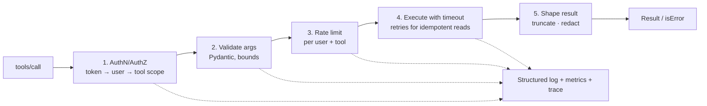

# Production MCP Server Patterns



The first production failure is often silent. A tool call times out, the model apologizes vaguely, and nobody knows whether the server crashed, an upstream API slowed down, the client sent bad arguments, or a proxy dropped the connection.

A demo server and a production server differ less in **how many tools** they expose than in the **discipline applied to every call**: authorization, input validation, rate limiting, timeouts, structured logging, metrics, graceful shutdown, and clear errors. The code below gives building blocks, not a framework.

## 1. What Changes in Production
| Demo | Production |
|---|---|
| Trusts every caller | Authenticates every request; authorizes per tool and per record |
| Raw exceptions | Typed, actionable `isError` results; no stack traces leak |
| No limits | Rate limits, quotas, size caps, timeouts |
| `print()` | Structured logs with request ids, metrics, traces |
| Kill -9 on deploy | Graceful drain |
| One user's credentials | Per-user delegated access, least privilege |

## 2. One Wrapper for Every Tool
Put the cross-cutting concerns in a decorator so each tool stays pure domain logic.
```python
import asyncio, time, uuid, structlog
from functools import wraps
from pydantic import BaseModel, ValidationError

log = structlog.get_logger()

class ToolError(Exception):
    def __init__(self, code: str, message: str, hint: str = "", retryable: bool = False):
        self.code, self.message, self.hint, self.retryable = code, message, hint, retryable

def production_tool(*, scope: str, args_model: type[BaseModel], timeout_s: float = 10,
                    rate: str = "30/minute", max_result_chars: int = 20_000):
    def deco(fn):
        @wraps(fn)
        async def wrapper(**raw):
            req_id, t0 = uuid.uuid4().hex[:12], time.perf_counter()
            user = current_user()                                    # from validated token
            outcome = "ok"
            try:
                if scope not in user.scopes:
                    raise ToolError("FORBIDDEN", f"Missing scope {scope}.")
                args = args_model.model_validate(raw)
                if not limiter.hit(f"{user.id}:{fn.__name__}", rate):
                    raise ToolError("RATE_LIMITED", "Too many calls; wait a minute.", retryable=True)
                result = await asyncio.wait_for(fn(user=user, args=args), timeout_s)
                return truncate(redact(result), max_result_chars)
            except ValidationError as e:
                outcome = "invalid_args"
                return error_result("INVALID_ARGS", format_validation(e), retryable=True)
            except ToolError as e:
                outcome = e.code.lower()
                return error_result(e.code, e.message, e.hint, e.retryable)
            except asyncio.TimeoutError:
                outcome = "timeout"
                return error_result("TIMEOUT", f"Upstream exceeded {timeout_s}s.", retryable=True)
            except Exception:
                outcome = "internal"
                log.exception("tool_crash", tool=fn.__name__, req_id=req_id)
                return error_result("INTERNAL", f"Unexpected error (ref {req_id}).")
            finally:
                dur = time.perf_counter() - t0
                TOOL_LATENCY.labels(fn.__name__, outcome).observe(dur)
                log.info("tool_call", tool=fn.__name__, user=user.id, req_id=req_id,
                         outcome=outcome, ms=round(dur * 1000), args=redact_args(raw))
        return wrapper
    return deco
```
Usage:
```python
class RefundArgs(BaseModel, extra="forbid"):
    order_id: str = Field(pattern=r"^ord_[a-z0-9]{8}$")
    amount_cents: int = Field(gt=0, le=50_000)
    reason: Literal["damaged", "late", "wrong_item", "other"]

@mcp.tool(annotations={"destructiveHint": True, "idempotentHint": True})
@production_tool(scope="refunds:write", args_model=RefundArgs, timeout_s=15, rate="5/hour")
async def issue_refund(user, args: RefundArgs) -> dict:
    """Refund part or all of an order. Irreversible. Max $500. Requires the order to belong to the user's account."""
    order = await orders.get(args.order_id, account=user.account_id)       # ownership check
    if order is None:
        raise ToolError("ORDER_NOT_FOUND", "No such order on this account.", "Call search_orders.")
    return await payments.refund(order, args.amount_cents, idempotency_key=f"{order.id}:{args.amount_cents}")
```
Note: with FastMCP, keep the public signature typed (so the generated schema is correct) or register the schema explicitly; the decorator above shows the logic, not the schema plumbing.

## 3. Authorization Patterns
| Pattern | Detail |
|---|---|
| Scope per tool | `tickets:read`, `refunds:write`; hide tools whose scope the token lacks from `tools/list` |
| Record-level checks | Every query is filtered by `user.account_id`/tenant from the token, never from args |
| Delegated credentials | Exchange the user token for a downstream token (OAuth token exchange), or look up the user's stored grant |
| Separate read/write servers | Deploy write tools separately with stricter auth, so read-only agents never even see them |
| Approval hints | `destructiveHint` + host approval; for risk 4, require an out-of-band approval id as an argument the model can't fabricate |

## 4. Errors the Model Can Use
```python
def error_result(code, message, hint="", retryable=False):
    return CallToolResult(isError=True, content=[TextContent(type="text",
        text=json.dumps({"code": code, "message": message, "hint": hint, "retryable": retryable}))])
```
| Code | Model should |
|---|---|
| `INVALID_ARGS` | Fix the arguments and retry once |
| `NOT_FOUND` | Search first, or ask the user |
| `FORBIDDEN` | Tell the user it can't do that |
| `RATE_LIMITED` / `TIMEOUT` | Retry later or tell the user |
| `INTERNAL` | Report with the reference id |

Use `isError` results for tool-level failures. Reserve JSON-RPC errors for protocol problems (unknown tool, malformed request).

## 5. Timeouts, Retries, Cancellation
- Every downstream call has a timeout shorter than the client's (server 10–15 s; client 30 s).
- Retry **idempotent reads** inside the server (2 attempts, jittered backoff). Never auto-retry non-idempotent writes without an idempotency key.
- Circuit-break a failing upstream: fail fast with `retryable: true` instead of piling up requests.
- Honor `notifications/cancelled`: propagate cancellation to the running task.
- Long jobs (> 30 s): send progress notifications, or start a job and return an id plus a `get_job_status` tool.

## 6. Rate Limiting and Quotas
- Per user per tool (token bucket in Redis), plus a global ceiling per upstream API.
- Cost-weighted limits for expensive tools (a report generator counts as 10).
- Size caps: max request bytes, max list items, max result characters (truncate with "showing 20 of 340; refine query").

## 7. Observability
| Signal | What |
|---|---|
| Logs | JSON: req_id, session_id, user, tool, redacted args, outcome, latency, upstream status |
| Metrics | `tool_calls_total{tool,outcome}`, latency histogram, rate-limit hits, upstream errors, active sessions |
| Traces | OpenTelemetry span per call, propagating `traceparent` from the client (via `_meta`) into upstream calls |
| Alerts | Error rate per tool > X%, p95 latency, auth failure spikes (attack or expired config) |
| Product | Which tools are used, never used (delete them), or frequently fail with `INVALID_ARGS` (schema problem) |

## 8. Graceful Shutdown and Health
```python
@asynccontextmanager
async def lifespan(app):
    await db.connect(); await http.start()
    yield
    draining.set()                                    # readiness → 503; LB stops routing
    await asyncio.wait_for(inflight.wait_empty(), 25)  # finish in-flight calls
    await http.close(); await db.disconnect()
```
- Readiness fails during drain; liveness stays up.
- Set `terminationGracePeriodSeconds` longer than the drain timeout.
- Reuse connection pools (DB, HTTP) across calls via lifespan; never open them per call.

## 9. Testing
| Layer | How |
|---|---|
| Unit | Call tool functions directly with fake users; test validation and authz denial paths |
| Protocol | In-memory client/server session from the SDK; assert `tools/list` schemas (snapshot test) |
| Contract | Pin schema snapshots; a CI diff flags breaking changes (renamed or removed params) |
| Model-in-the-loop | Tool-selection evals ([schema testing](../08-tool-use/02-designing-tool-schemas.md)) on every description change |
| Security | Injection strings in args and upstream data; cross-tenant ids; oversized inputs |
| Load | Concurrent sessions; SSE through the real proxy |

## 10. Production Checklist
- [ ] Auth on every request; scopes per tool; tenant from token
- [ ] Pydantic validation, `extra="forbid"`, bounds on every field
- [ ] Timeouts, retries only for idempotent ops, idempotency keys on writes
- [ ] Rate limits and size caps
- [ ] Typed `isError` results with hints; no stack traces
- [ ] Structured logs, metrics, traces; redaction of secrets/PII
- [ ] Graceful drain, health endpoints, pooled connections
- [ ] Schema snapshot tests and tool-selection evals in CI
- [ ] Pinned dependencies; servers in containers with least privilege

## Takeaways
- Wrap every tool in one layer that handles auth, validation, timeouts, errors, and logging.
- Authorize per user with OAuth-scoped tokens; never trust identity passed in by the model.
- Return errors the model can act on, and add rate limits, quotas, and cancellation.
- Make servers observable, health-checked, and gracefully shutting down; test with the MCP Inspector and contract tests.

## References
- MCP spec: Tools (annotations, isError, outputSchema), Utilities (cancellation, progress), Security Best Practices
- OpenTelemetry semantic conventions for GenAI · OWASP Top 10 for LLM Applications (LLM06 Excessive Agency)

## Related
- [Remote MCP servers](03-remote-mcp-servers.md) · [Designing tool schemas](../08-tool-use/02-designing-tool-schemas.md)
- [Monitoring and observability](../12-production-deployment/03-monitoring-and-observability.md) · [Agent sandboxing and security](../14-agentic-ai/06-agent-sandboxing-and-security.md)
