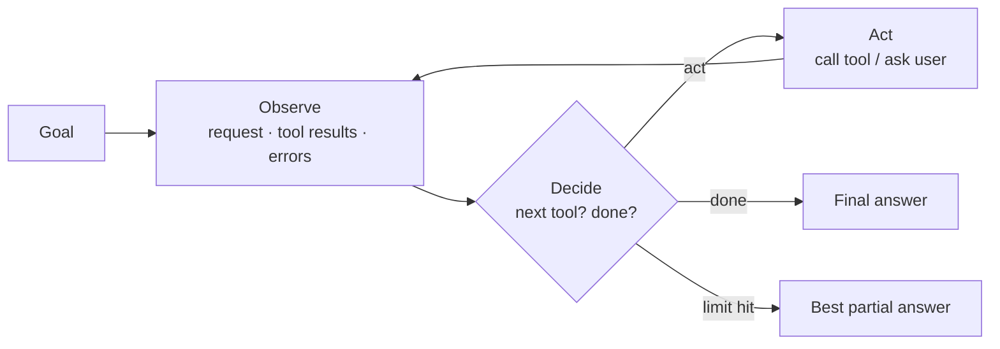

# What are AI Agents



Chat is the usual first LLM experience. Real work is often multi-step: inspect files, query APIs, compare options, recover from errors, and keep going until the task is done.

An **agent** is a software system in which a language model **helps choose the actions** toward a goal. It can plan, inspect state, call tools, read results, revise its approach, and decide when to stop. Tools are ordinary software interfaces: APIs, databases, search, file systems, browsers, code sandboxes, internal services.

> In a chatbot the **application** controls the flow. In an agent the **model takes part in choosing the next step**. That's the source of both the usefulness and the new failure modes.

## 1. The Agent Loop: Observe, Decide, Act
| | Chatbot | Agent |
|---|---|---|
| Flow | Message → model → response | Loop: observe → decide → act → … |
| Verification | None unless the app adds it | Can check its own work with tools |
| External state | Only what's in the prompt | Fetched as needed |
| Ends when | One response is produced | Goal met, or a limit is hit |

Example: comparing flights. The agent searches, notices high prices, tries nearby dates, checks baggage fees, and summarizes the trade-offs.

Risks: wrong tool calls, repeated useless searches, budget overruns, and **irreversible actions based on a mistaken premise**. Every iteration costs tokens, latency, and attention, and every tool call needs validation, permissions, and error handling.

## 2. The Autonomy Spectrum
| Level | Who decides | Example | Fits |
|---|---|---|---|
| **1. Chatbot** | App | Support Q&A | Predictable, cheap |
| **2. Copilot** | Model suggests, human approves | Code edit suggestions; drafted refund awaiting approval | Default when wrong actions are costly |
| **3. Supervised agent** | Model acts on low-risk steps; pauses at decision points | Read-only investigation, then asks before changes | Most production agents: bounded autonomy, audit trails, escalation |
| **4. Autonomous agent** | Model, with little human involvement | Narrow background tasks (triage, data cleanup) | Needs reliable tools, narrow scope, strong permissions; rare |

Choosing a level is a **risk decision**. Ask: what does a wrong action cost, how fast is it detected, is it reversible, and can the run be audited afterwards?

## 3. Agent, Pipeline, or Chatbot?
| Situation | Approach | Why |
|---|---|---|
| One-off questions | Chatbot | No tool loop needed |
| Fixed sequence of steps | **Pipeline** | Predictable, fast, cheap, testable |
| Branching on results | Pipeline with branches, or agent | Pipeline if branches can be enumerated; agent if not |
| High-stakes actions (billing, customer messages) | Copilot | Human approval limits damage |
| Exploratory work (research, debugging) | Agent | Steps can't be predicted |
| Real-time, low latency | Chatbot or pipeline | Loops add delay |

**Rule of thumb**: if you can write the steps down in advance, build a pipeline. Add autonomy only where the task truly needs it. (Anthropic calls the code-controlled patterns "workflows": prompt chaining, routing, parallelization, orchestrator-workers, evaluator-optimizer; see [building AI workflows](08-building-ai-workflows.md).)

## 4. Agent Architectures
| Architecture | Shape | Good for | Limitation |
|---|---|---|---|
| **Single-loop** (ReAct-like) | One model, one loop, one toolset | Focused research, bug fixing, read-only support lookups | Context fills with tool results; long tasks drift or forget early constraints |
| **Hierarchical** | Orchestrator splits the goal, delegates to sub-agents with their own context, then synthesizes | Competitive analysis: 1 researcher per competitor + a synthesizer | More calls, cost, and latency; bad orchestration breaks everything downstream |
| **Collaborative** (multi-agent) | Peers communicate, check each other, work in parallel; flow isn't strictly top-down | Planner → coder → reviewer → tester, with test failures going back to the coder | Hardest to build and debug |

Start with a workflow or a single-loop agent. Add hierarchy or collaboration **only when you can name the specific limitation it solves**. Details: [multi-agent systems](03-multi-agent-systems.md).

Fixes for single-loop context limits: running summaries, external state (scratchpad/files), checkpoints, clearing old tool results.

## 5. Cost and Reliability Trade-Offs
| | Chatbot | Pipeline | Agent |
|---|---|---|---|
| Token cost | Low (≈1 call) | Medium (fixed calls) | Variable, often much higher |
| Latency | Low | Medium, predictable | High, variable |
| Reliability | Easy to control | Easy to control | Harder: errors feed back into the loop |
| Capability | Limited | Medium | High for adaptive tasks |
| Debuggability | Easy | Easy | Hard |
| Best for | Q&A | Fixed workflows | Adaptive multi-step tasks |

- **Token growth**: each iteration resends the whole history, so cost grows roughly **quadratically** with steps. Step *k* carries *k* prior tool results. A 10-step run can cost 20–50× a single reply. Prompt caching helps a lot, since the prefix is stable.
- **Don't hard-code prices**: pricing, context windows, and cache discounts change. Benchmark real runs, compute cost from current pricing, and set **per-run budgets** before high traffic.
- **Latency**: model calls plus tool calls add up. Agents suit background or async work better than instant replies.
- **Error propagation**: in a pipeline, step 3 fails visibly. In an agent the error becomes the next observation: the agent may recover, misread it, try something risky, or burn iterations. Mitigate with validation, timeouts, budgets, retries, explicit stop conditions, and human escalation.

## 6. A Minimal Agent Loop
```python
import json
from anthropic import Anthropic
client = Anthropic()

TOOLS = [
  {"name": "search_web", "description": "Search the web. Returns top 5 results (title, url, snippet).",
   "input_schema": {"type": "object", "properties": {"query": {"type": "string"}}, "required": ["query"]}},
  {"name": "calculate", "description": "Evaluate an arithmetic expression, e.g. '500000/1e6*3'.",
   "input_schema": {"type": "object", "properties": {"expression": {"type": "string"}}, "required": ["expression"]}},
]
IMPL = {"search_web": search_web, "calculate": safe_calculate}   # safe_calculate: a real parser, not eval()

def run_agent(goal: str, max_iterations: int = 8, model: str = "claude-sonnet-5-5") -> str:
    system = "You are a research assistant. Use tools when you need facts or math. Stop when you can answer."
    messages = [{"role": "user", "content": goal}]
    for _ in range(max_iterations):
        resp = client.messages.create(model=model, max_tokens=2048, system=system,
                                      tools=TOOLS, messages=messages)
        if resp.stop_reason != "tool_use":
            return "".join(b.text for b in resp.content if b.type == "text")
        messages.append({"role": "assistant", "content": resp.content})
        results = []
        for b in resp.content:
            if b.type != "tool_use":
                continue
            try:
                out = IMPL[b.name](**b.input)
                results.append({"type": "tool_result", "tool_use_id": b.id, "content": json.dumps(out)})
            except Exception as e:
                results.append({"type": "tool_result", "tool_use_id": b.id,
                                "content": f"{type(e).__name__}: {e}", "is_error": True})
        messages.append({"role": "user", "content": results})
    # limit hit: ask for the best answer instead of failing silently
    messages.append({"role": "user", "content": "Step limit reached. Give your best answer with what you have, and say what is missing."})
    resp = client.messages.create(model=model, max_tokens=1024, system=system, messages=messages)
    return resp.content[0].text
```
Sample run for "What would 500K tokens cost on model X?": `search_web("model X pricing")` → `calculate("0.5 * 3.00")` → answer combining both.

Production notes:
- Load pricing from config or a billing API, not a constant.
- Replace the toy calculator with a proper parser or a sandboxed executor.
- Add token, time, and cost budgets plus repeat detection ([stopping conditions](../08-tool-use/03-multi-tool-orchestration.md)).
- Trace every step ([reliability and debugging](05-agent-reliability-and-debugging.md)).

## 7. What Makes Agents Work (additions)
| Lever | Why |
|---|---|
| **Tool quality** (the agent-computer interface) | Most agent failures are tool and schema failures |
| **Context engineering** | Deciding what goes in the window each turn matters more than prompt wording |
| **Environment feedback** | Tests, compilers, and validators give ground truth; agents excel where results are checkable |
| **Narrow scope** | Fewer tools and a clear goal mean higher reliability |
| **Evals on trajectories** | Score the path, not just the answer ([agent evaluation](06-agent-evaluation-and-testing.md)) |

## Takeaways
- An agent is a loop in which the model picks actions; the app still enforces limits and permissions.
- Choose autonomy by risk: copilot and supervised agents are the production norm.
- Prefer pipelines when the steps are known.
- Start single-loop; add hierarchy or multiple agents only for a named limitation.
- Agents trade cost, latency, and predictability for capability, so budget every run.

## References
- Yao et al., *ReAct* (2022) · Anthropic, *Building effective agents* (2024) · OpenAI function calling docs
- LangGraph docs · Lilian Weng, *LLM Powered Autonomous Agents* (2023)

## Related
- [Agent memory systems](02-agent-memory-systems.md) · [Multi-agent systems](03-multi-agent-systems.md) · [Agent frameworks](04-agent-frameworks.md)
- [Agentic RAG](../07-rag/09-agentic-rag.md) · [Long-running agents](../14-agentic-ai/05-long-running-agents.md)
