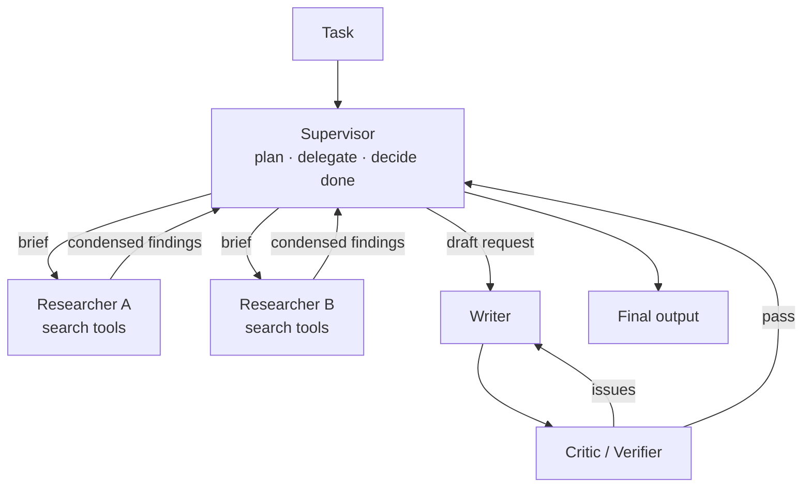

# Multi-Agent Systems



Single-agent systems hit practical limits on long tasks that span research, planning, implementation, review, execution, and synthesis. Cramming all of that into one prompt and one context window **overloads state, weakens verification, and makes behavior hard to debug**.

A **multi-agent system** splits a larger task across several agents, each owning a **role, toolset, context, or workflow phase**. Example: one agent gathers sources, another drafts, another checks claims, and a supervisor decides when the output is ready.

Multi-agent design **does not make a system reliable by itself**. It adds coordination cost, latency, and new failure modes. It's worth it only when **specialization, parallelism, independent review, or context isolation** pays for the overhead.

## 1. Why Single Agents Hit a Ceiling
| Limit | What happens | Multi-agent fix |
|---|---|---|
| Context saturation | Tool results from step 3 crowd out the goal by step 30 | Sub-agents explore in their own windows and return condensed summaries |
| Too many tools | 40+ tools → wrong tool selection | Each agent gets 3–8 relevant tools |
| Conflicting instructions | "Be creative" + "be rigorous" in one prompt | Separate prompts per role |
| Self-verification | Model grades its own work leniently | Independent reviewer with different context |
| Serial execution | 5 independent searches run one by one | Parallel workers |

## 2. Patterns
| Pattern | Shape | Use when | Watch out for |
|---|---|---|---|
| **Supervisor-worker** (orchestrator-workers) | Central agent decomposes, delegates, aggregates | Breadth-first tasks with separable subtasks (research, analysis) | Supervisor is a single point of failure; vague briefs → duplicate work |
| **Hierarchical** | Supervisors of supervisors | Very large tasks | Latency and cost multiply |
| **Pipeline / sequential handoff** | A → B → C, each a phase | Clear phases (spec → code → test) | Errors flow downstream |
| **Peer-to-peer / network** | Agents message each other or a shared board | Open-ended collaboration | Loops, chatter, hard to debug |
| **Debate** | 2+ agents argue, a judge decides | Reasoning/factuality questions with checkable answers | Expensive; agents can converge on a confident wrong answer |
| **Critic / evaluator-optimizer** | Generator ↔ reviewer loop until pass | Clear quality criteria (tests, rubric) | Needs a stop limit; critic must be specific |
| **Handoff / routing** (swarm style) | Active agent transfers control to a specialist | Customer support (billing → tech → refunds) | Lost context across handoffs |

## 3. Supervisor-Worker in Code
```python
WORKER_SYSTEM = "You are a research worker. Investigate ONLY the brief. Return <=300 words: findings, sources, confidence, gaps."

async def worker(brief: dict) -> dict:
    out = await run_agent(goal=json.dumps(brief), system=WORKER_SYSTEM,
                          tools=SEARCH_TOOLS, max_iterations=brief.get("max_steps", 8))
    return {"id": brief["id"], "result": out}

async def supervisor(task: str, max_rounds: int = 3) -> str:
    plan = await llm_json(f"""Split into 2-5 independent subtasks. For each give:
id, objective, scope (what NOT to cover), output_format, max_steps.\nTask: {task}""")
    findings = []
    for _ in range(max_rounds):
        findings += await asyncio.gather(*(worker(b) for b in plan["subtasks"]))
        verdict = await llm_json(f"Task: {task}\nFindings: {findings}\nEnough to answer? "
                                 "Return {done: bool, followups: [briefs]}")
        if verdict["done"] or not verdict["followups"]:
            break
        plan = {"subtasks": verdict["followups"]}
    return await llm(f"Write the final answer for: {task}\nUsing: {findings}\nCite sources.")
```
Key rule: **briefs must be explicit**: objective, boundaries, output format, budget. Vague delegation ("research X") causes overlap and gaps.

## 4. Structured Handoffs
A handoff passes **control plus context** between agents. Most multi-agent bugs live here.
```python
class Handoff(BaseModel):
    from_agent: str
    to_agent: str
    reason: str
    task: str                    # what the receiver must do
    context_summary: str         # what's known so far (not the full transcript)
    artifacts: list[str] = []    # ids/paths of files, records
    constraints: list[str] = []  # user requirements that must survive
    return_to: str | None = None
```
| Practice | Why |
|---|---|
| Typed schema, not free text | Receiver can't miss required fields |
| Summary + references, not full transcript | Context isolation is the point |
| Carry user constraints explicitly | Most often lost across handoffs |
| Shared artifact store (files, DB) | Agents exchange ids, not large blobs |
| Log every handoff as a trace span | Debug "who decided what" |

## 5. Debate and Critique
- **Critic** works best with **concrete criteria** (rubric, tests, citations-must-match-source) and **different context** from the generator (fresh window; ideally a different model or prompt).
- Cap iterations (2–3); diminishing returns after that.
- **Debate**: N agents answer independently, see each other's answers, revise, and a judge picks. It helps on reasoning benchmarks but costs N× or more. Usually use **self-consistency** (sample N, majority vote) first; it's cheaper.

## 6. When to Choose Multi-Agent
| Choose multi-agent if… | Stay single-agent if… |
|---|---|
| Subtasks are independent and parallelizable | Steps are tightly coupled (each depends on the last) |
| Context per subtask would overflow one window | Task fits comfortably in one context |
| Distinct tools/permissions per role (read-only researcher vs. write-capable executor) | One small toolset |
| Independent verification matters | A deterministic check (tests, schema) can verify instead |
| Value per task justifies 3–15× tokens | Cost or latency sensitive |

Data point: Anthropic reported its multi-agent research system beat a single agent by ~90% on an internal research eval, but used **~15× the tokens** of chat. Token usage explained most of the performance variance. Coding tasks, which have more interdependence, benefit less.

## 7. Failure Modes
| Failure | Mitigation |
|---|---|
| Duplicate/overlapping work | Explicit scopes in briefs; a supervisor dedupe step |
| Lost constraints across handoffs | `constraints` field; final check against the original request |
| Infinite back-and-forth | Max rounds per pair; global step and cost budget |
| Echo chamber (agents agree on errors) | Diverse models/prompts; ground-truth checks |
| Cost explosion (spawning too many workers) | Cap workers per task; effort scaling rules in the supervisor prompt ("simple fact: 1 worker, 3–10 calls") |
| Untraceable failures | One trace id across all agents; per-agent spans |

## 8. Frameworks
LangGraph (supervisor/swarm graphs), OpenAI Agents SDK (handoffs, agents-as-tools), CrewAI (role-based crews), AutoGen / AG2 (conversational agents), Claude Agent SDK (subagents), Google ADK. For agents across organizations or vendors, see A2A in [agent protocols](../14-agentic-ai/04-agent-protocols.md).

## Takeaways
- Use multiple agents for context isolation, parallelism, specialization, or independent review, and only for those.
- Supervisor-worker is the workhorse; critic loops are the cheapest quality boost.
- Typed handoffs with explicit constraints prevent most coordination bugs.
- Budget aggressively; multi-agent multiplies tokens.

## References
- Anthropic, *How we built our multi-agent research system* (2025) · Anthropic, *Building effective agents* (2024)
- Du et al., *Improving Factuality and Reasoning through Multiagent Debate* (2023) · Wu et al., *AutoGen* (2023)
- Cognition, *Don't build multi-agents* (2025): the counter-argument on context sharing

## Related
- [What are AI agents](01-what-are-ai-agents.md) · [Agent frameworks](04-agent-frameworks.md) · [Agent evaluation](06-agent-evaluation-and-testing.md)
- [Deep research agents](../14-agentic-ai/03-deep-research-agents.md)
