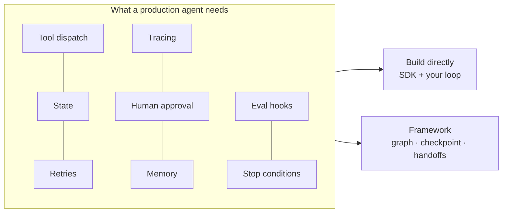

# Agent Frameworks



A first agent demo is easy to build from scratch. Running one reliably is much harder. The model call is one piece; you also need **tool dispatch, state management, retries, tracing, human approval, memory, evaluation hooks, and a clear way to stop the loop**.

Frameworks provide reusable infrastructure for these: tool calling, graph execution, checkpointing, multi-agent handoffs, observability, and workflow orchestration. They **save time but shape your architecture**, and they **don't remove the need to understand how agents work**.

## 1. Why Frameworks Exist
| Concern | DIY cost | Framework gives |
|---|---|---|
| Tool loop + schema generation | Low | Decorators that turn functions into tools |
| Persistence / resume after crash | High | Checkpointers (Postgres, Redis, SQLite) |
| Human-in-the-loop pause/resume | High | Interrupts with durable state |
| Streaming tokens + intermediate steps | Medium | Built-in event streams |
| Multi-agent handoffs | Medium | Handoff primitives, subgraphs |
| Tracing | Medium | Native integration (LangSmith, Logfire, OpenAI traces) |
| Provider switching | Medium | Unified model interface |

## 2. Framework Styles
| Style | Idea | Examples | Best for |
|---|---|---|---|
| **Graph / state machine** | Nodes + edges over a typed state; explicit control flow | LangGraph, LlamaIndex Workflows, Google ADK workflows | Production workflows needing control, checkpoints, HITL |
| **Agent-loop SDK** | Agent = model + instructions + tools; the SDK runs the loop | OpenAI Agents SDK, Claude Agent SDK, Pydantic AI, smolagents | Fast single/multi-agent apps with little ceremony |
| **Role-based crews** | Define agents with roles/goals; framework coordinates | CrewAI | Prototyping multi-agent processes |
| **Conversational multi-agent** | Agents chat with each other | AutoGen / AG2, Microsoft Agent Framework | Research, collaborative patterns |
| **Durable execution** | Workflow engine with retries/replay; LLM calls as activities | Temporal, Inngest, Restate, DBOS | Long-running, mission-critical agents |
| **Hosted / managed** | Provider runs the loop and sandbox | OpenAI Responses + tools, Anthropic Managed Agents, Bedrock Agents, Vertex Agent Engine | Teams who want less infra |

## 3. Quick Comparison
| | LangGraph | OpenAI Agents SDK | Claude Agent SDK | CrewAI | Pydantic AI |
|---|---|---|---|---|---|
| Abstraction | Low-level graph | Agents, handoffs, guardrails | Claude Code's harness as a library (tools, subagents, hooks, MCP) | High-level roles/tasks | Typed agents, DI |
| Control | Highest | Medium | Medium | Lower | Medium-high |
| Persistence | Built-in checkpointers | Sessions | Sessions | Basic | Via graph/durable integrations |
| Model lock-in | None | OpenAI-first (others via adapters) | Claude | None | None |
| Learning curve | Steep | Gentle | Gentle | Gentle | Gentle |

Versions move fast. Check the current docs before committing, and pin versions.

## 4. Same Agent, Three Ways
**Direct (no framework)**: see the loop in [what are AI agents §6](01-what-are-ai-agents.md). ~40 lines; you own everything.

**LangGraph**:
```python
from langgraph.prebuilt import create_react_agent
from langgraph.checkpoint.postgres import PostgresSaver

agent = create_react_agent(model="anthropic:claude-sonnet-5-5", tools=[search_web, calculate],
                           checkpointer=PostgresSaver.from_conn_string(DB_URL))
cfg = {"configurable": {"thread_id": "user-42"}, "recursion_limit": 20}
result = agent.invoke({"messages": [("user", "Cost of 500K tokens on model X?")]}, cfg)
```

**OpenAI Agents SDK**:
```python
from agents import Agent, Runner, function_tool

@function_tool
def search_web(query: str) -> str: ...

agent = Agent(name="Researcher", instructions="Answer with sources.", tools=[search_web], model="gpt-4.1-mini")
result = await Runner.run(agent, "Cost of 500K tokens on model X?", max_turns=10)
```

A custom graph in LangGraph (explicit control):
```python
from langgraph.graph import StateGraph, START, END

g = StateGraph(State)
g.add_node("classify", classify); g.add_node("lookup", lookup); g.add_node("draft", draft)
g.add_node("approve", human_approval)                 # uses interrupt() to pause
g.add_edge(START, "classify")
g.add_conditional_edges("classify", route, {"refund": "lookup", "faq": "draft"})
g.add_edge("lookup", "draft"); g.add_edge("draft", "approve"); g.add_edge("approve", END)
app = g.compile(checkpointer=saver)
```

## 5. Build vs Framework: Decision Guide
| Build directly if… | Use a framework if… |
|---|---|
| One agent, < 10 tools, short runs | Long-running runs needing resume/checkpoints |
| You need full control of prompts and the token layout | Human approval with pause/resume across hours |
| Latency-critical; minimal deps | Multi-agent handoffs, subgraphs |
| Team understands the loop well | Team wants standard patterns + tracing out of the box |
| Framework abstractions fight your design | Framework matches your shape (graph, roles) |

Common path: **prototype directly** (to learn the failure modes) → adopt a framework for persistence/HITL → keep business logic in plain functions so you can switch.

## 6. Patterns That Matter Either Way
- **Typed state** (Pydantic/TypedDict) instead of passing raw message lists around.
- **Hard limits**: max steps (`recursion_limit`, `max_turns`), token/cost budget, wall-clock timeout.
- **Tools as plain functions**, framework-agnostic, unit-tested on their own.
- **Idempotent side effects** with idempotency keys, since replays and retries happen.
- **Checkpoint after every step** for long runs.
- **Trace everything**: OpenTelemetry GenAI conventions so you can switch vendors.
- **Evals in CI** independent of the framework ([agent evaluation](06-agent-evaluation-and-testing.md)).

## 7. Framework Pitfalls
| Pitfall | Example |
|---|---|
| Hidden prompts | Framework injects system text you never see; inspect the actual requests |
| Abstraction leaks | Debugging needs knowledge of framework internals |
| Version churn | Breaking API changes every few months |
| Over-engineering | A 3-agent crew for what a single prompt could do |
| Lock-in | State formats and tool wrappers tied to one framework |

## Takeaways
- Frameworks solve infrastructure (state, persistence, HITL, tracing), not reasoning quality.
- Graph frameworks = control; agent SDKs = speed; durable engines = reliability for long runs.
- Learn the raw loop first; keep tools and business logic framework-independent.

## References
- LangGraph docs · OpenAI Agents SDK docs · Claude Agent SDK docs · CrewAI docs · Pydantic AI docs · Temporal AI cookbook
- Anthropic, *Building effective agents* (2024) on starting with direct API calls

## Related
- [What are AI agents](01-what-are-ai-agents.md) · [Multi-agent systems](03-multi-agent-systems.md) · [Human-in-the-loop patterns](07-human-in-the-loop-patterns.md)
- [Building AI workflows](08-building-ai-workflows.md) · [Long-running agents](../14-agentic-ai/05-long-running-agents.md)
