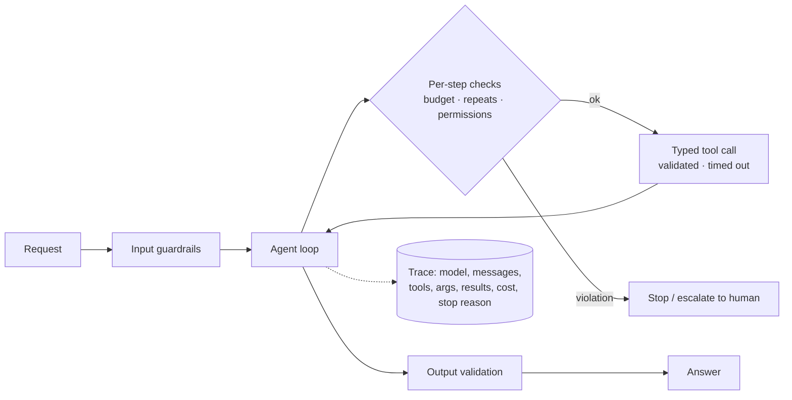

# Agent Reliability and Debugging



Agents fail in ways single-request LLM features don't: they **pick the wrong tool, misread a tool error, repeat the same action, run over budget, or give a confident answer on incomplete information**. These failures are riskier when the agent can act on databases, APIs, files, browsers, or customer-facing workflows.

Reliability isn't added after the prompt "seems to work". It's **architecture**: hard limits, typed tool interfaces, permission checks, tracing, evals, rollback paths, and human escalation.

You need a record of what the agent did: **which model was called, which messages were sent, which tools were requested with which arguments, what they returned, what the run cost, and why it stopped**. Without that, debugging is guesswork.

## 1. Common Failure Modes
| Failure | Symptom | Root cause (usually) | Control |
|---|---|---|---|
| **Wrong tool** | Calls `search_docs` when it needs `get_order` | Overlapping/vague descriptions, too many tools | Sharper descriptions, fewer tools, tool-selection evals |
| **Bad arguments** | Invented ids, wrong formats | Missing constraints in schema | Strict schemas, enums, patterns, validation errors with hints |
| **Misread errors** | Treats "not found" as "doesn't exist, done" | Unstructured error text | Typed errors (`code`, `hint`, `retryable`) |
| **Loops** | Same call 5× with same args | No progress signal; error not actionable | Repeat detection; max identical calls |
| **Premature stop** | Answers after one search | Weak stop criteria | Completion checklist; verifier step |
| **Never stops** | Hits step limit every time | Goal unclear; perfectionism | Explicit done criteria; budgets |
| **Hallucinated success** | "I've updated the record" without a call | No grounding | Verify claims against the tool log; require a tool receipt |
| **Goal drift** | Ends up solving a different problem | Long context, lost constraints | Restate the goal in working memory each turn |
| **Budget overrun** | $4 per run instead of $0.20 | Big tool outputs, many steps | Token/cost caps; result truncation |
| **Unsafe action** | Deletes data, emails customer | Excess permissions | Least privilege, approval gates, dry-run |
| **Prompt injection via tools** | Web page tells agent to exfiltrate | Untrusted content in context | Isolation, permission scoping ([prompt injection](../05-prompt-engineering/06-defending-against-prompt-injection.md)) |

## 2. Hard Limits
```python
@dataclass
class Budget:
    max_steps: int = 15
    max_tokens: int = 200_000
    max_usd: float = 0.50
    max_seconds: float = 120
    max_identical_calls: int = 2

class Guard:
    def __init__(self, b: Budget):
        self.b, self.steps, self.tokens, self.usd, self.t0 = b, 0, 0, 0.0, time.monotonic()
        self.calls = Counter()

    def after_model(self, usage, price):
        self.steps += 1
        self.tokens += usage.input_tokens + usage.output_tokens
        self.usd += price(usage)
        for name, cond in [("steps", self.steps >= self.b.max_steps),
                           ("tokens", self.tokens >= self.b.max_tokens),
                           ("cost", self.usd >= self.b.max_usd),
                           ("time", time.monotonic() - self.t0 >= self.b.max_seconds)]:
            if cond:
                raise BudgetExceeded(name)

    def before_tool(self, name, args):
        key = (name, json.dumps(args, sort_keys=True))
        self.calls[key] += 1
        if self.calls[key] > self.b.max_identical_calls:
            raise LoopDetected(name)
```
On `BudgetExceeded` / `LoopDetected`: don't crash. Ask the model for a **best partial answer** and note the stop reason, or escalate.

## 3. Typed Tools and Permissions
- Validate every argument (Pydantic) **before** executing; return a validation error the model can fix.
- Classify tools by risk (read / reversible write / irreversible / external communication). See [structured workflows](../08-tool-use/04-structured-workflows-with-tool-use.md).
- Permission checks run **in code**, using the user's identity, never based on what the model claims.
- **Dry-run mode** for writes: the tool returns "would do X" and needs a confirm token to execute.
- Idempotency keys on writes so retries don't double-charge.

## 4. Tracing: The Debugging Foundation
One trace per run, one span per model call and tool call:
| Field | Why |
|---|---|
| run_id, user, agent version, prompt version, model | Reproduce and compare |
| Full request messages (or hash + storage ref) | See exactly what the model saw |
| Response, stop_reason, usage, latency | Cost and behavior |
| Tool name, args, result (truncated), error, latency | Find the step that went wrong |
| Final stop reason (`done`, `budget:cost`, `loop`, `escalated`) | Aggregate failure stats |

```python
with tracer.start_as_current_span("agent.run", attributes={"run.id": rid, "agent.version": V}):
    with tracer.start_as_current_span("llm.call") as s:
        resp = call_model(...)
        s.set_attributes({"gen_ai.request.model": model, "gen_ai.usage.input_tokens": resp.usage.input_tokens,
                          "gen_ai.usage.output_tokens": resp.usage.output_tokens, "stop_reason": resp.stop_reason})
```
Tools: LangSmith, Langfuse, Arize Phoenix, Braintrust, Weights & Biases Weave, Logfire, OpenAI traces. Prefer OpenTelemetry GenAI semantic conventions for portability.

## 5. Debugging Workflow
1. **Find the failing runs**: filter traces by stop reason, user feedback, eval score, or cost outliers.
2. **Locate the first bad step**: the first wrong decision, not the final symptom. Usually a tool result the model misread, or a missing tool.
3. **Classify the cause**: prompt/instructions, tool description/schema, tool bug, missing context, model capability, or an infra error (timeout).
4. **Reproduce**: replay the run from the trace (same messages, mocked tool results) at temperature 0. Run it 5–10× to measure flakiness.
5. **Fix at the lowest layer**: a schema or tool fix beats a prompt patch, and a prompt patch beats a model swap.
6. **Add the case to the eval set** so it stays fixed ([agent evaluation](06-agent-evaluation-and-testing.md)).

```python
def replay(trace, override_system=None, model=None):
    msgs = trace.messages_before(step=trace.first_bad_step)
    mocked = {s.tool_call_id: s.result for s in trace.tool_spans}   # deterministic tool results
    return run_agent_from(msgs, system=override_system or trace.system,
                          model=model or trace.model, tool_executor=lambda c: mocked.get(c.id) or call_real(c))
```

## 6. Rollback and Recovery
| Mechanism | Use |
|---|---|
| Checkpoints | Resume from the last good step instead of restarting |
| Compensating actions | Each write tool has an undo (cancel order, revert commit) |
| Staging / sandbox | Agent works on a branch, draft, or copy; a human merges |
| Transactions | Group DB writes; commit only at the end of a successful run |
| Kill switch | Feature flag to disable an agent or a tool globally |

## 7. Human Escalation
Escalate when: confidence is low, a policy threshold is reached (amount > $X), a budget is exhausted, repeated tool errors occur, the user is upset, or an action is irreversible. Send the **summary, evidence, and the proposed action** to the human, not the raw transcript. See [human-in-the-loop patterns](07-human-in-the-loop-patterns.md).

## 8. Reliability Metrics
| Metric | Target idea |
|---|---|
| Task success rate (eval set) | Track per release |
| pass^k (succeeds on all k trials) | Measures consistency, not just capability |
| Stop-reason distribution | `done` should dominate; `budget`/`loop` should be rare |
| Tool error rate per tool | Spikes = schema or upstream issue |
| Avg steps, tokens, $ per success | Efficiency regressions |
| Escalation rate and human override rate | Too high = agent not useful; zero = gates may be missing |

## Takeaways
- Design for failure: budgets, repeat detection, typed tools, permissions in code.
- Trace every model and tool call; without traces, debugging is guessing.
- Debug from the first bad step, fix at the lowest layer, and add the case to evals.
- Provide rollback and escalation paths before giving agents write access.

## References
- Anthropic, *Building effective agents* (2024) · OpenTelemetry GenAI semantic conventions
- Yao et al., *τ-bench* (2024; pass^k) · OWASP Top 10 for LLM Applications (Excessive Agency)
- Cemri et al., *Why Do Multi-Agent LLM Systems Fail?* (MAST taxonomy, 2025)

## Related
- [Agent evaluation and testing](06-agent-evaluation-and-testing.md) · [Human-in-the-loop patterns](07-human-in-the-loop-patterns.md)
- [Monitoring and observability](../12-production-deployment/03-monitoring-and-observability.md) · [Agent sandboxing and security](../14-agentic-ai/06-agent-sandboxing-and-security.md)
