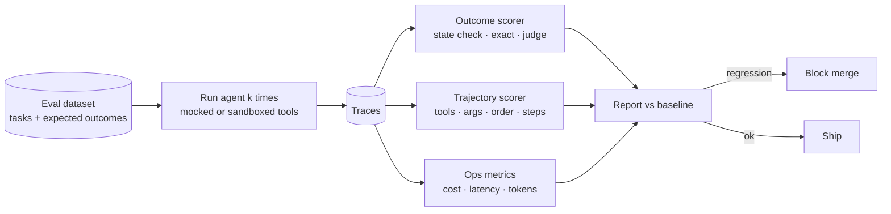

# Agent Evaluation and Testing



One successful run doesn't prove an agent works. Agents are sensitive to **prompt wording, model versions, retrieved context, tool outputs, latency, rate limits, and small variations in user input**. Evaluation shows whether the system behaves **consistently**.

The question to answer: **does the agent complete the task correctly, safely, and efficiently under the conditions it will face in production?** That requires:
- a repeatable set of test cases
- stable tool responses where possible
- clear scoring rules
- cost and latency tracking
- regression tests that run before changes ship

## 1. Why Agent Evaluation Is Harder Than LLM Evaluation
| Single LLM call | Agent |
|---|---|
| One input → one output | Many steps; each depends on earlier ones |
| Output is the only thing to grade | Grade the **outcome and the path** (unsafe or wasteful paths matter) |
| Deterministic-ish at temp 0 | Compounding variance: a 95%-reliable step repeated 10× gives ~60% |
| No side effects | Tools change state, so you need sandboxes or mocks |
| Cheap to run | Runs cost 10–100× more; eval budgets matter |
| One right answer | Many valid trajectories reach the same goal |

## 2. What to Measure
| Dimension | Metric | How |
|---|---|---|
| **Outcome** | Task success rate | Check the final **state** (DB row exists, test passes, refund issued) or the answer against a reference |
| **Trajectory** | Correct tool selection, valid args, no forbidden calls, step count | Compare the trace to expected/allowed tool sets |
| **Safety** | Policy violations, unapproved writes, data leakage | Rule checks on traces; red-team cases |
| **Efficiency** | Steps, tokens, $, wall time per success | From traces |
| **Consistency** | pass@k (≥1 of k succeeds) vs **pass^k** (all k succeed) | Run each task k = 3–10 times |
| **Robustness** | Success under paraphrased input, tool errors, slow tools | Perturbed variants of each case |
| **UX** | Clarifying questions when needed; no over-asking | Judge or human review |

Prefer **state-based checks** over judging text: "Did the order get cancelled?" is objective; "Does the answer say it was cancelled?" is not.

## 3. Building the Eval Set
| Source | Notes |
|---|---|
| Hand-written core cases | 20–50 representative tasks per capability; start here |
| Production traces | Sample real runs, especially failures and escalations |
| Bug reports | Every fixed bug becomes a regression case |
| Edge/adversarial | Ambiguous requests, missing info, injection in tool output, impossible tasks (should refuse or escalate) |
| Synthetic variants | LLM-generated paraphrases and persona variations of core cases |

```yaml
- id: refund-007
  input: "I was double charged for order 8812, please fix"
  setup: {orders: [{id: 8812, charges: [49.0, 49.0], status: delivered}]}
  expect:
    final_state: {refunds: [{order: 8812, amount: 49.0}]}
    must_call: [get_order, issue_refund]
    must_not_call: [cancel_order]
    max_steps: 6
  tags: [refunds, happy-path]
```

## 4. Stable Tool Responses
| Approach | Fidelity | Determinism | Use |
|---|---|---|---|
| **Mocked tools** (fixtures by args) | Low-medium | High | Unit tests, fast CI |
| **Record/replay** (VCR-style cassettes) | Medium-high | High | Regression on real API shapes |
| **Simulated environment** (fake DB/API seeded per case) | High | High | State-based outcome checks (τ-bench style) |
| **Sandbox against staging** | Highest | Low | Nightly/pre-release |
| **User simulator** (LLM plays the user) | n/a | Low | Multi-turn conversational agents |

```python
class FakeOrders:
    def __init__(self, seed): self.db = copy.deepcopy(seed); self.refunds = []
    def get_order(self, order_id): return self.db["orders"].get(order_id) or {"error": "NOT_FOUND"}
    def issue_refund(self, order_id, amount):
        self.refunds.append({"order": order_id, "amount": amount}); return {"ok": True}

def run_case(case, k=5):
    results = []
    for _ in range(k):
        env = FakeOrders(case["setup"])
        trace = run_agent(case["input"], tools=bind(env), max_iterations=case["expect"].get("max_steps", 10) + 4)
        results.append(score(case, env, trace))
    return {"id": case["id"], "pass_at_k": any(r["pass"] for r in results),
            "pass_hat_k": all(r["pass"] for r in results), "runs": results}
```

## 5. Scoring
```python
def score(case, env, trace):
    exp, called = case["expect"], [s.name for s in trace.tool_spans]
    checks = {
        "state": env.refunds == exp.get("final_state", {}).get("refunds", env.refunds),
        "must_call": all(t in called for t in exp.get("must_call", [])),
        "must_not_call": not any(t in called for t in exp.get("must_not_call", [])),
        "steps": trace.steps <= exp.get("max_steps", 99),
    }
    return {"pass": all(checks.values()), **checks, "cost": trace.cost_usd, "latency": trace.seconds}
```
| Scorer | Use for | Caveat |
|---|---|---|
| Code/state assertions | Outcomes, forbidden actions, formats | Best; use wherever possible |
| Reference match (exact/fuzzy) | Extracted values, short answers | Brittle on free text |
| **LLM-as-judge** with a rubric | Answer quality, helpfulness, tone, trajectory sensibility | Calibrate against human labels; use a different/stronger model; binary or 1–3 scales |
| Human review | Calibration set, high-stakes launches | Slow; sample |

Judge prompt pattern: give the task, the rubric (pass/fail criteria), the trace summary, and the final answer, and ask for **reasoning, then a verdict** as JSON.

## 6. Regression Testing in CI
| Tier | When | Size | Tools |
|---|---|---|---|
| Smoke | Every PR | 10–30 cases, k=1, mocked | Fast and cheap |
| Full regression | Pre-merge to main / prompt or model change | 100–500 cases, k=3 | Simulated env |
| Nightly / release | Daily or before release | Full set + robustness variants, k=5+ | Staging sandbox |
| Online | Continuous | Sampled production traffic | Judges on traces, user feedback |

- Compare to a **baseline** (last release), not to an absolute bar. Block on statistically meaningful drops in success, or on any new safety failure.
- Version everything: prompt, tools schema, model id, eval dataset.
- Watch for **eval set overfitting**: keep a held-out set.

## 7. Public Benchmarks (reference points)
| Benchmark | Tests |
|---|---|
| SWE-bench Verified / Pro | Resolve real GitHub issues (coding agents) |
| τ-bench / τ²-bench | Tool-using customer-service agents with policies; pass^k |
| GAIA | General assistant tasks needing tools + reasoning |
| WebArena / OSWorld | Web/computer-use agents |
| Terminal-Bench | Command-line tasks |
| BFCL | Function-calling accuracy |

Public benchmarks help with model selection; **your own task-specific evals** decide shipping.

## 8. Tooling
Braintrust, LangSmith, Langfuse, Arize Phoenix, Weave, promptfoo, Inspect AI (UK AISI), OpenAI Evals, DeepEval. Pick one that stores traces and eval results together.

## Takeaways
- Grade outcomes by final state, and grade the path for safety and efficiency.
- Run each case several times; report pass^k for reliability.
- Make tools deterministic with fakes or replay; save live sandboxes for nightly runs.
- Every production failure becomes a regression case; gate merges on a baseline comparison.

## References
- Yao et al., *τ-bench* (2024) · Jimenez et al., *SWE-bench* (2023) · Mialon et al., *GAIA* (2023)
- Anthropic, *Demystifying evals for AI agents* (2025) · Hamel Husain, *Your AI product needs evals* (2024)

## Related
- [Agent reliability and debugging](05-agent-reliability-and-debugging.md) · [Evaluating RAG systems](../07-rag/05-evaluating-rag-systems.md)
- [CI/CD for AI applications](../12-production-deployment/02-ci-cd-for-ai-applications.md) · [Iterating in production](../12-production-deployment/05-iterating-in-production.md)
