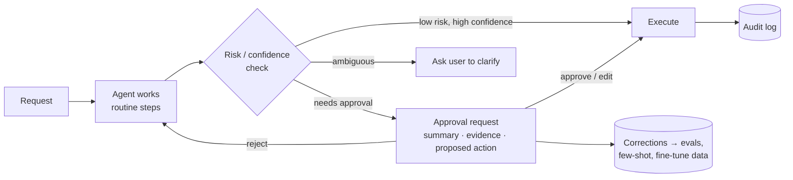

# Human-in-the-Loop Patterns



Agents can automate useful work, but **full autonomy is rarely the right starting point**. Many production actions still need human judgment, approval, or later audit, because mistakes are costly or the system lacks context.

**Human-in-the-loop (HITL)** design makes those control points explicit. The agent handles routine work; humans **review important outputs, approve risky actions, resolve ambiguity, and correct mistakes**. Those corrections become evaluation data, examples, or training data.

## 1. The Autonomy Paradox
- The more autonomous an agent is, the **less** people watch it, so errors run longer before anyone notices.
- The more approvals you add, the less value the agent delivers, and approvals turn into **rubber-stamping**: reviewers click "approve" without reading.
- So the goal isn't maximum oversight. It's **oversight where it changes outcomes**: place gates on the few actions that are risky, irreversible, or uncertain, and make each review fast and meaningful.

## 2. Autonomy Levels
| Level | Agent does | Human does | Example |
|---|---|---|---|
| L0 Suggest | Drafts only | Executes everything | Drafted email reply |
| L1 Approve-each | Proposes each action | Approves every action | Early-stage refunds agent |
| L2 Approve-risky | Executes low-risk; pauses on risky | Approves flagged actions | Support agent: lookups auto, refunds > $50 approved |
| L3 Audit | Executes all within policy | Reviews samples and exceptions after the fact | Ticket triage |
| L4 Autonomous | Everything in scope | Monitors metrics | Log cleanup |

Promote a workflow up a level when **measured** approval rates and error rates justify it (e.g., > 98% approved unchanged over 500 cases), and demote it on incidents.

## 3. Approval Workflows
```python
RISK = {"get_order": 0, "update_address": 1, "issue_refund": 2, "delete_account": 3}

async def execute_tool(call, ctx):
    level = RISK[call.name]
    if call.name == "issue_refund" and call.args["amount"] > ctx.policy.auto_refund_limit:
        level = 3
    if level >= ctx.policy.approval_threshold:
        req = ApprovalRequest(run_id=ctx.run_id, tool=call.name, args=call.args,
                              summary=await summarize_for_reviewer(ctx), evidence=ctx.evidence_refs,
                              expires_at=now() + timedelta(hours=24))
        await approvals.create(req)
        raise PauseRun(req.id)          # checkpoint state; resume on decision
    return await TOOLS[call.name](**call.args)

async def on_decision(req_id, decision, edited_args=None, reviewer=None):
    run = await checkpoints.load_for(req_id)
    result = (await TOOLS[run.pending.name](**(edited_args or run.pending.args))
              if decision in ("approve", "edit") else {"rejected": True, "reason": decision.reason})
    audit.log(req_id, decision, reviewer, edited_args)
    await resume_agent(run, tool_result=result)
```
Requirements: **durable pause/resume** (checkpoint, not an in-memory wait), expiry and default action, idempotent execution after approval, and an audit trail of who approved what.

## 4. Confidence-Based Escalation
LLM self-reported confidence is poorly calibrated. Combine several signals:
| Signal | Example |
|---|---|
| Policy rules (most reliable) | Amount, data sensitivity, customer tier, irreversible action |
| Retrieval quality | Top reranker score below threshold; no supporting source |
| Model disagreement | Self-consistency: k samples disagree |
| Verifier/judge | Separate check fails |
| Classifier | Intent = complaint/legal/churn risk |
| Loop health | Repeated tool errors, budget nearly exhausted |
| User signals | Frustration, "talk to a human" |

Calibrate thresholds on labeled data: choose the escalation rate humans can handle, then measure the error rate in the auto-handled slice.

## 5. Asynchronous Review Queues
For non-blocking review (content moderation, document extraction, outbound messages):
| Design point | Practice |
|---|---|
| Prioritization | By risk × value × SLA; oldest first within a tier |
| Routing | Skills/permissions-based; 4-eyes rule for high stakes |
| SLA and expiry | Escalate or apply a safe default when an item ages out |
| Batching | Group similar items; keyboard shortcuts |
| Sampling | Review 100% of high-risk items, plus a random 1–5% of auto-approved ones to catch silent errors |
| Load metrics | Queue depth, time to decision, reviewer agreement |

## 6. Correction Loops
Every human edit is labeled data.
```python
correction = {"input": case_input, "model_output": draft, "human_output": final,
              "diff": diff(draft, final), "reason_code": "wrong_policy|tone|factual|missing_info",
              "reviewer": rid, "prompt_version": pv, "model": m}
```
Uses: (1) **regression evals**: add corrected cases; (2) **few-shot examples** retrieved for similar inputs; (3) **prompt fixes** from clustering reason codes; (4) **fine-tuning / preference data** (draft vs. edited pairs for DPO); (5) **promotion decisions** based on the edit rate.

## 7. Review UX That Isn't a Checkbox
| Do | Avoid |
|---|---|
| Show the **proposed action** in plain language plus a diff of what changes | A raw JSON tool call |
| Show **evidence** (sources, records) with highlights | A full transcript dump |
| Show why it was flagged (rule hit, low confidence) | Unexplained requests |
| Approve / edit / reject with a reason code | Approve-only buttons |
| Inline edit of arguments | Forcing a reject-and-redo |
| Measure time per review; detect rubber-stamping (< 2 s approvals) | Assuming reviews happen |
| Undo window after approval | Irreversible on click |

User-facing HITL in chat: confirm before acting ("I'll refund $49 to Visa ••42. Confirm?"), ask clarifying questions when ambiguous, and show progress for long tasks with a way to interrupt.

## 8. Tools
LangGraph `interrupt()` + `Command(resume=...)`; OpenAI Agents SDK tool approval; Claude Agent SDK permission modes and `canUseTool` hooks; MCP elicitation; workflow engines (Temporal signals); labeling tools (Label Studio, Argilla) for review queues.

## Takeaways
- Gate actions by risk and reversibility, not everything; too many approvals become rubber stamps.
- Escalate on policy rules first, then on retrieval, consistency, and verifier signals; don't trust self-reported confidence alone.
- Pause durably and resume idempotently; audit every decision.
- Capture corrections as structured data and feed them into evals, prompts, and training.

## References
- Anthropic, *Building effective agents* (2024) · LangGraph human-in-the-loop docs
- Parasuraman & Riley, *Humans and Automation: Use, Misuse, Disuse, Abuse* (1997): automation complacency
- Amershi et al., *Guidelines for Human-AI Interaction* (CHI 2019)

## Related
- [Agent reliability and debugging](05-agent-reliability-and-debugging.md) · [Building AI workflows](08-building-ai-workflows.md)
- [Building AI-powered UX](../11-ai-system-architecture/06-building-ai-powered-ux.md) · [Iterating in production](../12-production-deployment/05-iterating-in-production.md)
