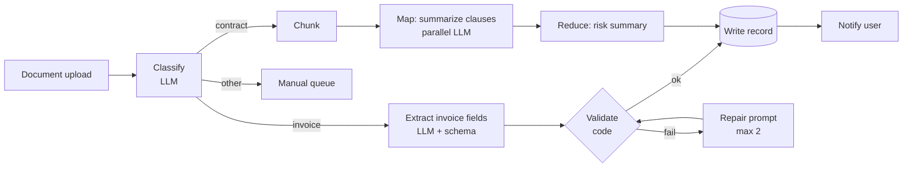

# Building AI Workflows



Production AI features rarely use a single prompt. They chain steps: **retrieve data, classify inputs, call a model, parse structured output, validate, write records, notify users, handle failures**. That chain is a **workflow**.

An AI workflow combines model calls with ordinary software in a **controlled flow: the application decides the sequence**. Models are used at specific points where they add value: classification, extraction, summarization, synthesis, ranking, and validation.

Core principle: **control**. Use the model where it helps; keep orchestration in code when the path is known.

## 1. Agents vs. Workflows: Choosing the Right Tool
| | Workflow | Agent |
|---|---|---|
| Who picks the next step | Code | Model |
| Path | Known in advance (maybe with branches) | Discovered at runtime |
| Cost/latency | Predictable | Variable |
| Testing | Unit-test each step | Trajectory evals |
| Failure handling | Explicit per step | Model must recover |
| Fits | Document processing, ETL, content pipelines, triage | Research, debugging, open-ended tasks |

Hybrid is common: a workflow with **one agentic step** (e.g., "investigate" inside an otherwise fixed incident pipeline), or an agent that calls deterministic workflows as tools.

## 2. Workflow Patterns
| Pattern | Shape | Example |
|---|---|---|
| **Prompt chaining** (pipeline) | A → B → C, with a gate between steps | Outline → check outline → write draft |
| **Routing** | Classifier sends input to a specialized path or model | FAQ → small model; refund → tools + approval |
| **Parallelization: sectioning** | Independent subtasks run concurrently | Check facts, tone, and compliance in parallel |
| **Parallelization: voting** | Same task N times, aggregate | 3 judges for content safety |
| **Map-reduce** | Split → map per chunk → reduce | Summarize a 300-page filing |
| **Orchestrator-workers** | LLM decides the subtasks, code runs them | Multi-file code change |
| **Evaluator-optimizer** | Generate → critique → revise loop | Translation with a quality rubric |
| **DAG** | Steps with dependencies; parallel where possible | Enrichment pipeline over records |

## 3. Deterministic Pipeline with Typed Steps
```python
class Invoice(BaseModel):
    vendor: str
    invoice_no: str
    date: date
    total: Decimal
    currency: Literal["USD", "EUR", "GBP", "INR"]
    line_items: list[LineItem]

    @model_validator(mode="after")
    def totals_match(self):
        if abs(sum(li.amount for li in self.line_items) - self.total) > Decimal("0.01"):
            raise ValueError("line items do not sum to total")
        return self

async def process(doc_id: str):
    text = await ocr(doc_id)                                   # plain code
    kind = await classify(text, labels=["invoice", "contract", "other"])  # small model
    if kind == "other":
        return await manual_queue.add(doc_id)
    if kind == "invoice":
        inv = await extract(text, Invoice, max_repairs=2)        # LLM + schema + repair loop
        await db.upsert_invoice(doc_id, inv, idempotency_key=doc_id)
    else:
        summary = await map_reduce_contract(text)
        await db.save_contract_summary(doc_id, summary)
    await notify(doc_id)
```
Extraction with a repair loop:
```python
async def extract(text, schema, max_repairs=2):
    msg = f"Extract fields as JSON matching this schema:\n{schema.model_json_schema()}\n\n<doc>{text}</doc>"
    for attempt in range(max_repairs + 1):
        raw = await llm(msg, response_format=schema)          # structured outputs where supported
        try:
            return schema.model_validate_json(raw)
        except ValidationError as e:
            msg += f"\n\nYour previous output failed validation:\n{e}\nReturn corrected JSON only."
    raise ExtractionFailed(text[:200])
```

## 4. Map-Reduce
```python
async def map_reduce_contract(text, chunk_tokens=6000, concurrency=8):
    chunks = split_by_headings(text, max_tokens=chunk_tokens, overlap=200)
    sem = asyncio.Semaphore(concurrency)
    async def m(c):
        async with sem:
            return await llm(f"List obligations, deadlines, penalties, termination terms in:\n{c}")
    partials = await asyncio.gather(*(m(c) for c in chunks))
    while count_tokens(partials) > 50_000:                     # hierarchical reduce if needed
        partials = [await llm(f"Merge:\n{g}") for g in group(partials, 5)]
    return await llm(f"Produce a risk summary with clause references from:\n{partials}")
```
Watch for: lost cross-chunk context (overlap, carry headings), the reduce step hallucinating merges (keep clause ids), and concurrency limits vs. provider rate limits.

## 5. DAGs and Orchestration
For multi-step jobs with dependencies, run them on an orchestrator instead of ad-hoc scripts:
| Tool | Strength |
|---|---|
| Temporal / Restate / DBOS | Durable execution: automatic retries, resume after crash, long waits (human approval) |
| Inngest / Trigger.dev | Event-driven step functions, serverless-friendly |
| Prefect / Dagster / Airflow | Batch data pipelines, scheduling, lineage |
| LangGraph / LlamaIndex Workflows | LLM-native graphs with state, streaming, HITL |
| Celery / RQ / SQS + workers | Simple async job queues |

## 6. Retries and Failure Handling
| Failure | Handling |
|---|---|
| 429 / 5xx / timeout | Exponential backoff with jitter; respect `retry-after`; fall back to another provider |
| Schema validation failure | Repair prompt (≤ 2), then a stronger model, then a human queue |
| Low-confidence classification | Route to manual review |
| Content filter / refusal | Log, route to a human, don't retry blindly |
| Partial batch failure | Retry only failed items; dead-letter queue after N tries |
| Downstream write failure | Idempotency keys; outbox pattern |

```python
@retry(wait=wait_exponential_jitter(initial=1, max=30), stop=stop_after_attempt(5),
       retry=retry_if_exception_type((RateLimitError, APITimeoutError, InternalServerError)))
async def llm(prompt, **kw): ...
```

## 7. Checkpointing
- Persist each step's output keyed by `(workflow_id, step_name, input_hash)`. On rerun, skip completed steps. This saves money when step 7 of 8 fails.
- Store intermediate artifacts (OCR text, chunk summaries) in object storage; pass references.
- Version prompts and models per step so reprocessing is reproducible.
```python
async def step(wf_id, name, fn, *args):
    key = f"{wf_id}:{name}:{stable_hash(args)}"
    if (hit := await cache.get(key)) is not None:
        return hit
    out = await fn(*args)
    await cache.set(key, out)
    return out
```

## 8. End-to-End: Document Processing Checklist
| Stage | Choice |
|---|---|
| Ingest | Queue per upload; dedupe by content hash |
| Parse | OCR/layout model (Textract, Azure DI, Docling, Unstructured, or a vision LLM) |
| Classify | Small model or embeddings + classifier; confidence threshold → manual |
| Extract | Structured outputs + Pydantic validation + business rules |
| Verify | Cross-field checks in code; LLM verifier for fuzzy fields; human review on low confidence |
| Store | Idempotent upsert; keep provenance (page/bbox) per field |
| Observe | Per-step latency/cost, validation failure rate, manual-queue rate, field-level accuracy on a labeled set |

## Takeaways
- If you know the path, write it in code; use models only at the steps that need judgment.
- Typed outputs + validation + repair loops make LLM steps behave like functions.
- Map-reduce for long inputs, routing for cost, parallelism for latency.
- Retries, idempotency, and checkpoints turn a demo into a pipeline.

## References
- Anthropic, *Building effective agents* (2024): workflow patterns · Temporal docs on durable execution
- LangGraph workflows docs · Instructor / Pydantic structured outputs docs

## Related
- [What are AI agents](01-what-are-ai-agents.md) · [Human-in-the-loop patterns](07-human-in-the-loop-patterns.md)
- [Structured workflows with tool use](../08-tool-use/04-structured-workflows-with-tool-use.md) · [Designing for reliability](../11-ai-system-architecture/02-designing-for-reliability.md)
